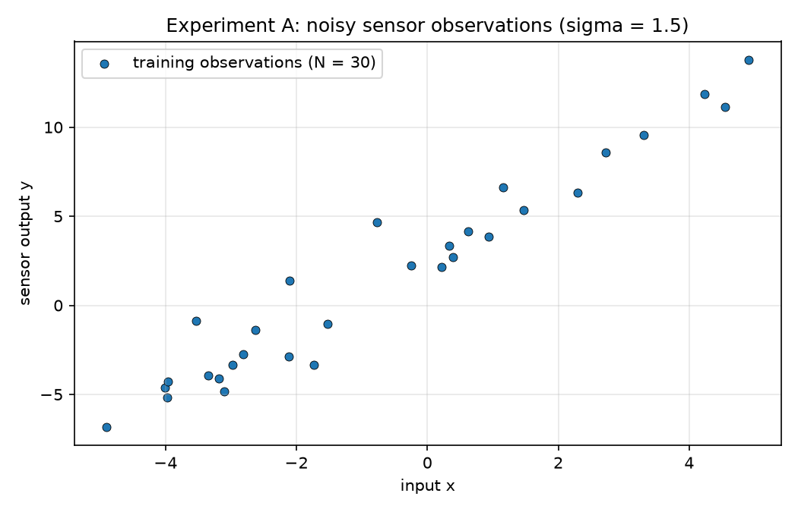
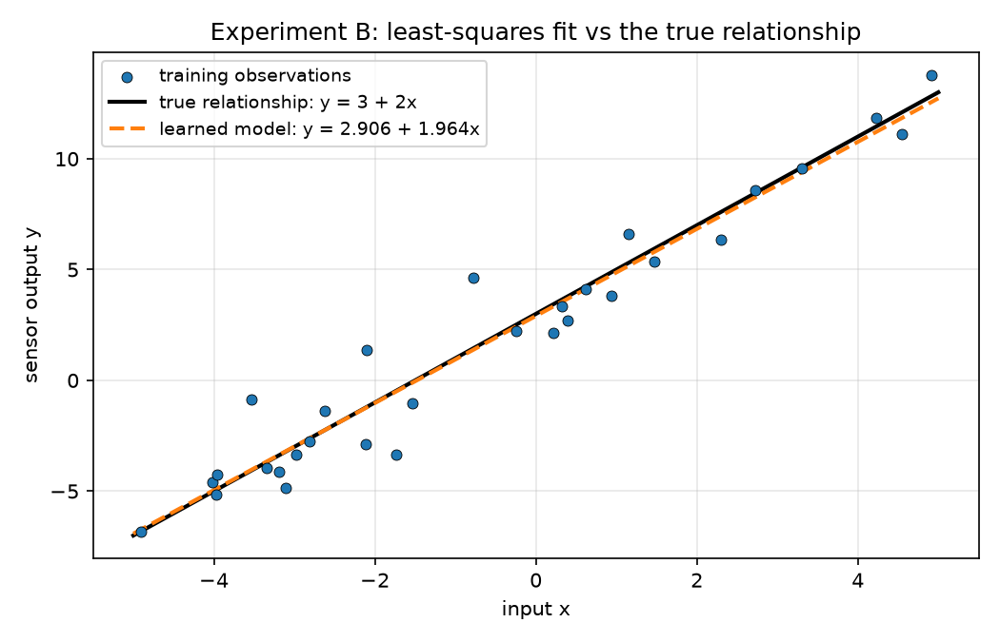
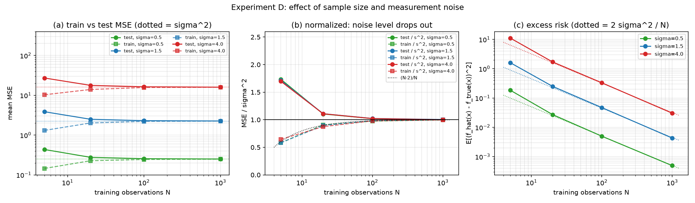
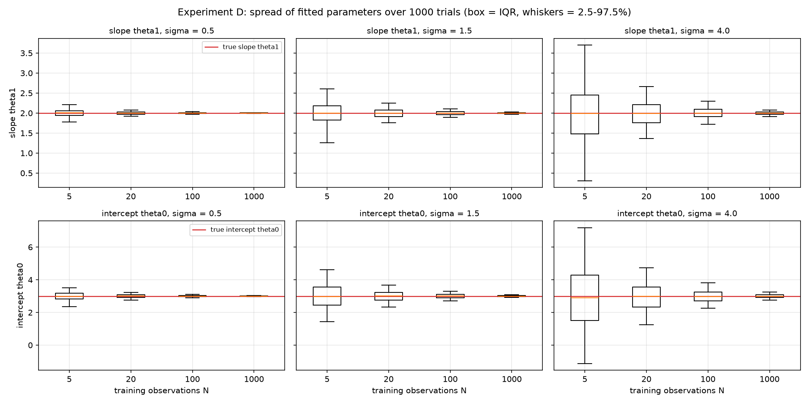
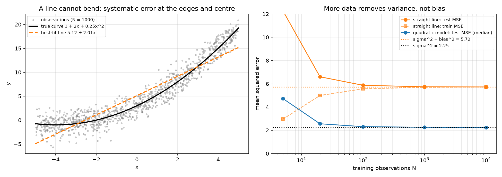

# Module 1: Your First Learning System

All numbers below come from `python run_all.py`. The full console output is saved in `outputs/run_all_output.txt`.

| File | Purpose |
|---|---|
| `learning_core.py` | Data generator (starter code, seed 560), design matrix, `lstsq` fit, MSE, exact excess risk |
| `exp_a_data.py` | Experiment A: training scatterplot, plus four other 30-point samples |
| `exp_b_fit.py` | Experiment B: least-squares fit, learned vs true parameters, fit plot |
| `exp_c_generalization.py` | Experiment C: train/test/baseline MSE, then 5000 repeated experiments |
| `exp_d_sample_size_noise.py` | Experiment D: all 12 (N, σ) combinations, 1000 seeds each, tables + CSV + plots |
| `exp_e_model_mismatch.py` | Optional challenge: a straight line fitted to quadratic truth |
| `run_all.py` | Runs everything; figures go to `outputs/` |

The fitting routine (`fit_linear`) receives only `(x, y)`. The true coefficients are used only to generate the data and to score the results afterward.

---

## Experiment A: the data

- **Can you see the relationship?** Yes. The points clearly follow a rising straight band. A rough rise-over-run between the left and right thirds of the scatter gives a slope of **1.97**.
- **How precisely could you estimate the slope by eye?** Only to about ±0.2–0.3. With ±1.5 of vertical scatter over a span of only 10 in x, a few outliers can pull your judgement. The formal standard error from Experiment B is about 0.09.
- **Would every 30-point dataset give the same slope?** No. `exp_a_other_samples.png` shows four other draws. Experiment D measures the spread directly: at N = 20 and σ = 1.5, the fitted slope has a standard deviation of 0.12 across 1000 datasets.
- **Does the noise change the physics?** No. The sensor's true relationship is always y = 3 + 2x. The noise affects only our *observations* of that relationship. This is why the estimate is random but centred on the truth.

## Experiment B: least-squares fit (N = 30, σ = 1.5)

| parameter | learned | true | error | std. error | error / SE |
|---|---|---|---|---|---|
| intercept θ₀ | 2.9064 | 3.0 | −0.094 | 0.259 | −0.36 |
| slope θ₁ | 1.9644 | 2.0 | −0.036 | 0.091 | −0.39 |

Yes, the fit recovers the relationship. Both errors are well under one standard error, and the learned line sits almost on top of the true line across the whole input range.

## Experiment C: generalization

| seed 560 | MSE |
|---|---|
| training | 1.773 |
| test (500 new points) | 1.991 |
| baseline: always predict mean(y_train) | 35.75 |
| irreducible σ² | 2.25 |

- The learned model cuts the baseline's error by a factor of about 18. The baseline ignores x, so its error contains all of Var(2x) ≈ 33 on top of the noise.
- In this particular run, the test MSE (1.99) is *below* 2.25. This is just chance: this test set happened to draw slightly small noise. The exact expected test MSE for this θ̂ is 2.25 + 0.019 = 2.269.
- **Averaged over 5000 repeated experiments:** training MSE is 2.094 (theory σ²(N−2)/N = 2.100), and test MSE is **2.407**. On average the test MSE sits above σ², even though 24% of individual runs came in below it. Training MSE is optimistic: it fell below 2.25 in 65% of runs, because the fit partly adapts to the noise in the data it was trained on.

## Experiment D: sample size and measurement noise

Means ± standard deviations over 1000 independent trials. Each configuration uses its own fresh training set and its own 500-point test set at the same σ. The "theory sd" columns are the large-N standard errors σ/√N and σ/√(N·Var x).

| N | σ | θ₀ | theory sd | θ₁ | theory sd | train MSE | test MSE | test/σ² | excess risk |
|---|---|---|---|---|---|---|---|---|---|
| 5 | 0.5 | 2.988 ± 0.282 | 0.224 | 1.998 ± 0.112 | 0.077 | 0.145 | 0.434 | 1.735 | 0.1849 |
| 20 | 0.5 | 3.001 ± 0.118 | 0.112 | 1.999 ± 0.040 | 0.039 | 0.227 | 0.276 | 1.104 | 0.0272 |
| 100 | 0.5 | 2.999 ± 0.051 | 0.050 | 2.000 ± 0.017 | 0.017 | 0.244 | 0.255 | 1.021 | 0.0050 |
| 1000 | 0.5 | 2.999 ± 0.016 | 0.016 | 2.000 ± 0.005 | 0.005 | 0.249 | 0.250 | 1.001 | 0.0005 |
| 5 | 1.5 | 3.008 ± 0.856 | 0.671 | 1.996 ± 0.324 | 0.232 | 1.313 | 3.858 | 1.715 | 1.6103 |
| 20 | 1.5 | 3.000 ± 0.349 | 0.335 | 1.997 ± 0.124 | 0.116 | 2.014 | 2.496 | 1.110 | 0.2497 |
| 100 | 1.5 | 3.002 ± 0.153 | 0.150 | 1.999 ± 0.053 | 0.052 | 2.215 | 2.302 | 1.023 | 0.0472 |
| 1000 | 1.5 | 3.000 ± 0.045 | 0.047 | 2.000 ± 0.016 | 0.016 | 2.251 | 2.260 | 1.004 | 0.0043 |
| 5 | 4.0 | 2.935 ± 2.242 | 1.789 | 1.971 ± 0.856 | 0.620 | 10.32 | 27.16 | 1.698 | 11.14 |
| 20 | 4.0 | 2.964 ± 0.889 | 0.894 | 1.991 ± 0.331 | 0.310 | 14.00 | 17.74 | 1.109 | 1.704 |
| 100 | 4.0 | 2.990 ± 0.403 | 0.400 | 2.001 ± 0.142 | 0.139 | 15.68 | 16.34 | 1.021 | 0.331 |
| 1000 | 4.0 | 3.002 ± 0.126 | 0.126 | 2.000 ± 0.042 | 0.044 | 15.95 | 15.99 | 0.999 | 0.030 |

### 1. What happens as the number of observations increases?

- **Parameter estimation:** The estimates are centred on the truth at every N; the averages are 3.00 and 2.00 throughout, so least squares is unbiased. What shrinks is the *spread*, which falls as 1/√N. For example, at σ = 1.5 the slope's standard deviation goes 0.324 → 0.124 → 0.053 → 0.016, matching σ/√(N·Var x) from N = 20 upward. At N = 5 the spread is larger than the large-N formula predicts, because 5 random x values often bunch together and give poor leverage.
- **Training error** rises toward σ² from below, following σ²(N−2)/N (0.58σ² at N = 5, about 1.00σ² at N = 1000). With few points, two parameters can absorb a large share of the noise. The training MSE is therefore optimistic.
- **Test error** falls toward σ² from above (1.7σ² → 1.11σ² → 1.02σ² → 1.00σ²). The gap between training and test error closes, so at large N the training error becomes an honest estimate of performance.
- **Statistical uncertainty:** The excess risk E[(f̂ − f)²] falls almost exactly as 2σ²/N (panel c). Each 10× increase in data cuts it by about 10×. The trial-to-trial spread of the test MSE also narrows, except that at N = 5 it has a heavy tail (σ = 4: mean 27.2, median 21.4). A single small-sample result is therefore an unreliable measure of model quality.

### 2. What happens as measurement noise increases?

- **Estimating the relationship gets harder in proportion to σ.** Parameter standard deviations scale linearly with σ: at N = 100 the slope's sd is 0.017, 0.053 and 0.142 for σ = 0.5, 1.5 and 4. Excess risk scales with σ². However, the cost can be *bought back with data*. At N = 1000 and σ = 4 the slope is known to ±0.042, which is better than N = 20 at σ = 1.5 (±0.124). Noisy sensors still allow the underlying relationship to be learned precisely; they just need more samples (N must grow like σ²).
- **Predicting an individual reading cannot be bought back.** Every test MSE converges to σ² (0.25, 2.25, 16), and no amount of data goes below it. Even the perfect model y = 3 + 2x mis-predicts each new reading by a typical ±σ, because the noise in that reading is new and independent of everything learned.
- **Normalized by σ², the noise level drops out completely.** In panel (b) the curves for all three σ lie on top of each other: test/σ² ≈ 1.71, 1.11, 1.02, 1.00 at every noise level. With a correct model, the *relative* penalty for having limited data depends only on N (and the number of parameters), not on σ.

## Optional challenge: deliberate model mismatch

Truth y = 3 + 2x + 0.25x² + ε (σ = 1.5), still fitted with a straight line. 500 trials per N.

| N | θ₀ | θ₁ | line train MSE | line test MSE | test − floor | quadratic model test MSE (median) |
|---|---|---|---|---|---|---|
| 5 | 4.49 ± 1.63 | 1.97 ± 0.66 | 2.97 | 12.27 | +6.55 | 4.73 |
| 20 | 4.96 ± 0.60 | 1.98 ± 0.24 | 4.99 | 6.60 | +0.88 | 2.56 |
| 100 | 5.06 ± 0.25 | 1.99 ± 0.10 | 5.57 | 5.87 | +0.15 | 2.31 |
| 1000 | 5.08 ± 0.07 | 2.00 ± 0.03 | 5.70 | 5.74 | +0.015 | 2.26 |
| 10000 | 5.08 ± 0.03 | 2.00 ± 0.01 | 5.72 | 5.73 | +0.003 | 2.24 |

**No, more data does not remove the error caused by the wrong functional form.** With more data, the line converges, very precisely, to the *best possible straight line*: θ* = [3 + 0.25·E[x²], 2] = [5.083, 2]. It does not converge to the truth. The intercept absorbs the average of the curvature, and the slope stays 2 because x² is symmetric about zero.

That best line still misses the curve: it is too high near x = 0 and too low at the edges. The leftover error is

bias² = 0.25²·Var(x²) = 0.0625·(125 − 625/9) = **3.47**,

so the test MSE floors at σ² + bias² = **5.72**, not 2.25. More data drives the *variance* part to zero (+6.55 → +0.003 above the floor) but leaves the bias untouched.

A clear sign of the problem: at N = 10000 the training and test MSE agree (5.72 vs 5.73). This is not overfitting; the model is underfitting. Adding an x² column, a model with the right form, brings the test MSE down to 2.24, which is the noise floor. This is the bias/variance split: data fixes variance, while model capacity fixes bias.
