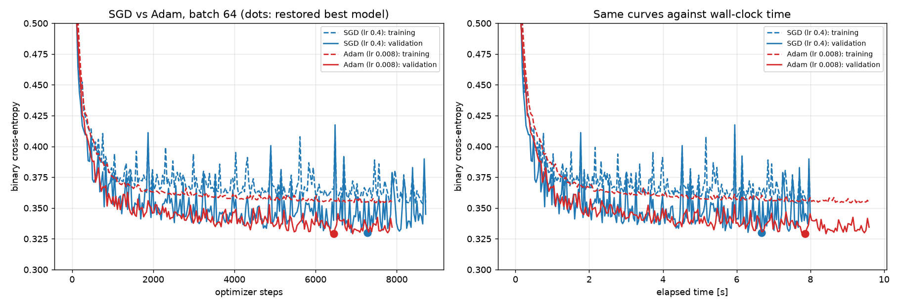

# Module 10: From NumPy to PyTorch

All numbers come from `python run_all.py` (about 3 minutes). The full console output is saved in `outputs/run_all_output.txt`.

**Environment:**
- **PyTorch:** 2.15.0, CPU build, installed for this module from PyPI.
- **Device:** no GPU is available, so everything runs on the CPU (the code moves tensors to CUDA automatically when it exists). Timings use one CPU thread (`torch.set_num_threads(1)`) so they are comparable and reproducible.

**Naming:** the course text calls the NumPy network the "Module 9 MLP"; after the folder mix-up it lives in `../module-8/mlp.py`, and that is the reference used here. The star data and the 45 / 15 / 30 image split are exactly Module 8's.

| File | Purpose |
|---|---|
| `torch_mlp.py` | `TorchMLP` (`nn.Linear` → `nn.Tanh` → `nn.Linear`, outputs logits) and `copy_from_numpy` |
| `trainer.py` | reusable `Trainer` (mini-batch training, validation, early stopping with best-model restore, metric logging), `save_checkpoint` / `load_checkpoint` |
| `inference.py` | `StarInference`: checkpoint → `predict_proba(features)` → NumPy probabilities |
| `data10.py` | the Module 8 split; normalisation statistics from the training images only |
| `exp_a_numpy_vs_torch.py`, `exp_b_optimizers.py`, `exp_c_inference.py` | Experiments A–C |

---

## Experiment A: NumPy vs PyTorch

The NumPy 2 → 4 → 1 XOR network's parameters were copied into `nn.Linear` / `nn.Tanh` layers in **float64**. `nn.Linear` stores its weight as (out, in) and computes x Wᵀ + b, so W₁ is transposed. Loss: `nn.BCEWithLogitsLoss`; gradients from autograd. The reference is the analytical NumPy backpropagation.

| quantity | max \|PyTorch − NumPy\| at initialisation | after 2,000 training steps |
|---|---|---|
| output logits | 5.6e-17 | 0.0 |
| predicted probabilities | 5.6e-17 | 1.1e-16 |
| binary cross-entropy loss | 0.0 | 1.7e-16 |
| ∂J/∂W₁ (2 × 4) | 1.0e-17 | 4.2e-17 |
| ∂J/∂b₁ (4) | 1.7e-17 | 3.7e-17 |
| ∂J/∂W₂ (4) | 2.8e-17 | 3.6e-17 |
| ∂J/∂b₂ | 0.0 | 2.3e-17 |

**PyTorch computes exactly the same forward pass and gradients**: every quantity agrees to machine precision, about 1e-16, far inside the 1e-10 target. Autograd performs the same chain-rule products that Module 8 wrote and verified by hand.

**A pitfall found and fixed along the way.** My first version agreed to 1e-17 at initialisation but differed by **5.5e-8** after training. The cause: the NumPy model's b₂ is a plain Python float, and `torch.tensor([b2])` creates a **float32** tensor, PyTorch's default dtype, which rounds b₂ to about 7 digits before it's copied into the float64 layer. It was invisible at initialisation only because b₂ = 0 there. `copy_from_numpy` now passes `dtype=torch.float64` for every parameter. Mixing default-dtype tensors into a "float64" comparison is an easy way to get a false mismatch, or to hide a real one.

## Experiment B: mini-batch training and optimizers

**Setup:**
- **Network:** 3 → 16 → 1, batch size 64, `BCEWithLogitsLoss`, float32.
- **Data:** the same image groups as Module 8: 45 training images (2,262 candidates) and 15 validation images (720). Standardised with training-image statistics.
- **Early stopping:** on validation loss, with patience 40 epochs; **the best parameters are restored**.

**Learning rates**, adjusted only on validation results. Starting from the suggested 0.05 (SGD) and 0.001 (Adam), the rate was doubled while validation loss kept improving. Both suggested rates turned out far too cautious. The search stopped once the curve turned over, so the choice is a genuine validation optimum, not a grid boundary:

| optimizer | learning rate | best validation loss | best epoch | optimizer steps to best | elapsed s |
|---|---|---|---|---|---|
| SGD | 0.05 | 0.3428 | 330 | 11,880 | 12.3 |
| SGD | 0.1 | 0.3376 | 269 | 9,684 | 10.2 |
| SGD | 0.2 | 0.3346 | 225 | 8,100 | 8.7 |
| **SGD** | **0.4** | **0.3301** | 202 | 7,272 | 7.9 |
| SGD | 0.8 | 0.3303 | 82 | 2,952 | 4.0 |
| SGD | 1.6 | 0.3339 | 82 | 2,952 | 4.1 |
| Adam | 0.001 | 0.3467 | 324 | 11,664 | 16.1 |
| Adam | 0.002 | 0.3374 | 319 | 11,484 | 15.7 |
| Adam | 0.004 | 0.3347 | 271 | 9,756 | 13.6 |
| **Adam** | **0.008** | **0.3290** | 179 | 6,444 | 9.7 |
| Adam | 0.016 | 0.3306 | 83 | 2,988 | 5.4 |
| Adam | 0.032 | 0.3315 | 59 | 2,124 | 4.3 |

**Speed comparison:** to first reach a validation loss within 1% of the weaker optimizer's best (0.3334), **SGD needed 6,192 optimizer steps (5.7 s) and Adam 4,392 (5.4 s)**. Adam needs about 30% fewer steps, but each Adam step costs more (it keeps two moment estimates per parameter), so the wall-clock time is about the same. Steps and seconds have to be reported separately, as the problem set says.

**What the curves show.** Both reach essentially the same validation loss (0.330 vs 0.329). The difference is stability: **SGD at its best learning rate is very noisy**, with its validation loss spiking by up to 0.08 between epochs, whereas **Adam descends smoothly**. Adam's per-parameter step sizes tame the large rate. The training loss sits *above* the validation loss throughout, because the validation images happen to be slightly easier (Module 8 saw the same thing). That's composition, not a bug.

**Adam (learning rate 0.008) is selected** for Experiment C. It has the lowest validation loss, and its smooth convergence makes the early-stopping point more trustworthy.

**`trainer.py`:**
- **What it does:** training, per-epoch validation, early stopping with best-model restoration, and metric logging (epoch, optimizer steps, training and validation loss, elapsed time).
- **Checkpoint contents:** `model_state_dict`, `optimizer_state_dict`, epoch, best validation loss, model configuration (input / hidden size, optimizer, learning rate, batch size), the **training-image normalisation statistics**, and the step count.
- **Safe loading:** tensors and plain Python values only, so the checkpoint loads with `torch.load(..., weights_only=True)`, which executes no pickled code.

## Experiment C: the inference pipeline

`StarInference(checkpoint).predict_proba(features)`:
1. applies the saved training-set normalisation;
2. moves the input tensor to the model's device;
3. runs `model.eval()` under `torch.inference_mode()`, with no gradient tracking;
4. applies a sigmoid to turn logits into probabilities;
5. returns an ordinary NumPy array.

**Reproducibility:**
- a freshly constructed `StarInference` from the checkpoint reproduces the outputs **exactly** (max difference 0.0);
- **retraining the selected configuration from scratch with the same seed reproduces the checkpoint's parameters bit for bit** (max difference 0.0), thanks to seeded initialisation, a seeded DataLoader shuffle and single-threaded CPU arithmetic.

**Thresholds**, from the validation images only: Policy A (recall ≥ 0.95) = **0.37**, against **0.40** for the NumPy network; Policy B (precision ≥ 0.90) = 0.62. The two networks' probability outputs are scaled differently (here, validation probabilities have median 0.54, and 10th / 90th percentiles of 0.002 / 0.995), so the old threshold would not have meant the same operating point.

### Final comparison: untouched test images, evaluated once

| metric | NumPy MLP (Module 8 folder) | **PyTorch MLP** |
|---|---|---|
| test ROC AUC | 0.888 | **0.889** [0.873, 0.903] |
| Brier score | 0.134 | **0.135** |
| high-recall policy recall | 0.917 | **0.903** |
| precision / FPR at Policy A | 0.726 / 0.409 | 0.732 / 0.392 |
| high-precision policy precision | 0.904 | 0.891 (recall 0.653) |
| trainable parameters | 81 | **81** |
| training time | ~23 s (full-batch gradient descent) | **9.6 s** (6,444 Adam steps to the best model) |
| inference latency, batch of 1,499 | ~0.6–1.7 µs / candidate | **0.15 µs / candidate** (p95 0.16) |
| latency, a single candidate | – | 92 µs (fixed per-call framework overhead) |

**Interpretation:**
- **Same model, same performance.** AUC 0.889 vs 0.888 and Brier 0.135 vs 0.134: the PyTorch rewrite reproduces the NumPy network's quality. That was expected: Experiment A showed the mathematics is identical, and the architecture and data are the same.
- **What PyTorch adds is engineering:** mini-batch Adam trains in less than half the time; batched inference is about 4–10× faster per candidate; and the checkpoint plus `StarInference` give a reproducible, self-contained component.
- **Per-call overhead matters.** Calling the model for *one* candidate costs about 92 µs, roughly 600 times the per-candidate cost in a batch. Candidates should be batched per image in deployment.
- **The high-recall policy still under-delivers on new images** (0.903 vs the 0.95 target; 95% group-bootstrap interval [0.883, 0.920]), as it did for the NumPy network. Thresholds from only 15 validation images don't transfer with enough margin. This is the same lesson as Modules 5, 8 and 9: use more validation images, out-of-fold predictions or a margin.
- **Ready to extend.** `TorchMLP`, `Trainer` and `StarInference` take the input dimension from the checkpoint configuration, and the normalisation travels with the model. Moving from 3 engineered features to whole image patches means swapping the model class and the feature extraction, while the training, checkpointing and inference machinery stays.
