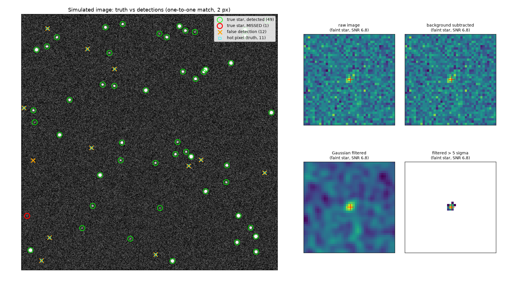
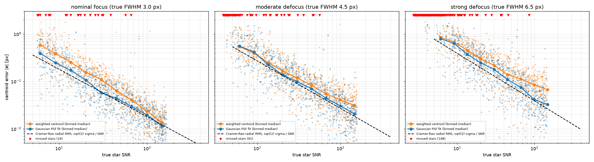

# Module 11: From Images to Source Catalogues

All numbers come from `python run_all.py` (about 3 minutes). The full console output is saved in `outputs/run_all_output.txt`.

**Environment:** photutils 3.1.1 and astropy 8.0.2 were installed for this module from PyPI. Everything runs on the CPU. Coordinates: x = column, y = row, with the centre of pixel (row j, column i) at (i, j).

| File | Purpose |
|---|---|
| `starfield.py` | simulator, the six-step `detect()` (returns an N × 2 array), `weighted_centroid`, `gaussian_fit` (SciPy `least_squares`), one-to-one `match` |
| `catalog.py` | `detect_sources()`: the integrated catalogue (x, y, flux, snr, centroid_uncertainty, quality_flags) |
| `exp_a_detection.py` … `exp_c_photutils.py` | Experiments A–C |

---

## Experiment A: simulate an image and detect stars

### Image formation

Electron counts throughout:
- **Image:** 512 × 512 pixels with a uniform background B = 100 e⁻.
- **Stars:** 50, with subpixel positions drawn uniformly (at least 10 px from the edges) and flux log-uniform between 300 and 30,000 e⁻.
- **PSF:** circular Gaussian, FWHM 3 px (σ = 1.27 px), **integrated exactly over each pixel's area**. A Gaussian is separable, so the integral is a product of error-function differences, not a pixel-centre approximation: [Φ((i + ½ − x₀)/σ) − Φ((i − ½ − x₀)/σ)] × [the same in y]. Each star's stamp sums to 1.000.
- **Hot pixels:** 10–20 single pixels with 500–5,000 extra electrons.
- **Noise:** measured = Poisson(expected) + N(0, RN²), with read noise RN = 5 e⁻.
- **Ground truth:** stored separately (x, y, flux, and the true SNR = F / √(F + 4πσ²(B + RN²))).

### Detector

`detect(image)` runs six steps, with no neural network:

| step | what it does | effect on the nominal image |
|---|---|---|
| 1. background estimation | sigma-clipped median and MAD-based RMS of the whole image | 99.92 e⁻ and RMS 11.17 e⁻ (expected √(B + RN²) = 11.18) |
| 2. background subtraction | image − median | |
| 3. Gaussian filtering | kernel with the assumed PSF σ (a matched filter for point sources) | per-pixel noise falls 4.5× (RMS 2.50 e⁻); point sources are preserved |
| 4. local-maximum detection | 5 × 5 maximum filter | 4,962 maxima, almost all of them noise bumps |
| 5. thresholding | filtered peak > 5 × the **measured** RMS of the filtered image | 61 peaks |
| 6. minimum-separation filtering | drop peaks within 4 px of a brighter one | 61 detections, returned as a (61, 2) array |

**Result**, using one-to-one Hungarian matching within 2 px:
- **49 true matches, 1 missed star** (true SNR 6.4), and **12 false detections, 11 of which are hot pixels**;
- recall 0.98, precision 0.80;
- the peak *pixel* is within a median 0.37 px of the true position. Sub-pixel centroiding is Experiment B.



**How each step affects the measured information:**
- **Filtering is what makes faint stars detectable.** It averages over the PSF footprint, cutting the noise 4.5× while keeping most of a point source's peak. The SNR-6.8 star in the zoom panels is invisible in the raw pixels but clearly above threshold after filtering.
- **The threshold must use the filtered image's noise.** Using the raw image's RMS would be 4.5× too strict.
- **Hot pixels survive filtering**, as sharp, filtered-down spikes. A threshold can't tell them from stars; their *shape* can (the SHARP flag in Experiment C).
- **Minimum separation removes duplicate peaks** on bright stars, but it can merge genuine close pairs.

## Experiment B: centroid accuracy

**Two estimators:**
- **Method 1, intensity-weighted centroid:** the background-subtracted pixel intensities within a 4 px radius, re-centred 3 times.
- **Method 2, Gaussian PSF fit:** `scipy.optimize.least_squares` fits flux, x₀, y₀, σ and a local background on an 11 × 11 cutout. It uses the same pixel-integrated Gaussian, with residuals weighted by the Poisson + read-noise variance.

**Setup:** 20 independent images × 50 stars per condition. **The processing architecture is fixed at the nominal design**: filter for FWHM 3 px, aperture radius 4 px, 11 × 11 fitting cutout. Only the true PSF changes.

| condition (true FWHM) | method | recall | false positives (20 images) | median error | 90th-pct error | RMSE | fitted σ (true σ) |
|---|---|---|---|---|---|---|---|
| nominal focus (3.0 px) | weighted centroid | 0.976 | 317 | 0.066 px | 0.424 | 0.299 | |
| nominal focus | **Gaussian PSF fit** | 0.976 | 317 | **0.043 px** | **0.266** | **0.182** | 1.27 (1.27) |
| moderate defocus (4.5 px) | weighted centroid | 0.909 | 318 | 0.090 | 0.469 | 0.306 | |
| moderate defocus | Gaussian PSF fit | 0.909 | 318 | 0.080 | 0.421 | 0.306 | 1.91 (1.91) |
| strong defocus (6.5 px) | weighted centroid | **0.802** | 340 | 0.176 | 0.716 | 0.416 | |
| strong defocus | Gaussian PSF fit | 0.802 | 340 | 0.137 | 0.659 | 0.406 | 2.76 (2.76) |

The false positives here are almost all hot pixels, which this experiment doesn't filter.

**By true SNR** (median / 90th-percentile error in px; detected / all stars in the bin):

| condition, method | SNR < 10 | 10–20 | 20–50 | 50–100 | > 100 |
|---|---|---|---|---|---|
| nominal: detected | 114/123 | 156/163 | 269/275 | 232/234 | 205/205 |
| nominal, weighted centroid | 0.526 / 1.022 | 0.232 / 0.524 | 0.099 / 0.199 | 0.033 / 0.074 | 0.016 / 0.030 |
| nominal, Gaussian fit | **0.323 / 0.679** | **0.148 / 0.329** | **0.057 / 0.135** | 0.027 / 0.057 | 0.013 / 0.028 |
| moderate: detected | 124/199 | 154/162 | 253/260 | 206/207 | 172/172 |
| moderate, weighted / fit | 0.505 / 0.501 (median) | 0.243 / 0.188 | 0.112 / 0.094 | 0.052 / 0.042 | 0.034 / 0.022 |
| strong: detected | **87/264** | 168/182 | 225/231 | 186/187 | 136/136 |
| strong, weighted / fit | 0.741 / 0.778 (median) | 0.425 / 0.355 | 0.213 / 0.164 | 0.109 / 0.069 | 0.068 / 0.033 |



**Findings:**
- **Accuracy is set by SNR.** Errors fall roughly as 1/SNR, from about 0.5 px at SNR < 10 to about 0.015 px at SNR > 100. The Gaussian fit's binned median tracks the **Cramér–Rao bound** √2·σ/SNR (dashed). Its median sits slightly *below* that RMS-based bound, as expected, since the median of a 2-D radial error is smaller than its RMS. **The PSF fit beats the weighted centroid by 20–40%** at nominal focus.
- **The averages hide the faint stars.** The overall nominal median of 0.043 px is dominated by bright stars. Below SNR 10 it is 0.32 px, and 7% of those stars are not detected at all.
- **Defocus first costs detections, then accuracy.** Under strong defocus, **two-thirds of the SNR < 10 stars are missed** (87 of 264 found), because the light is spread over more noisy pixels and the fixed FWHM-3 matched filter no longer matches. For the stars that are detected, errors at a given SNR roughly double.
- **The fixed architecture hurts the weighted centroid most.** Its 4 px aperture truncates a 6.5 px-FWHM star, biasing it toward the peak pixel: at SNR > 100 its median error is 0.068 px, against 0.033 px for the fit. The fit adapts, recovering σ = 2.76 exactly. Some loss remains, from the 11 × 11 cutout.
- **A few bright stars are missed even at nominal focus** (the red triangles at SNR 50+). Those are close pairs merged by the 4 px minimum-separation step, a crowding limit rather than a sensitivity limit. The CROWDED flag in Experiment C marks such cases.

## Experiment C: our detector vs photutils DAOStarFinder

**Setup:** the same images and truth catalogues for both methods; 10 images × 50 stars per configuration.
- **nominal:** flux 300–30,000 e⁻, B = 100 e⁻, RN = 5 e⁻;
- **low SNR:** flux 100–3,000 e⁻, B = 300 e⁻, RN = 10 e⁻.

`DAOStarFinder(threshold=5·rms, fwhm=3.0)` runs on the background-subtracted image, using the same sigma-clipped background and a scalar RMS. A `None` result is handled.

**Is 5 × RMS a fair threshold for DAO?** photutils compares its threshold against a differently normalised convolved image, so the two "5σ" settings don't mean the same thing. I swept DAO's multiplier on 10 *separate calibration images* and selected the highest recall with precision ≥ 0.97:

| multiplier | 1–2.5 | 3 | 4 | 5 |
|---|---|---|---|---|
| precision / recall | ≈ 0.05–0.07 / 0.92 | 0.17 / 0.90 | 0.86 / 0.86 | **1.00 / 0.82** |

Below 5, DAO is swamped by noise detections, so **5 × RMS is also its best qualifying setting**.

**Comparison:**

| metric | ours (all detections) | ours (without SHARP-flagged) | DAOStarFinder |
|---|---|---|---|
| **nominal** — detection precision | 0.762 | **0.974** | 1.000 |
| detection recall | **0.982** | **0.982** | 0.766 |
| false positives (10 images) | 153 (134 SHARP, 6 SHARP + EDGE) | 13 | 0 |
| median centroid error | 0.052 px | 0.052 px | 0.056 px |
| 90th-percentile centroid error | 0.271 px | 0.271 px | 0.189 px |
| processing time per image | 1,347 ms (detection alone 124 ms) | – | **84 ms** |
| **low SNR** — detection precision | 0.640 | **0.993** | 0.990 |
| detection recall | **0.538** | 0.536 | 0.208 |
| false positives | 151 (149 SHARP) | 2 | 1 |
| median centroid error | 0.186 px | 0.186 px | 0.125 px |
| 90th-percentile centroid error | 0.519 px | 0.520 px | 0.332 px |
| processing time per image | 610 ms (detection alone 119 ms) | – | **82 ms** |

**The same stars, compared directly.** DAO's better 90th-percentile error comes from **detecting only the easier stars**. On stars detected by *both* methods, our PSF fit is more accurate:
- **nominal:** 383 shared stars; median / 90th percentile **0.037 / 0.134 px**, against DAO's 0.056 / 0.189;
- **low SNR:** 104 shared stars; **0.110 / 0.226 px**, against 0.125 / 0.332.

**Conclusions:**
- **Sensitivity:** our matched-filter detector, with hot pixels flagged by shape, finds far more real stars at the same high precision. Nominal: recall 0.98 vs 0.77 at precision 0.97 vs 1.00. Low SNR: recall 0.54 vs 0.21 at precision 0.99 vs 0.99.
- **Without the SHARP flag, our raw precision is poor** (0.64–0.76), because hot pixels pass a pure threshold. DAOStarFinder has the equivalent sharpness and roundness filters built in.
- **Accuracy:** PSF fitting gives better centroids than DAO's windowed centroids on the same stars.
- **Cost:** DAO is about 15× faster (84 ms vs 1.35 s per image). Our detection step alone takes about 120 ms; the time goes on one SciPy least-squares fit per detection. For real-time use, fit only unflagged candidates, vectorise the fits, or use a closed-form centroid for faint sources.

### Final output: the integrated catalogue

`detect_sources(image)` returns:

```python
{"x", "y",                  # Gaussian-PSF-fit centroid [px]
 "flux",                    # fitted total flux [e-]
 "snr",                     # flux / sqrt(flux + 4 pi sigma_fit^2 rms^2)
 "centroid_uncertainty",    # radial 1-sigma [px], model-based and empirically calibrated
 "quality_flags",           # 1 SHARP, 2 EDGE, 4 CROWDED, 8 LOW_SNR, 16 BAD_FIT
 ...}                       # plus sigma, sx, sy, background
```

Example rows (nominal image, brightest and faintest detections):

| x | y | flux [e⁻] | snr | centroid_uncertainty [px] | quality_flags |
|---|---|---|---|---|---|
| 25.052 | 27.695 | 22,986 | 143.8 | 0.018 | 0 (OK) |
| 159.811 | 186.083 | 20,513 | 135.2 | 0.021 | 0 (OK) |
| 465.193 | 155.800 | 362 | 7.9 | 0.282 | 8 (LOW_SNR) |
| 137.604 | 281.731 | 514 | 7.5 | 0.527 | 8 (LOW_SNR) |

**Where the centroid uncertainty comes from:**
1. **The model.** The fit's covariance, (JᵀWJ)⁻¹ scaled by the reduced χ², gives per-axis σₓ and σᵧ from the Poisson + read-noise model.
2. **An empirical calibration.** On 10 separate calibration images, the per-axis normalised errors (x̂ − x)/σₓ had a standard deviation of **1.118** against the ideal 1.0, so the model under-states the error by about 12%. That factor is applied.
3. **A check on the evaluation images** (unflagged stars):

   | configuration | radial error within 1σᵣ | within 2σᵣ |
   |---|---|---|
   | ideal 2-D Gaussian | 63.2% | 98.2% |
   | nominal | 72.2% | 98.6% |
   | low SNR (calibrated on nominal images) | 66.7% | 96.6% |

   The uncertainty is therefore calibrated: slightly conservative at 1σ, accurate at 2σ, and it holds up in the low-SNR configuration it was not calibrated on.

**The quality flags explain the false positives.** In the nominal set, 140 of 153 false detections carry SHARP (fitted σ < 0.6 px, narrower than any optical PSF). The rest are mostly EDGE, LOW_SNR or BAD_FIT. Only 2 false detections had no flag at all.

**Conclusion for the module.** An image can now be turned reliably into a source list with physically meaningful columns:
- **Sensitivity:** recall 98% at precision 97% in the nominal case, with hot pixels separated by a shape flag.
- **Positions:** typically within 0.04–0.05 px for bright stars.
- **Uncertainties:** per source, calibrated against known positions.
- **Known limits:** faint stars (SNR < 10), close pairs (merged at the 4 px minimum separation; flagged CROWDED), and defocus, which costs faint-star detections first and then centroid accuracy.
