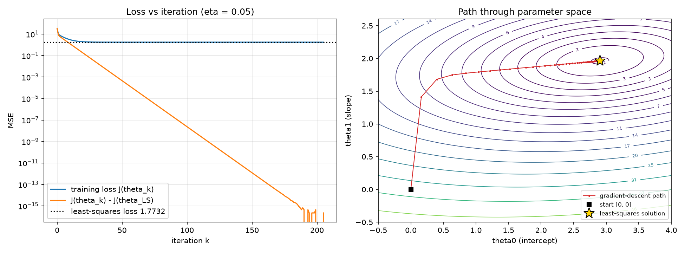
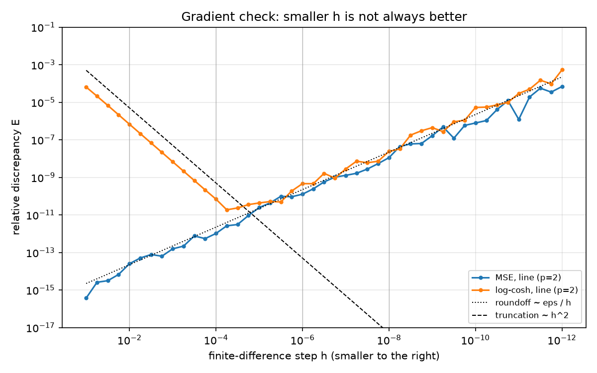
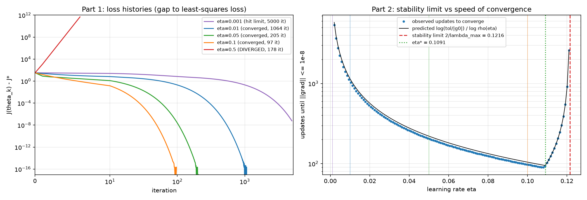
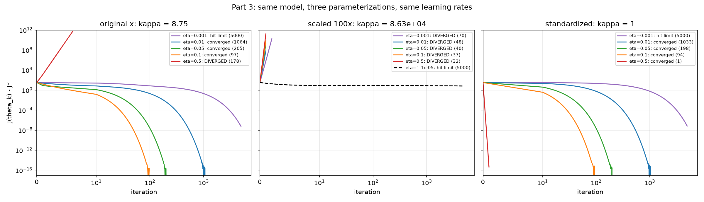
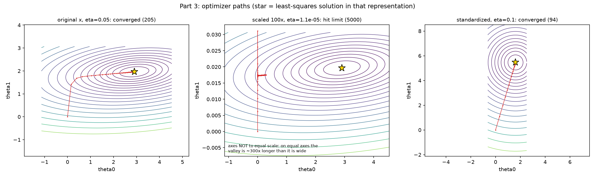
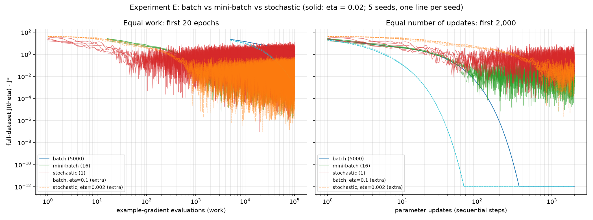
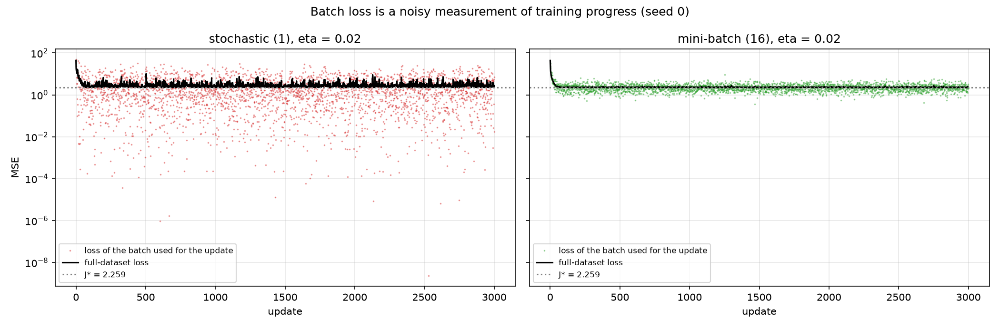

# Module 2: Gradient Descent

All numbers come from `python run_all.py`. The full console output is saved in `outputs/run_all_output.txt`.
Module 1's data generator and `fit_linear()` are imported from `../module-1/learning_core.py`, not copied, so the data are exactly the Module 1 data.

| File | Purpose |
|---|---|
| `gd_core.py` | `mse_loss`, `mse_gradient`, `gradient_descent` (Exp A), `numerical_gradient`, `relative_discrepancy` (Exp C), `minibatch_gradient_descent` (Exp E) |
| `exp_a_engine_checks.py` | Experiment A: tests the engine against each stated requirement |
| `exp_b_gd_vs_lstsq.py` | Experiment B: gradient descent vs `fit_linear()`, loss curve, parameter-space path |
| `exp_c_gradient_check.py` | Experiment C: central-difference gradient checks, sweep over h, bug detection |
| `exp_d_learning_rates.py` | Experiment D: learning-rate comparison, Hessian analysis, feature scaling |
| `exp_e_batch_sgd_minibatch.py` | Experiment E: batch vs stochastic vs mini-batch on 5000 points, 5 seeds |
| `run_all.py` | Runs everything; figures go to `outputs/` |

---

## Experiment A: the engine

```
J(θ) = (1/N)‖Xθ − y‖²      ∇J(θ) = (2/N) Xᵀ(Xθ − y)      θ ← θ − η ∇J(θ)
```

`gradient_descent(X, y, theta_initial, learning_rate, max_iterations, tolerance)` returns `(theta, loss_history, theta_history, info)`.

**Stopping criterion.** Before each update the engine checks, in this order:
1. **`nonfinite`**: the loss, gradient or parameters contain inf or NaN, which means divergence or overflow.
2. **`converged`**: ‖∇J(θ)‖₂ ≤ `tolerance` (default 1e-8). The gradient is exactly zero at the minimiser, so this tests the actual optimality condition. A test on how much the loss changed could stop on a slow plateau and report convergence that hasn't happened. For a quadratic objective it also bounds the error: ‖θ − θ*‖ ≤ ‖∇J‖ / λ_min.
3. **`max_iterations`**: the budget ran out before either of the above.

`theta_history[k]` and `loss_history[k]` always describe the same iterate, and `theta_history[0]` is a copy of the starting point.

All 7 requirement checks pass: a 4-parameter cubic and a 6-parameter model both converge to the normal-equation solution (errors 3e-7 and 5e-9). The histories line up with the iteration count, the loss never increases for a stable η, and the input array is left unchanged. A rate 50× too large is caught as `nonfinite` after 91 updates, and a 10-update budget is reported as `max_iterations`.

## Experiment B: gradient descent vs direct least squares

Module 1 data (seed 560, N = 30), start θ = [0, 0], η = 0.05, tolerance ‖∇J‖ ≤ 1e-8. The run converged after **205 updates**.

| Quantity | Gradient descent | Direct least squares |
|---|---|---|
| Learned intercept | 2.9064119268 | 2.9064119318 |
| Learned slope | 1.9644254964 | 1.9644254969 |
| Final training MSE | 1.7731784943 | 1.7731784943 |
| Parameter difference norm | **5.0e-9** | — |

The results agree to well within 1e-4. The path reached within 1e-4 of the solution at iteration 105 and within 1e-6 at iteration 152.



The path in the right-hand panel is not a straight line to the answer. In the first few steps it climbs steeply in **slope**, the stiff direction with curvature ≈ 16. It then creeps along the shallow **intercept** direction with curvature ≈ 2. Each step goes downhill on the local gradient, without any knowledge of where the minimum is. That is the conceptual difference from `lstsq`, which solves for the answer in one step.

## Experiment C: numerical gradient checking

Relative discrepancy E between the analytical and central-difference gradients:

| problem | θ | h = 1e-2 | 1e-4 | 1e-6 | 1e-8 |
|---|---|---|---|---|---|
| MSE, line | zeros | 1.2e-14 | 2.0e-12 | 1.6e-10 | 8.8e-9 |
| MSE, line | LS optimum | 1.6e-14 | 3.5e-12 | 6.3e-15 | 1.6e-8 |
| MSE, line | random | 2.5e-14 | 1.0e-12 | 1.3e-10 | 1.1e-8 |
| MSE, line | random (large) | 2.9e-13 | 3.5e-11 | 3.1e-9 | 1.2e-7 |
| MSE, cubic (p = 4) | random | 1.9e-14 | 2.1e-12 | 1.4e-10 | 1.8e-8 |
| log-cosh, line | zeros | 9.7e-6 | 9.7e-10 | 4.3e-11 | 2.7e-8 |
| log-cosh, line | random | 6.7e-7 | 6.9e-11 | 4.6e-10 | 2.4e-8 |



The analytical gradient is correct: E is at most 1e-7 everywhere, and at a sensible h it is 1e-10 to 1e-14. The total error has two parts:

- **Truncation error** ≈ (h²/6)·J‴. It shrinks as h shrinks.
- **Roundoff error** ≈ ε_machine·|J|/h. J(θ+h) and J(θ−h) agree in almost all their digits, so subtracting them cancels most of the significant figures. This error *grows* as h shrinks.

**For MSE, J is an exact quadratic, so J‴ = 0 and there is no truncation error at all.** Only roundoff remains, so the accuracy gets steadily worse as h gets smaller: from 1e-14 at h = 1e-2 to 1e-8 at h = 1e-8, following the ε/h line.

To show the usual trade-off, I added a non-quadratic loss (mean log-cosh of the residual). Its error curve is V-shaped: truncation dominates at large h, roundoff at small h, and the best h is about 1e-4 to 1e-5 (about ε^(1/3)). Either way, a smaller h is not always better.

The check catches real bugs. A dropped factor of 2 gives E = 0.50, a flipped residual sign gives E = 2.0, and using only one example gives E = 0.46. The correct gradient gives E = 1e-11.

**Engineering question: why is gradient checking valuable for backpropagation?** Backpropagation is a long, hand-written chain of local derivatives. A wrong transpose, a missing factor, a sign error, or a gradient for the wrong layer **does not crash anything**. The network still trains, just worse, and the bug is easily blamed on hyperparameters or data. A finite-difference check needs only forward evaluations of the loss, which are easy to get right, so it gives an independent reference for every parameter. Typical practice:
- Run it once on a small network in double precision, at a few random parameter vectors.
- Use h ≈ 1e-5 and expect E ≈ 1e-7 or better.
- Then switch it off: it costs 2p loss evaluations per check, which is far too slow for training.
- Watch for non-differentiable points such as ReLU kinks, where the check can fail legitimately.

## Experiment D: learning rates, scaling, and convergence

### Part 1: learning-rate comparison (budget 5000 updates, tolerance 1e-8)

| η | outcome | updates | final loss | ‖θ − θ_LS‖ | ρ(η) = max\|1 − ηλᵢ\| | predicted updates |
|---|---|---|---|---|---|---|
| 0.001 | hit limit | 5000 | 1.77318 | 2.5e-4 | 0.9981 | 11570 |
| 0.01 | converged | 1064 | 1.77318 | 5.2e-9 | 0.9812 | 1147 |
| 0.05 | converged | 205 | 1.77318 | 5.0e-9 | 0.9060 | 221 |
| 0.1 | converged | **97** | 1.77318 | 5.2e-9 | 0.8120 | 105 |
| 0.5 | **diverged** (inf) | 178 | inf | 1e153 | 7.23 | ∞ |



Note that η = 0.001 shows a final loss equal to J* to six digits, yet it has *not* converged: its parameters are still 2.5e-4 away from the solution. The loss is a poor measure of convergence near the minimum, because it is quadratic in the parameter error.

### Part 2: Hessian eigenvalue analysis

```
H = (2/N) XᵀX = [[ 2.000, -1.319],
                 [-1.319, 16.333]]      λ_min = 1.880,  λ_max = 16.453,  κ = 8.75
```

For a quadratic objective the error evolves as e_{k+1} = (I − ηH) e_k. Along each eigenvector the error is multiplied by (1 − ηλᵢ) at every step.

- **Theoretical stability** requires |1 − ηλᵢ| < 1 for every i, which means **η < 2/λ_max = 0.1216**. This was confirmed directly: η = 0.98 × limit converged (in 533 updates), and η = 1.02 × limit diverged. All five experiments agree with the threshold: 0.001–0.1 are below it and converge, while 0.5 is 4× above it and blows up by about 7× per step.
- **Rapid practical convergence** is a different question. The speed is set by the *slowest* mode, ρ(η) = max(|1 − ηλ_min|, |1 − ηλ_max|).
  - Small η: the flat direction barely moves (ρ = 1 − ηλ_min). η = 0.001 is perfectly stable but would need about 11,600 updates.
  - Near the limit: the stiff direction oscillates and barely decays (ρ → 1). η = 0.119 is stable but took 533 updates.
  - The optimum is **η\* = 2/(λ_min + λ_max) = 0.109**, giving ρ\* = (κ−1)/(κ+1) = 0.795. The fine sweep found the fewest updates (90) at η = 0.107.
  - The prediction log(tol/‖g₀‖)/log ρ follows the observed counts closely across the whole range (right-hand panel).

  "Stable" only means the error doesn't grow. How fast it actually shrinks depends on the condition number.

### Part 3: feature scaling

The input is changed to x′ = 100x with the targets unchanged. The standardized input is z = (x′ − 65.96)/278.06, using the **training** mean and standard deviation.

| representation | λ_min | λ_max | κ | stable η < | η\* | ρ\* |
|---|---|---|---|---|---|---|
| original x | 1.88 | 16.45 | **8.75** | 0.122 | 0.109 | 0.795 |
| scaled 100x | 1.89 | 163,300 | **86,260** | 1.2e-5 | 1.2e-5 | 0.99998 |
| standardized | 2 | 2 | **1** | 1.0 | 0.5 | 0 |

| representation | η = 0.001 | 0.01 | 0.05 | 0.1 | 0.5 |
|---|---|---|---|---|---|
| original x | limit (5000) | 1064 | 205 | 97 | diverged |
| scaled 100x | diverged | diverged | diverged | diverged | diverged |
| standardized | limit (5000) | 1033 | 198 | 94 | **1 update** |




1. **Condition number.** Multiplying x by 100 multiplies the slope-direction curvature by 10⁴. κ rises from 8.75 to 86,000. Standardizing makes the columns of X orthonormal, so XᵀX/N = I, H = 2I, and κ = 1.
2. **Convergence speed.** With the scaled input, even the fastest *stable* rate (0.9 × 1.2e-5) has ρ ≈ 0.99998, which would take millions of updates. After 5000 updates the slope had settled but the intercept had barely moved (0.29 vs 2.91): the path oscillates across the narrow valley and then crawls along its floor. Standardized, η = 0.5 = 1/λ converges in a **single** step, because ρ = 0.
3. **Learning-rate stability.** Scaled: every original learning rate diverges, the smallest being 80× over the 1.2e-5 limit. Standardized: all of them converge, with the limit raised to 1.0.
4. **Final prediction accuracy.** After mapping back to original units, every *converged* run in every representation gives the same line, y = 2.90641 + 1.96443x, with test MSE **1.99086**, identical to least squares. The scaled run that stopped at the iteration limit has test MSE **9.63**, nearly 5× worse. The representations differ only in how hard the optimizer has to work, not in the best achievable model.

**Lesson:** y = a + bx, y = a + b′(100x) and y = a + b″z describe exactly the same set of predictors. Gradient descent sees only the local curvature, though, and rescaling a feature changes that curvature by the square of the scale factor. For any gradient-based learner, standardizing the inputs is therefore part of the optimization algorithm, not cosmetic preprocessing.

## Experiment E: batch vs stochastic vs mini-batch

Setup: N = 5000 points from the same relationship, start θ = [0, 0], and 5 seeds (a new dataset and shuffle order for each). The controlled comparison uses **η = 0.02 for all three methods**. This is roughly half the worst-case stability limit for a single example: that example's curvature is 2(1 + x²) ≤ 52, so η < 0.038. Two extra runs show how the step size matters: batch at its near-optimal η = 0.1, and SGD at η = 0.002.

Mean full-dataset excess loss J − J* (J* ≈ 2.27):

| method | after 1 epoch (5k examples) | after 20 epochs (100k examples) | after 20 updates | after 2000 updates |
|---|---|---|---|---|
| batch, η = 0.02 | 23.1 (1 update) | 1.76 (20 updates) | 1.76 (100k examples) | 0 (10M examples) |
| mini-batch 16, η = 0.02 | **0.041** (313 updates) | **0.017** | 1.94 (320 examples) | 0.008 (32k examples) |
| SGD, η = 0.02 | 0.62 ± 0.61 | 0.60 ± 0.58 | 2.76 (20 examples) | 0.33 (2k examples) |
| *batch, η = 0.1* | 20.1 | *0.0012* | *0.0012* | *3e-16* |
| *SGD, η = 0.002* | *0.040* | *0.035* | 17.1 | 0.087 |

Share of updates in epochs 10–20 with J − J* < 0.1: batch η = 0.02: **0%**, mini-batch: **94%**, SGD: **23%**, SGD η = 0.002: 89%, batch η = 0.1: 100%.

Average J − J* over the last 2 epochs (the noise floor): mini-batch 0.030, SGD 0.61, SGD η = 0.002 0.042.




**What the comparison shows:**

- **Equal work** (per example evaluated): the stochastic methods win early by a wide margin. After one pass through the data, mini-batch has made 313 updates and is within 0.04 of J*, while batch has made one update and is 23 above it. Redundant data is the reason: 5000 examples of the same line give nearly the same gradient as 16 of them, so batch pays 300× more per step for little extra information.
- **Equal updates**: batch wins. Every batch step uses the exact gradient, so after 2000 updates it is at J* to machine precision. SGD after 2000 updates is still at 0.33. Per step, more data gives a more accurate step.
- **Constant-step noise floor.** With a fixed η, SGD never settles: it keeps hopping around the minimum. Its typical excess loss stays around 0.6 from the first epoch to the twentieth, and it spends only 23% of the late phase within 0.1 of J*. That floor scales with η × (gradient variance ÷ batch size):
  - Batch size 16 cuts the gradient variance by 16×, giving a floor of 0.03.
  - A 10× smaller η gives SGD a floor of 0.04, but it starts 10× slower (17.1 after 20 updates vs 2.8).
  - In practice SGD therefore needs a decaying learning rate to converge exactly.
- **Measuring progress.** The second figure shows the loss of the single example or mini-batch actually used for each update. It jumps by orders of magnitude from one update to the next while the full-dataset loss changes smoothly. A single batch loss is a noisy *measurement* of training progress, so the experiment logs the full-dataset loss separately.

**Engineering question: why mini-batches for millions of images?**
- **Cost per step.** A full-batch gradient over millions of images, each with millions of activations, takes a full pass through the dataset per update and may not fit in memory. A mini-batch step costs the same no matter how large the dataset is, so the model improves thousands of times per epoch instead of once. Real datasets are highly redundant, so a few hundred images give a useful gradient estimate, as with the 313 updates per epoch above.
- **Hardware efficiency.** Pure SGD (batch size 1) wastes the hardware. GPUs and TPUs are built for large matrix–matrix products, and a batch of 64–1024 images costs almost the same wall-clock time as one image. Mini-batches use that parallelism and spread the per-step overhead across many examples.
- **Variance control.** Averaging over b examples cuts the gradient variance by about b. Steps are smoother, larger learning rates stay stable, and the noise floor drops (0.61 → 0.03 here). Some noise remains, which in non-convex networks can even help the optimizer escape poor regions.
- **Data streaming.** Batches can be loaded, shuffled and augmented on the fly from disk, so the dataset never has to sit in memory all at once.
