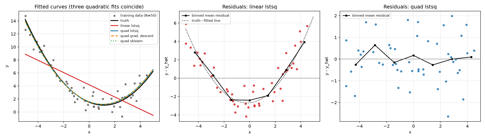
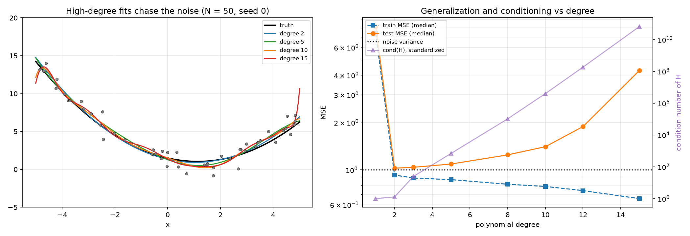
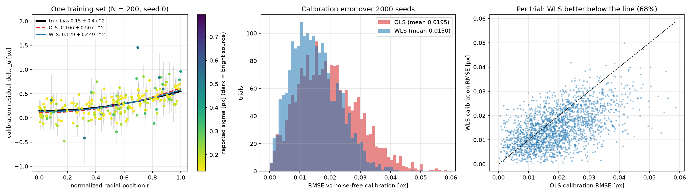
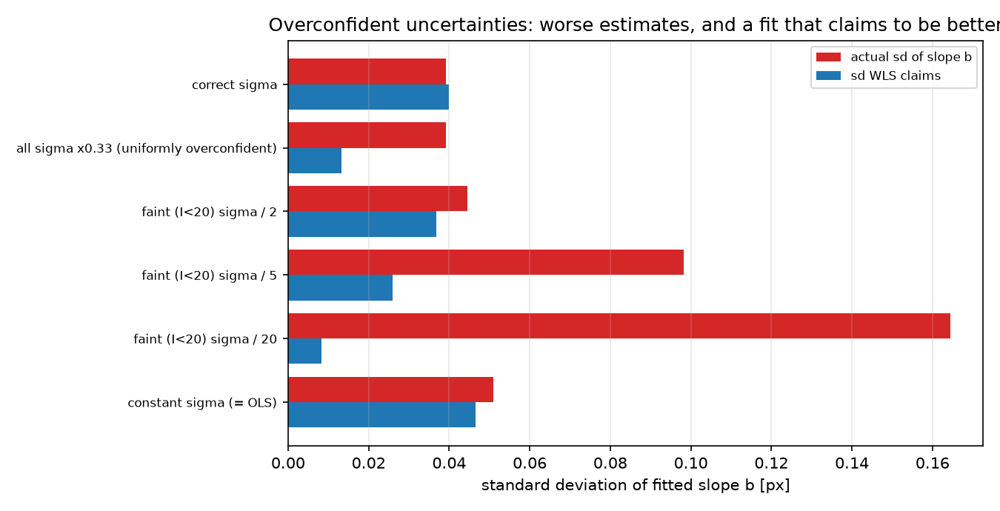
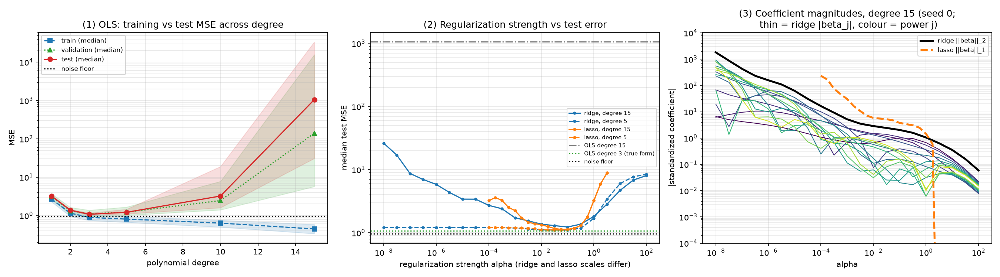
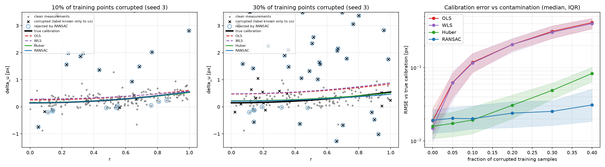
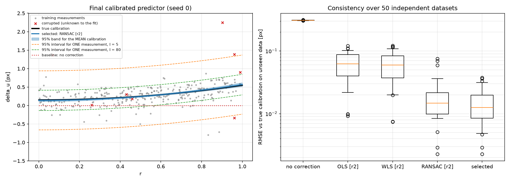
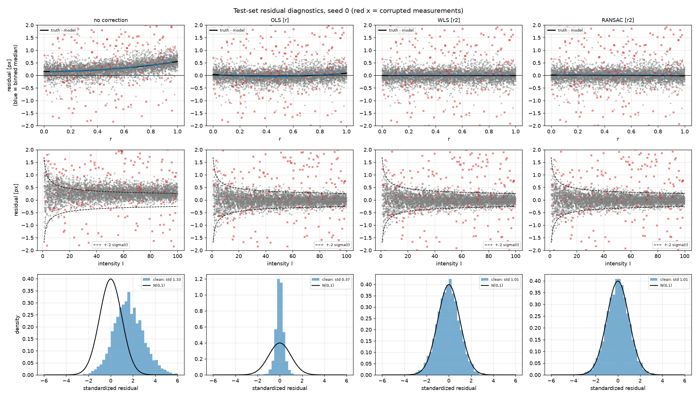

# Module 3: Regression Methods, Weighting, Regularization, and Robustness

All numbers come from `python run_all.py` (about 5 minutes). The full console output is saved in `outputs/run_all_output.txt`.
Module 2's `gradient_descent` is imported from `../module-2`, not copied. scikit-learn 1.9.1 is used for `LinearRegression`, `Lasso`, `HuberRegressor` and `RANSACRegressor`.

| File | Purpose |
|---|---|
| `reg_core.py` | Data generators (quadratic, calibration starter, corruption), polynomial features, training-only `Standardizer`, OLS/WLS/ridge solvers, metrics |
| `exp_a_regression_methods.py` | A: four estimators on one training set; sizes and seeds; degree 1–15 conditioning |
| `exp_b_weighted_least_squares.py` | B: OLS vs WLS over 2000 seeds; wrong-σ engineering extension |
| `exp_c_regularization.py` | C: OLS / ridge (own implementation) / lasso (sklearn), train/validation/test selection |
| `exp_d_robust_regression.py` | D: OLS, WLS, Huber, RANSAC vs contamination fraction; RANSAC detection |
| `calibration_eval.py` | E: reusable `CalibrationModel` and `evaluate()` (all metrics in the table), `residual_plots()` |
| `exp_e_integrated_evaluation.py` | E: final integration challenge and baseline comparison |

---

## Experiment A: can different methods recover the same solution?

Truth: y = 1.5 − 0.8x + 0.35x² + ε, with x ~ U(−5, 5) and ε ~ N(0, 1). All four methods use **one shared training set**. Parameters are compared as raw coefficients [c₀, c₁, c₂]; the gradient-descent fit runs on standardized features and its coefficients are mapped back.

N = 50, seed 0:

| method | c₀ | c₁ | c₂ | train MSE | test MSE |
|---|---|---|---|---|---|
| linear, lstsq | 4.185 | −0.939 | (0) | 6.70 | 8.10 |
| quadratic, lstsq | 1.57166 | −0.74107 | 0.34660 | 1.041 | 1.030 |
| quadratic, gradient descent (standardized, η = 0.25, 46 updates) | 1.57166 | −0.74107 | 0.34660 | 1.041 | 1.030 |
| quadratic, sklearn `LinearRegression` | 1.57166 | −0.74107 | 0.34660 | 1.041 | 1.030 |

Across 50 seeds at each of N = 20, 50, 200 and 1000, the three quadratic estimators agree to **2–4e-11** (gradient descent) and **3e-15** (sklearn). The answer to the central question is **yes**: they all minimise the same convex objective. The only difference is how accurately each solver reaches it.

| N | linear test MSE | quadratic test MSE | quadratic ‖c − c_true‖ |
|---|---|---|---|
| 20 | 8.97 | 1.14 | 0.235 |
| 50 | 8.34 | 1.06 | 0.196 |
| 200 | 8.01 | 1.01 | 0.089 |
| 1000 | 7.92 | 1.00 | 0.043 |

**The linear model's residuals reveal the missing term.** They form a clear U shape, positive at both ends and about −2.5 in the middle, which matches truth − line, the dotted curve. The quadratic model's residuals are structureless noise. More data does not help the line: its test MSE stays near 8 (Module 1's bias lesson again).

### Additional challenge: degrees up to 15 (N = 50, medians over 50 seeds)

| degree | cond(raw X) | cond(standardized X) | cond(H), standardized | train MSE | test MSE | normal-eq. coefficient rel. error | GD (budget 20k) |
|---|---|---|---|---|---|---|---|
| 2 | 16 | 1.1 | 1.3 | 0.93 | 1.03 | 1e-15 | converged |
| 5 | 1.9e3 | 26 | 695 | 0.87 | 1.09 | 7e-15 | converged |
| 8 | 3.1e5 | 321 | 1.0e5 | 0.81 | 1.25 | 8e-13 | **0% converged** |
| 10 | 1.0e7 | 2.0e3 | 4.0e6 | 0.78 | 1.40 | 4e-11 | 0% |
| 15 | **7.2e10** | 2.6e5 | **6.6e10** | 0.66 | **4.29** | 5e-7 | 0% |

- **Generalization:** training MSE keeps falling, from 0.93 to 0.66, while test MSE rises to 4.3. The extra terms fit noise, especially near the edges of the data.
- **Conditioning:** the powers x, x², …, x¹⁵ are nearly collinear. The raw condition number reaches 7e10. Standardizing helps a lot (2.6e5), but it cannot fix columns that are nearly parallel.
- **Normal equations:** solving XᵀXc = Xᵀy squares the condition number, so its coefficients drift away from the SVD-based lstsq solution as roughly κ²·ε: 1e-15 at degree 2, 5e-7 at degree 15.
- **Gradient descent:** it stops converging from degree 8 on. **This is not an optimizer bug.** With η = 1/λ_max, the slowest mode shrinks by only (1 − 1/κ) per step. At κ(H) = 1e5–1e10, reaching 1e-8 takes about κ·ln(1/tol) ≈ 10⁶–10¹² updates, far beyond the budget. The same engine converges in 46 steps at degree 2.

## Experiment B: weighted least squares for sensor calibration

Model a + b·r², with N_train = 200 and a 5000-point test set, over 2000 seeds:

| | test MSE (noisy) | RMSE vs truth [px] | ‖θ − θ_true‖ | sd(a) | sd(b) |
|---|---|---|---|---|---|
| OLS | 0.04330 | 0.01949 | 0.0469 | 0.0229 | 0.0511 |
| WLS | 0.04310 | **0.01505** | **0.0362** | **0.0177** | **0.0397** |

- **Both estimators are unbiased** (mean b = 0.3996 and 0.3992, against a true 0.4). WLS has about 23% smaller parameter standard deviations. The mean squared calibration error ratio is **OLS/WLS = 1.68**, so OLS would need about 68% more data to match WLS.
- **WLS is better on average, not on every trial.** It wins **68.3%** of trials, and OLS wins the other 31.6%.
- **The noisy-measurement MSE hides the difference.** It differs only in the 4th decimal (0.0433 vs 0.0431) because it is dominated by measurement noise. A perfect calibration would score 0.0428 on this test set (0.0467 expected). Only the truth-based error separates "learned the bias well" from "measurements are noisy".
- **Why weighting is right:** a source with I = 100 has σ = 0.13 px, while one with I = 1 has σ = 0.85 px. The bright source carries about 43× more information (1/σ²). OLS gives both the same vote.

### Engineering extension: wrong reported σ (1000 seeds)

The data always use the **true** σ; only the weights and WLS's reported uncertainty use the reported values.

| weights from | RMSE vs truth | actual sd(b) | sd(b) WLS reports | χ²/dof | 95% CI covers true b |
|---|---|---|---|---|---|
| correct σ | 0.0150 | 0.039 | 0.040 | 1.00 | 95.9% |
| all σ × 0.33 | 0.0150 | 0.039 | **0.013** | 9.0 | **48%** |
| faint (I < 20) σ ÷ 2 | 0.0173 | 0.045 | 0.037 | 1.6 | 89% |
| faint σ ÷ 5 | 0.0376 | 0.098 | 0.026 | 5.5 | 41% |
| faint σ ÷ 20 | **0.0610** | **0.164** | **0.008** | 75 | **10%** |
| constant σ (= OLS) | 0.0197 | 0.051 | 0.047 | 1.2 | 93% |

There are two separate failures:
1. **Uniformly wrong σ does not change the fit at all**, since only *relative* weights matter. It does make the reported uncertainty 3× too small, so the "95%" interval covers the truth only 48% of the time.
2. **Underestimating σ for faint sources changes the fit.** The noisiest measurements get the most weight. With faint σ ÷ 5, WLS is already about **2× worse than plain OLS** (0.038 vs 0.020). At the same time it reports a slope uncertainty 6–20× *smaller* than the real one. The estimate gets worse while the fit claims to be better.

The χ²/dof of the standardized residuals (5.5, 75) is the alarm that exposes this, and it should be checked routinely. With correct σ it is 1.00.

## Experiment C: ridge and lasso

Truth: a cubic, 1 + 0.8x − 0.5x² + 0.12x³ + N(0, 1), with x ~ U(−3, 3). Splits: **30 train / 30 validation / 2000 test**, over 100 seeds. Features are standardized using training statistics only, and the intercept is never penalized.
- **Ridge** (implemented here as augmented least squares, without forming ZᵀZ): (1/n)‖y − b − Zβ‖² + α‖β‖².
- **Lasso** (sklearn): (1/2n)‖y − b − Zβ‖² + α‖β‖₁.
- The two α scales differ, so each has its own grid. 571 of the 11,400 lasso fits did not fully converge; all were at degree ≥ 10 with α ≤ 3e-3, the ill-conditioned corner.

| OLS degree | 1 | 2 | 3 | 5 | 10 | 15 |
|---|---|---|---|---|---|---|
| train MSE (median) | 2.68 | 1.15 | 0.89 | 0.81 | 0.63 | 0.45 |
| test MSE (median) | 3.20 | 1.38 | **1.08** | 1.21 | 3.22 | **1055** |

At degree 15, ridge brings the median test MSE from 1055 (OLS) down to **1.37** at α ≈ 0.01–0.3. Lasso reaches **1.13** at α ≈ 0.1, and it zeroes most coefficients along the way (`exp_c_lasso_path_and_fits.png`). Too much regularization underfits: ridge at α = 10 gives 4.7.

**Final comparison:** degree and α are chosen on validation, and test is used once.

| model | mean test MSE | median | 90th pct | degrees chosen |
|---|---|---|---|---|
| OLS degree 15, no selection | 4e7 | 1055 | 3e6 | — |
| OLS degree 3 (oracle: true form) | 1.121 | 1.075 | 1.255 | — |
| OLS, degree chosen on val | 1.250 | 1.131 | 1.391 | mostly 3 |
| **Ridge, degree + α on val** | **1.191** | **1.082** | **1.353** | 2–15 |
| Lasso, degree + α on val | 1.246 | 1.109 | 1.368 | 2–15 |

The test MSE of the true function itself is 0.967. Validated ridge beats validated OLS on test in **67%** of seeds, and it comes within 6% of the oracle. It can do this even when validation picks degree 10 or 15, because the penalty, not the degree, controls complexity.

**Engineering question: why can a strongly regularized model win while fitting the training data worse?** Test error = bias² + variance + noise. With 30 points and 16 coefficients, the unregularized fit has huge *variance*: it bends to follow each noise draw (training MSE 0.45, below the true noise of 1.0). Its coefficients reach the hundreds or thousands and cancel each other, so its predictions swing wildly between and beyond the training points. The penalty limits coefficient size, giving smoother functions that change less from one training sample to the next. That adds a little bias but removes most of the variance. Training error measures how well the model memorised *this* sample; regularization deliberately gives some of that up in exchange for stability on the next one. A small validation set is enough to choose how much.

## Experiment D: robust regression and outlier rejection

The calibration data from B, with a fraction of training points getting an extra offset drawn from N(1.0, 2.0²) px. That is about 10× wider than the measurement noise, skewed to one side, and *not* reflected in the reported σ. Huber and RANSAC are applied to the σ-whitened problem, which makes them robust versions of WLS. RANSAC's consensus threshold is |residual| < 3σᵢ. Evaluation is on a clean set; 200 seeds per fraction.

RMSE against the true calibration [px], median:

| corrupted | OLS | WLS | Huber | RANSAC |
|---|---|---|---|---|
| 0% | 0.0189 | **0.0149** | 0.0159 | 0.0192 |
| 5% | 0.0627 | 0.0620 | **0.0174** | 0.0203 |
| 10% | 0.118 | 0.116 | **0.0193** | 0.0201 |
| 20% | 0.208 | 0.207 | 0.0307 | **0.0240** |
| 30% | 0.313 | 0.304 | 0.0490 | **0.0253** |
| 40% | 0.413 | 0.400 | 0.0834 | **0.0310** |

Parameter error ‖θ − θ_true‖ at 10%: OLS 0.179, WLS 0.180, Huber 0.043, RANSAC 0.049. At 40%: 0.49, 0.50, 0.11, 0.07.

RANSAC detection results (positive = flagged as outlier):

| corrupted | precision | recall | clean points rejected | corrupted points within 3σ (undetectable) |
|---|---|---|---|---|
| 5% | 0.71 | 0.78 | 2.6% | 21% |
| 10% | 0.82 | 0.80 | 2.6% | 20% |
| 20% | 0.90 | 0.80 | 2.5% | 20% |
| 40% | 0.95 | 0.80 | 3.0% | 20% |

- **Recall levels off at 80%** because about 20% of the corrupted points received offsets smaller than 3σ. No threshold can separate them, and since their errors are small they also do little harm.
- **About 2.6% of clean points are rejected**, more than the 0.3% expected for a 3σ Gaussian cut. sklearn reports the inlier set of the best *2-point* model, which is noisier than the final fit. This costs RANSAC a little efficiency on clean data (0.0192 vs WLS 0.0149).
- **Huber vs RANSAC:** Huber is the better choice at low contamination, and RANSAC degrades more slowly above about 15%.

**The key lesson, in numbers:** on the corrupted training data, OLS has the **lowest training MSE** of all four methods at every contamination level (0.514 at 10%, against 0.531 for RANSAC). It is the best squared-error fit to the data it was given, and also the **worst physical calibration**, 6× worse than the robust methods. WLS is no better: a corrupted *bright* star carries a large weight, so weighting can even make things worse. Minimising squared error measures agreement with the measurements, not with reality.

## Experiment E: integrated evaluation

`calibration_eval.py` provides `CalibrationModel(features, method)` and `evaluate(model, {"train", "val", "test"}, truth_fn, theta_true)`. The evaluation reports:
- MSE, RMSE, MAE and median absolute error, against the noisy measurements.
- RMSE against the noise-free calibration, and parameter error when ground truth is known.
- Standardized residuals: their mean and standard deviation, and the fraction with |z| > 3.
- **Two separate 95% coverage checks:**
  - **Mean-function band**, ±1.96·√(φᵀ Cov φ): does it contain the *true calibration curve*? This is uncertainty from learning the calibration from finite data.
  - **Prediction interval**, ±1.96·√(φᵀ Cov φ + σᵢ²): does it contain a *new measurement*? This adds the measurement noise of that individual source, broken down into faint (I < 20) and bright (I ≥ 50) sources.

`residual_plots()` draws residuals against r and against intensity, plus a histogram of standardized residuals against N(0, 1).

### Final integration challenge

The dataset includes all three effects: radial bias 0.15 + 0.4r², σ(I) = 0.05 + 0.8/√I, and **5% unrecognized corrupted measurements**. Each seed has train/validation/test splits of 300/300/5000, all drawn from that same imperfect process.

**Selection, informed by A–D.** There are 16 candidates: four feature sets ({1, r}, {1, r²}, {1, r, r²}, quartic) × four estimators (OLS, WLS, Huber, RANSAC). Each is scored on validation by a **10%-trimmed mean of z² = ((y − ŷ)/σ)²**:
- squares, so it is statistically efficient;
- trimmed, so the few corrupted points can't dominate (lesson from D);
- divided by σ, so precise sources count more (lesson from B).

Among the candidates within 2% of the best score, the one with the fewest parameters is chosen (lesson from A and C). A first attempt using the median of |z| was too blunt: calibration errors of about 0.02 px are small next to σ of 0.13–0.85 px, so it sometimes picked the wrong linear-in-r form.

Over 50 independent datasets the rule picked Huber [r²] 23 times and RANSAC [r²] 19 times. Only 4 of the 50 picks did not use the physical r² form.

| model | RMSE vs truth: median | 95th pct | worst | 95% band covers truth | 95% PI: all | faint | bright |
|---|---|---|---|---|---|---|---|
| **no correction (baseline)** | 0.307 | 0.311 | 0.312 | 0% | 61% | 82% | 51% |
| OLS [r²] | 0.063 | 0.106 | 0.120 | 76% | 99.7% | 98% | 100% |
| WLS [r²] | 0.060 | 0.112 | 0.121 | **25%** | 93% | 94% | 92% |
| RANSAC [r²] | 0.015 | 0.049 | 0.075 | 86% | 94.8% | 94.9% | 94.7% |
| **selected pipeline** | **0.0125** | **0.032** | **0.038** | **91%** | **95.1%** | **95.0%** | **95.1%** |

- **Against the baseline:** the selected predictor cuts the systematic error from 0.31 px to a median of 0.013 px, about 25× smaller. Its *worst* dataset (0.038 px) is still better than OLS's or WLS's *median*. That consistency across datasets is what "performs reliably" means.
- **Uncertainty is only trustworthy for the robust, weighted fits.**
  - **WLS:** precise and confident, but biased by the corrupted bright points. Its 95% band contains the true curve only **25%** of the time, which is the dangerous combination of a narrow band and a wrong centre.
  - **OLS:** its single pooled σ is inflated by the outliers, so its intervals are too wide everywhere (99.7%), and its standardized residuals have std 0.37 instead of 1.
  - **Selected pipeline:** its prediction intervals cover 95.0% of clean measurements for both faint and bright sources.
  - **Its mean-function band** covers 91% rather than 95%. The covariance ignores the outlier-selection step, and the 20% of corrupted points that fall within 3σ are not removed, so there is a small residual bias. It is close, but slightly overconfident, which is an honest limit worth stating.
- **Diagnostics:** in the residual plots the linear-in-r model shows a curved binned-median trend against r, which reveals the wrong form. The uncorrected baseline's residuals carry the entire r² curve. The selected model's residuals are flat, and its standardized residuals match N(0, 1).
