# Module 4: Star Candidate Classification

All numbers come from `python run_all.py` (about 18 minutes; Experiment C's SVM grids take most of it). The full console output is saved in `outputs/run_all_output.txt`.
The from-scratch logistic regression is trained with Module 2's `gradient_descent`, and its gradient is checked with Module 2's `numerical_gradient`. Both are imported from `../module-2`.

| File | Purpose |
|---|---|
| `star_data.py` | Generator: physical feature model, 2 star + 5 artifact subtypes, detection threshold, condition knobs for shift experiments, fixed splits |
| `classifiers.py` | From scratch: Perceptron, LogisticRegressionGD, KNN, PlattCalibrator, standardizer, all metrics (ROC/AUC, log loss, Brier, ECE) |
| `model_zoo.py` | The six candidates, with hyperparameters selected on validation and Platt calibration |
| `exp_a_features.py` … `exp_f_distribution_shift.py` | Experiments A–F |
| **`star_classifier.py`** | **The deliverable**: reproducible build, selection rule, calibrated `StarCandidateClassifier` with two policies; writes `outputs/star_classifier.json` |

---

## Experiment A: star and artifact features

### The simulation

Every source has latent amplitude A, width w, roundness ρ and sky level B. The per-pixel noise is background-dominated: σ = noise_scale·√(B + 5²). For a Gaussian source measured with a matched filter,

**SNR = √π · w · A / σ**,

so **peak, width, background and SNR are physically linked**: SNR is computed from the measured peak minus the background, scaled by width and noise.

Measurement noise grows as sources get fainter (width scatter 0.06 + 0.9/SNR in log units; roundness scatter 0.03 + 0.6/√SNR). Only candidates with **measured SNR ≥ 3** are kept, because a detector never reports anything fainter. That threshold truncates every population at the same place.

| subtype | width [px] (10–90%) | roundness | SNR | what makes it |
|---|---|---|---|---|
| bright star | 1.23 (1.05–1.45) | 0.95 | 50 (23–309) | PSF-sized, round, power-law flux tail |
| faint star | 1.33 (0.97–2.31) | 0.96 (0.54–1.00) | 6.4 (3.5–14) | same PSF, measured noisily |
| hot pixel | 0.60 (0.45–0.75) | 0.93 | 30 (6–146) | narrower than any PSF, round, often bright |
| diffuse | 3.3 (2.1–5.4) | 0.68 | 11.5 | broad glow or scattered light |
| noise peak | 1.18 (0.70–2.03) | 0.61 (0.15–1.00) | 5.9 (3.6–9.9) | fluctuation just above threshold |
| compact irregular | 0.96 (0.67–1.35) | 0.35 | 20 | cosmic-ray hit or trail fragment, elongated |
| *ghost (unseen)* | ~1.9 | ~0.9 | low | internal reflection; used only in Experiment F |

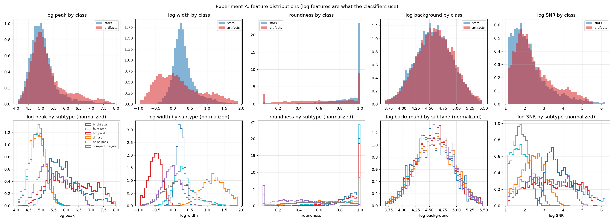
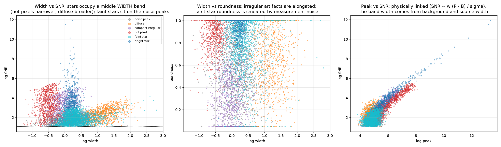
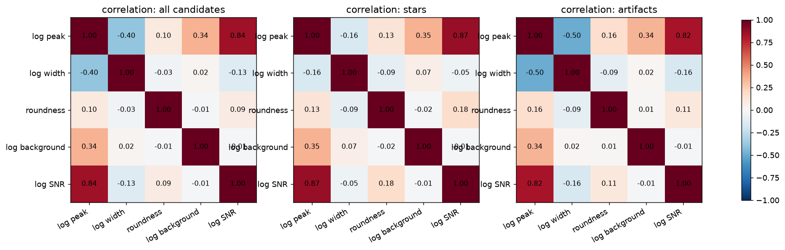

### Where the populations overlap, and why

The best single-feature threshold reaches only **68.7%** (roundness), against **59.9%** for always guessing the majority class. No one cut solves the problem.

- **Faint stars vs noise peaks.** Both are truncated at SNR 3 and pile up just above it: 46% of faint stars and 52% of noise peaks have SNR < 6. Their widths overlap almost completely (58% of noise peaks fall in the stellar band of 0.9–1.8 px). At low SNR, measurement noise smears faint-star roundness down to 0.54 at the 10th percentile. These two are genuinely ambiguous: same truncated SNR, same width, and roundness only weakly informative.
- **Hot pixels vs bright stars on SNR.** 61% of hot pixels have SNR > 20. Only their width separates them.
- **Stars sit in a middle width band.** Hot pixels are narrower and diffuse artifacts broader, so width is informative but **not monotonic**: a single linear threshold on width can't use it. This matters in Experiments B and C.
- **Correlations:** log peak and log SNR correlate at +0.84 (the physical link), log peak and log width at −0.40 (broad sources have lower peaks for the same flux), and log peak and log background at +0.34 (the peak includes the sky).

**Engineering question: why might a classifier ace this synthetic set and fail on real images?**
- **The simulation is the classifier's whole world.** It holds exactly the subtypes I wrote down, Gaussian PSFs and log-normal backgrounds. Real images have PSFs that vary across the field (coma, astigmatism, undersampling), blends and binaries, saturated stars, satellite trails, galaxies, gradients, crosstalk, radiation events with real morphology, and calibration errors. These are artifact types that were never seen (Experiment F's ghosts are one) and conditions outside the training range.
- **The labels here are perfect.** Real labels come from catalogue cross-matching, which has its own errors.
- **Features are measured differently.** A real source extractor's width and roundness estimators have different biases and noise than my formulas.
- **Priors differ.** The star fraction in real fields varies by orders of magnitude with galactic latitude.

High synthetic accuracy mostly shows that the classifier learned *my assumptions*. Shift testing (Experiment F) and validation against real labelled frames are what tell you whether it learned the sky.

## Experiment B: perceptron and logistic regression from scratch

Inputs: the engineered features (log peak, log width, roundness, log background, log SNR), standardized using training data only. Splits: 4000 train / 2000 validation / 4000 test, fixed seeds.

**Perceptron** (`classifiers.Perceptron`): works with any number of features, has a bias, uses the update w ← w + y·x on each mistake, tracks mistakes per epoch, keeps the final weights, and predicts on new data.

| dataset | epochs | mistakes, first → last epoch | train acc | test acc |
|---|---|---|---|---|
| 2 features (log width, roundness), stars vs hot pixels only | 50 | 98 → 97 of 2101 | 0.968 | 0.957 |
| 2 features, all candidates | 50 | 1517 → 1526 of 4000 | 0.556 | 0.556 |
| 5 features, all candidates | 50 | 1481 → 1551 of 4000 | 0.633 | 0.614 |

**Logistic regression** (`classifiers.LogisticRegressionGD`): loss = mean[log(1 + e^z) − yz] using `np.logaddexp`, plus (λ/2)‖w‖² with the bias left unpenalized. Trained by Module 2's gradient descent with step 1/L, where L = λ_max(XᵀX)/(4n) + λ, and λ = 1e-3.
- 2 features: converged in 29 updates, test accuracy **0.720**.
- 5 features: converged in 472 updates, test accuracy **0.705**. The weight is dominated by roundness (+1.11).

**Gradient check** (Module 2's checker): the relative discrepancy is 1e-14 to 1e-8 at four parameter vectors × four step sizes h. Logistic loss is not quadratic, so the typical V-shape appears again: about 3e-6 at h = 1e-2, best around h = 1e-4 to 1e-6, then roundoff grows.

**Against scikit-learn:** `LogisticRegression(C = 1/(nλ) = 0.25, lbfgs, tol = 1e-10)`. sklearn minimises ½‖w‖² + C·Σloss, which is the same objective divided by Cn, and neither leaves the intercept penalized. Results: ‖θ_mine − θ_sk‖ = **1.2e-5**, maximum probability difference 3e-6, **100% identical predictions**, and identical training objective (0.5670596424).

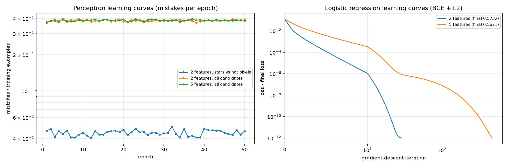
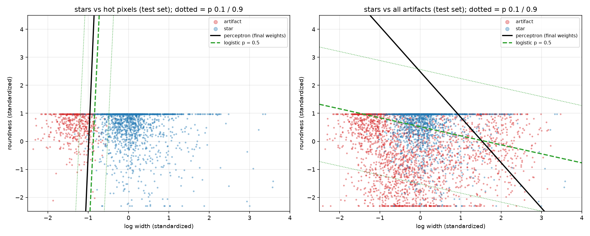
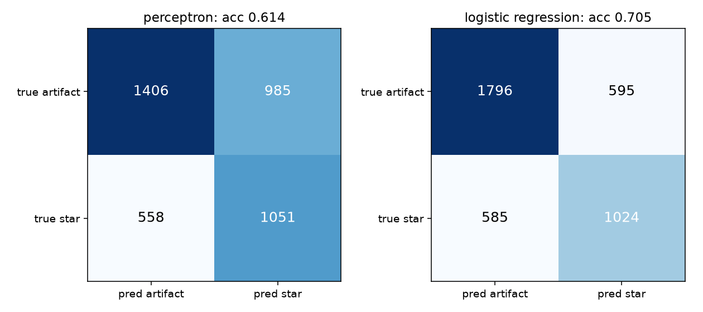

Test confusion matrices with 5 features: perceptron [[1406, 985], [558, 1051]], acc 0.614; logistic [[1796, 595], [585, 1024]], acc 0.705.

**Why the two linear classifiers draw different boundaries.** Both produce a hyperplane wᵀx + b = 0, but they choose it by different criteria.
- **The perceptron** minimises nothing global. It reacts only to the most recent misclassified point. When the classes overlap, the mistakes never stop: the weights keep jumping around, and the "final" vector is whatever the last few mistakes left behind. In the 2-feature all-candidates case that gives a boundary (right panel) that is badly tilted and worse than chance (0.556 vs 0.598 for always guessing artifact). When the data are close to separable (stars vs hot pixels, left panel) the two methods nearly agree.
- **Logistic regression** minimises the average log-likelihood over *all* points, so every point pulls on the boundary according to how wrong it is. The result is unique, stable, and gives probabilities (the dotted p = 0.1 / 0.9 lines).

Same model class, different objectives, so different answers. With overlapping classes that difference is large.

## Experiment C: support vector machines

All inputs standardized with training statistics (scikit-learn `SVC`).

**Part 1 (2D: log width, roundness, linear SVM, C = 1).** The margin width is 1.52 (in standardized units), with 2,782 support vectors (**70%** of the training set); 2,779 of them are bounded (inside the margin or misclassified). The SVM boundary is parallel to the logistic one (the angle between them is 0.2°), but shifted. Test accuracy: SVM 0.693, logistic 0.720. With overlapping classes, almost every point is a support vector, and the hinge loss only cares about points near the margin, so the intercept settles differently from the likelihood-based fit.

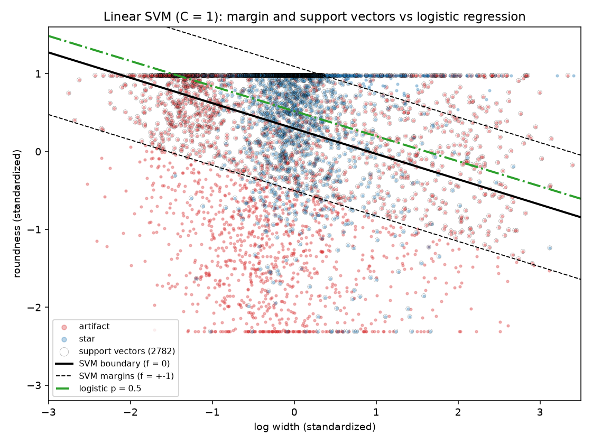

**Part 2 (soft margin):**

| C | 2D train / test | #SV | margin | 5D train / test | #SV |
|---|---|---|---|---|---|
| 0.001 | 0.595 / 0.596 | 3209 | 5.03 | 0.620 / 0.621 | 3212 |
| 0.01 | 0.685 / 0.689 | 2928 | 1.68 | 0.694 / 0.696 | 2853 |
| 0.1 | 0.689 / 0.693 | 2797 | 1.53 | 0.696 / 0.701 | 2724 |
| 1–100 | 0.689 / 0.693 | 2780 | 1.51 | 0.697 / 0.699 | 2703 |

Small C means a wide margin and a heavily regularized fit: at C = 0.001 the boundary is nearly "always artifact". Above C ≈ 0.1 nothing changes. The data are not separable, so no amount of margin-hardening can make the linear model fit better; it only makes it slower to train (3.1 s at C = 100 vs 0.2 s).

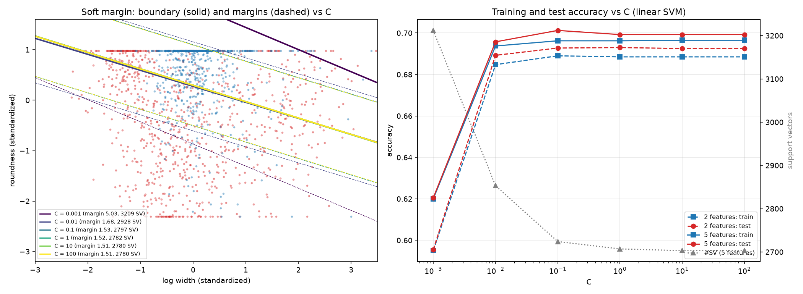

**Part 3 (RBF):** 5-feature validation accuracy, with training accuracy in brackets:

| C \ γ | 0.03 | 0.3 | 3 | 30 |
|---|---|---|---|---|
| 0.1 | 0.759 [0.776] | 0.799 [0.818] | 0.772 [0.790] | 0.614 [0.599] |
| 1 | 0.791 [0.808] | 0.806 [0.825] | 0.800 [0.862] | 0.714 [0.986] |
| 10 | 0.794 [0.817] | **0.809** [0.830] | 0.773 [0.916] | 0.726 [0.999] |
| 100 | 0.795 [0.817] | 0.801 [0.836] | 0.749 [0.960] | 0.728 [1.000] |

The validated model (C = 10, γ = 0.3) reaches **0.820 test accuracy** with 1,664 support vectors. In the 2-D grid figure, small γ gives a smooth elliptical "star region" (round sources of moderate width), while γ = 30 breaks it into islands around individual training points.

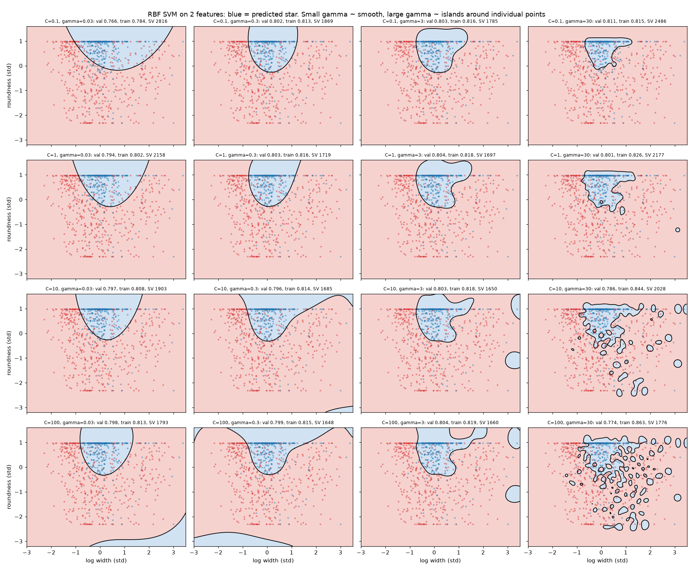

**Engineering question 1: is the gain genuine nonlinearity or fitting peculiarities of the sample?** Mostly genuine:
1. Logistic regression with all 20 squares and products of the 5 features, still a smooth and simple model, jumps from 0.705 to **0.808**. That recovers most of the RBF's 0.820. The physics predicts this: stars occupy a *middle* band of width, between hot pixels and diffuse sources, and a quadratic term in width captures that band.
2. At the validated setting, train and validation accuracy are close (0.830 vs 0.809).
3. Fitting peculiarities looks different: C = 100, γ = 30 gives **100% training accuracy and 0.728 validation accuracy**, which is memorisation. Validation tells the two cases apart.

**Engineering question 2: how does the number of support vectors behave?**
- It **grows roughly linearly with training size, as a fixed fraction** (5 features): linear C = 1 uses 68–70%, validated RBF 42–47%, and overfit RBF 97–100%.
- The fraction tracks how much the classes overlap and how flexible the boundary is. Overlapping points all end up inside the margin. A good kernel moves many points outside it (42% vs 68%), and an overfit kernel makes almost every point a support vector.
- Smaller C (a softer margin) means more support vectors.
- **Operational consequence:** prediction cost grows with the support-vector count. A kernel SVM never gets cheaper with more data (see the cost column in Experiment F).

## Experiment D: nearest neighbours and decision trees

**KNN (own NumPy implementation, brute-force Euclidean distance):** **100.0% identical predictions to scikit-learn** `KNeighborsClassifier(algorithm="brute")` for every k, with ties broken by training index as sklearn does.

| k | 1 | 3 | 5 | 11 | 21 |
|---|---|---|---|---|---|
| train acc | 1.000 | 0.879 | 0.851 | 0.835 | 0.833 |
| val acc | 0.745 | 0.773 | 0.789 | 0.800 | **0.806** |

Feature scaling, validation accuracy at k = 21: raw measured features **0.663**; raw but standardized 0.796; logs, unscaled 0.802; logs, standardized **0.806**. On raw features the standard deviations are peak 1672, SNR 267, background 37, width 1.1 and roundness 0.29, so Euclidean distance is just "peak and SNR distance" and the morphology is ignored. Any distance-based method needs comparable feature scales.

**Decision trees:**

| max_depth | 2 | 4 | 8 | 16 | unrestricted |
|---|---|---|---|---|---|
| leaves | 4 | 16 | 137 | 503 | 622 |
| train acc | 0.780 | 0.819 | 0.866 | 0.972 | 1.000 |
| val acc | 0.774 | **0.795** | 0.783 | 0.751 | 0.738 |

The depth-3 tree (`exp_d_shallow_tree.png`) reads like a hand-written rule:
- **narrow** (log width ≤ −0.12, i.e. < 0.89 px) and **low SNR**: star only if roundness > 0.85;
- **narrow and high SNR**: artifact (hot pixels);
- **wide** (log width > 0.78, i.e. > 2.2 px): artifact (diffuse);
- **in between and round** (> 0.71): star.

Depth-4 feature importance: log width 0.46, roundness 0.44, log SNR 0.10, and **peak and background 0.00**. The tree uses only morphology plus SNR, which hints at Experiment F's best feature set.

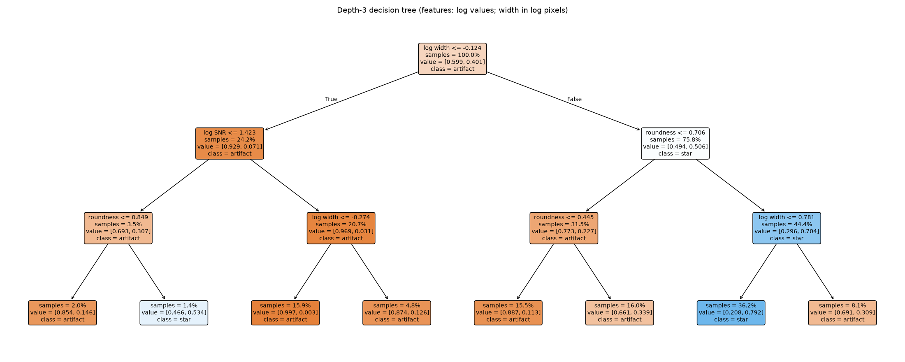

**Part 3, all classifiers on the same held-out test set** (hyperparameters chosen on validation by `model_zoo`):

| classifier | mechanism | acc | bal. acc | precision | recall | F1 | AUC | log loss* | Brier* | fit s | ms / 1000 predictions |
|---|---|---|---|---|---|---|---|---|---|---|---|
| perceptron | mistake-driven updates | 0.614 | 0.621 | 0.516 | 0.653 | 0.577 | 0.652 | 0.643 | 0.226 | 0.49 | 0.04 |
| logistic | Bernoulli maximum likelihood | 0.705 | 0.694 | 0.632 | 0.637 | 0.634 | 0.754 | 0.572 | 0.195 | 0.27 | 0.05 |
| linear SVM | margin, C = 1 | 0.699 | 0.702 | 0.607 | 0.715 | 0.657 | 0.753 | 0.576 | 0.196 | 0.32 | 36† |
| RBF SVM | kernel, C = 1, γ = 1 | **0.817** | **0.818** | **0.748** | **0.822** | **0.783** | 0.880 | 0.425 | 0.135 | 0.23 | 303 |
| KNN | similarity, k = 21 | 0.811 | 0.812 | 0.740 | 0.817 | 0.777 | **0.890** | **0.405** | **0.132** | 0.00 | 74 |
| tree | recursive partitioning, depth 6 | 0.802 | 0.804 | 0.729 | 0.809 | 0.767 | 0.879 | 0.432 | 0.137 | 0.01 | **0.11** |

\* After Platt calibration on validation. † sklearn's `SVC(kernel="linear")` predicts through its 2,700 support vectors; storing w directly would cost about 0.05 ms.

The three nonlinear methods are within about 1.5 points of each other, and all are about 11 points above the linear ones. Most of the gain comes from making the decision boundary nonlinear; the choice of nonlinear algorithm matters much less. `model_zoo`'s RBF grid picked C = 1, γ = 1 (0.817 test) where Experiment C's grid picked C = 10, γ = 0.3 (0.820 test). The two grids differ, and the result is insensitive to the choice.

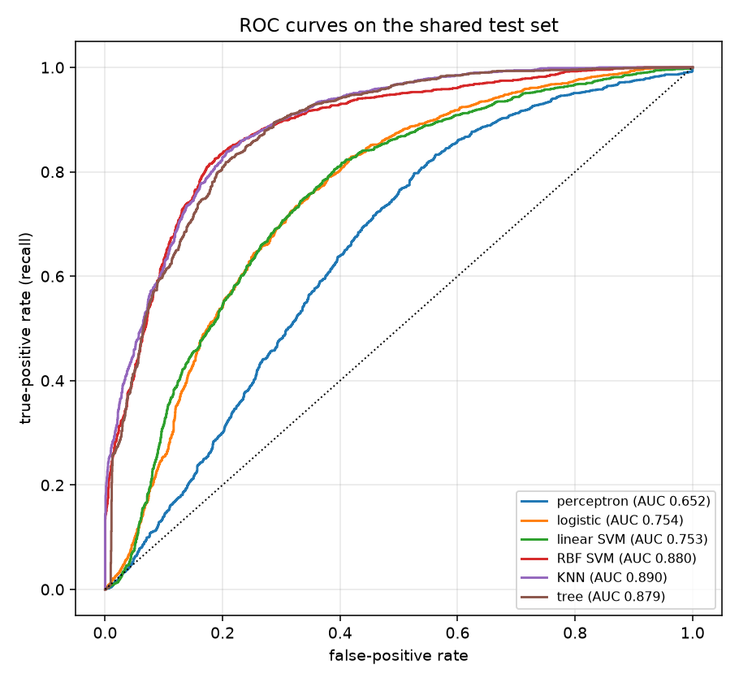

## Experiment E: thresholds and probability calibration

**Logistic-regression threshold sweep (test set, 1,609 stars of 4,000):**

| threshold | precision | recall | FPR | F1 | accepted |
|---|---|---|---|---|---|
| 0.1 | 0.448 | 0.978 | 0.811 | 0.614 | 3513 |
| 0.3 | 0.536 | 0.884 | 0.515 | 0.667 | 2654 |
| 0.5 | 0.632 | 0.637 | 0.250 | 0.634 | 1622 |
| 0.6 | 0.658 | 0.430 | 0.150 | 0.520 | 1051 |
| 0.7 | 0.562 | 0.093 | 0.049 | 0.160 | 267 |

Confusion matrices: at threshold 0.2 [[792, 1599], [93, 1516]]; at 0.5 [[1794, 597], [584, 1025]]; at 0.8 [[2387, 4], [1607, 2]].

**The linear model rarely becomes confident.** Its probabilities almost never exceed 0.8, and precision *falls* above a threshold of 0.65. Its most confident predictions are round but abnormally wide or narrow sources, which are mostly artifacts. A model that can't represent the middle width band can't buy precision by raising the threshold.

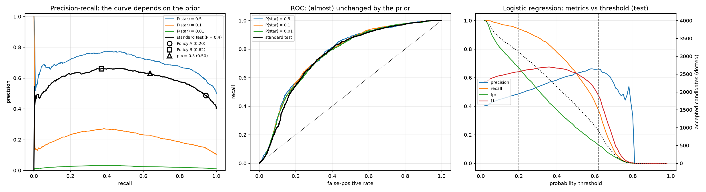

**Operational policies** (thresholds chosen on validation, evaluated once on test):

| model | policy | threshold | test precision | test recall | FPR | stars lost | artifacts passed |
|---|---|---|---|---|---|---|---|
| logistic | A (val recall ≥ 0.95) | 0.20 | 0.487 | 0.942 | 0.669 | 93 | 1599 |
| logistic | B (val precision ≥ 0.90) | **unreachable**: best is 0.62 at val precision 0.67 | 0.660 | 0.371 | 0.128 | 1012 | 307 |
| RBF SVM | A | 0.11 | 0.560 | 0.950 | 0.502 | 80 | 1200 |
| RBF SVM | B | 0.83 | **0.964** | 0.167 | 0.004 | 1340 | 10 |

Neither policy is better in general:
- **A** keeps 95% of stars but passes a large share of artifacts.
- **B** passes almost no artifacts but keeps only about 1 star in 6, mostly the bright ones.

Which one is right depends on what the downstream pattern matcher tolerates better: missing stars, or false stars.

**Class imbalance** (logistic, trained at P(star) = 0.4, threshold 0.5; same class-conditional distributions):

| P(star) | n | recall | FPR | precision | theory: recall·π / (recall·π + FPR·(1−π)) | accepted | AUC | ECE | ECE after prior correction |
|---|---|---|---|---|---|---|---|---|---|
| 0.5 | 3,000 | 0.606 | 0.230 | 0.724 | 0.725 | 1,254 | 0.764 | 0.090 | 0.045 |
| 0.1 | 15,000 | 0.612 | 0.230 | **0.230** | 0.228 | 4,035 | 0.762 | 0.240 | 0.018 |
| 0.01 | 150,000 | 0.600 | 0.239 | **0.025** | 0.025 | 36,412 | 0.757 | 0.316 | **0.0006** |

**Why precision collapses while recall and FPR hold steady.**
- Recall is measured *within* stars and FPR *within* artifacts. Each depends only on its own class-conditional feature distribution, which hasn't changed.
- Precision mixes the two classes. At 1% prevalence, the 23.9% FPR applied to 148,500 artifacts gives about 35,500 false positives, swamping about 900 true positives. Precision goes from 0.72 to 0.025, exactly as predicted.
- The probabilities become wrong too (ECE 0.32), because they still encode the training prior. The Bayes correction, logit(p) + log[π/(1−π)] − log[0.4/0.6], fixes calibration (ECE 0.0006) *if the new prior is known*. It cannot rescue precision: at π = 0.01 even a perfectly calibrated version of this model rarely exceeds p = 0.5.

**Calibration** (test set; Platt calibrators fitted on validation):

| model | log loss | Brier | ECE | actual star fraction when the model says p ∈ [0.85, 0.95] |
|---|---|---|---|---|
| logistic (native) | 0.571 | 0.195 | 0.037 | the model never says this |
| RBF SVM (Platt on margin) | 0.425 | 0.135 | 0.025 | 1.00 of 220 |
| KNN, k = 21 (native vote fraction) | 0.420 | 0.132 | 0.024 | **0.83** of 270 |
| KNN (Platt) | **0.405** | **0.132** | **0.021** | **0.93** of 209 |
| tree (native leaf frequency) | 0.628 | 0.139 | 0.045 | 0.33 of 9 |
| tree (Platt) | 0.432 | 0.137 | 0.020 | none in this bin |

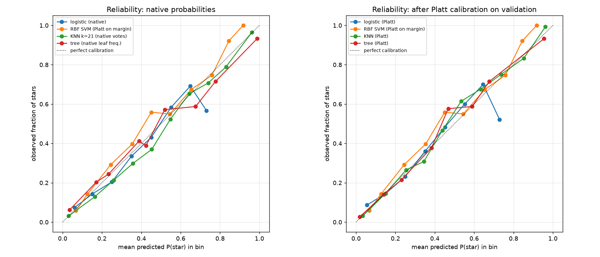

**Does a reported 90% mean 90%?**
- **Logistic regression:** well calibrated on average (ECE 0.037), but it has almost no *resolution*: it never claims 90%. Calibration and usefulness are different properties.
- **KNN's raw vote fractions** are overconfident at the top: "~90%" is right only 83% of the time.
- **The tree's raw leaf frequencies** give a log loss of 0.63, because small pure leaves claim certainty.
- **Platt calibration on a separate validation set** fixes all of them. Calibrated KNN's "90%" is right 93% of the time. The calibration must use data the model was not trained on, otherwise the model's overconfidence on its own training data carries straight into the calibration.

## Experiment F: robustness and distribution shift

All candidates are trained on nominal data and evaluated on new conditions **without retraining**. Each scenario has two independent draws:
- a **selection** draw, used only to choose the system;
- a **final-test** draw, used only for this report.

| scenario | what changes | type |
|---|---|---|
| higher sensor noise | σ × 1.8 | feature shift |
| optical defocus | stellar (and ghost) width × 1.6 | feature shift (stars only) |
| different prevalence | P(star) 0.40 → 0.05 | **prior shift only** |
| brighter background | sky × 6 | feature shift (absolute levels) |
| hot-pixel contamination | hot pixels 20% → 60% of artifacts | mixture shift within the artifact class |
| unseen artifact type | 35% of artifacts are ghosts | new artifact subtype |

Final-test AUC (all 5 features → 3 invariant features):

| scenario | logistic | RBF SVM | KNN | tree |
|---|---|---|---|---|
| nominal | 0.759 → 0.759 | 0.882 → 0.892 | 0.890 → **0.900** | 0.878 → 0.879 |
| higher sensor noise | 0.756 → 0.756 | 0.837 → 0.855 | 0.853 → **0.864** | 0.850 → 0.849 |
| optical defocus | 0.803 → 0.804 | 0.775 → 0.793 | 0.805 → **0.819** | 0.784 → 0.783 |
| different prevalence | 0.775 → 0.775 | 0.879 → 0.886 | 0.891 → **0.898** | 0.872 → 0.878 |
| brighter background | 0.754 → 0.755 | **0.634** → 0.854 | 0.807 → **0.858** | 0.833 → 0.838 |
| hot-pixel contamination | 0.755 → 0.753 | 0.918 → 0.936 | 0.929 → **0.938** | 0.922 → 0.922 |
| unseen artifact type | 0.613 → 0.612 | 0.796 → 0.807 | 0.809 → **0.819** | 0.796 → 0.798 |

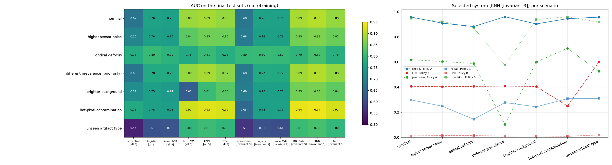

**Prior shift vs feature shift, separated.**
- **Prior shift (prevalence 0.05):** AUC is unchanged (0.898 vs 0.900). The selected system's Policy A recall (0.960) and FPR (0.408) match nominal (0.957 / 0.406), but precision drops from 0.618 to **0.103**, and ECE rises from 0.020 to 0.174. The Bayes prior correction restores calibration (**ECE 0.004**, mean p 0.043 vs true star fraction 0.046). Nothing about *how sources look* changed, only how many of each there are, so the fix is bookkeeping, provided the prior is known.
- **Feature shift:** recall, FPR and AUC themselves move, and no relabelling of probabilities can fix that:
  - **Defocus:** recall falls from 0.957 to **0.882**, mostly faint stars (95% → 86% accepted), whose broadened PSF now looks like diffuse artifacts or ghosts.
  - **Higher noise:** recall falls to 0.909 as faint-star features blur into the noise peaks.
  - **Unseen ghosts:** FPR jumps from 0.41 to **0.60** because **95% of ghosts are accepted**. They are round, roughly stellar in width and faint: the training data never taught the model that such an artifact exists.
- **Hot-pixel contamination is benign:** it shifts the mixture toward the *easiest* artifact type, so AUC goes *up* (0.938) and FPR down (0.249). Not every shift hurts.
- **Brighter background shows why the features matter.** With all five features, every model that uses the absolute background or peak level collapses: RBF SVM AUC 0.634, and KNN [all 5] Policy A FPR 0.82. Those levels move with sky brightness, not with what the source is. The 3-feature set (width, roundness, SNR) is roughly invariant to it, and its brighter-background AUC stays at 0.858.

**Unlabelled shift monitor** (computable on real data, where there are no labels):

| scenario | log peak | log width | roundness | log background | log SNR | outside training range |
|---|---|---|---|---|---|---|
| nominal | −0.01 | −0.00 | +0.00 | −0.01 | −0.01 | 4.0% |
| higher sensor noise | +0.27 | +0.09 | −0.04 | +0.01 | −0.05 | 5.7% |
| optical defocus | −0.11 | **+0.38** | −0.02 | −0.02 | −0.01 | 6.6% |
| different prevalence | +0.05 | −0.08 | **−0.30** | +0.01 | +0.04 | 4.2% |
| brighter background | **+1.97** | +0.13 | −0.05 | **+5.20** | −0.07 | **99.8%** |
| hot-pixel contamination | +0.39 | −0.38 | +0.27 | +0.02 | +0.28 | 4.5% |
| unseen artifact type | −0.13 | +0.19 | +0.17 | +0.02 | −0.11 | **3.8%** |

The monitor catches the background shift loudly and the defocus moderately, but **the unseen ghosts are invisible to it** (3.8% outside the range, against 4.0% at nominal). A new artifact class that falls *inside* the training feature ranges can't be caught by checking whether inputs look familiar. Only labelled spot-checks or downstream consistency checks will find it.

---

# Final technical report: candidate-star classifier

### Selected classifier

**KNN, k = 51, on 3 features (log width, roundness, log SNR)**, standardized with training statistics, with Platt-calibrated probabilities. The full specification is written to `outputs/star_classifier.json`. Rebuilding from scratch reproduces it exactly (maximum probability difference **0.0**).

### How it was selected (validation only; the final test sets were never used)

The 12 pipelines (6 classifiers × 2 feature sets) are scored on held-out **selection** sets, which no model or calibrator was fitted on:

**robust log loss = ½ × (nominal log loss) + ½ × (mean log loss over the 5 feature-shift scenarios)**

Eligibility requires nominal ECE ≤ 0.05 and prediction cost ≤ 1000 ms per 1000 candidates; a candidate within 1% of the best and cheaper would be preferred. Log loss rewards ranking and honest probabilities together, and including the shift scenarios rewards robustness.

| pipeline | nominal AUC | nominal log loss | ECE | shift log loss | worst shift AUC | robust log loss | ms / 1000 |
|---|---|---|---|---|---|---|---|
| **KNN [invariant 3]** | **0.892** | **0.398** | **0.016** | **0.451** | **0.812** | **0.424** | 85 |
| RBF SVM [invariant 3] | 0.887 | 0.418 | 0.030 | 0.475 | 0.787 | 0.447 | 254 |
| KNN [all 5] | 0.882 | 0.419 | 0.021 | 0.487 | 0.802 | 0.453 | 89 |
| tree [invariant 3] | 0.875 | 0.437 | 0.029 | 0.475 | 0.783 | 0.456 | **0.1** |
| tree [all 5] | 0.873 | 0.447 | 0.029 | 0.483 | 0.784 | 0.465 | 0.1 |
| RBF SVM [all 5] | 0.874 | 0.431 | 0.022 | 0.551 | 0.634 | 0.491 | 302 |
| logistic [either] | 0.75 | 0.57 | 0.04 | 0.59 | 0.61 | 0.58 | 0.0 |

**Runner-up worth knowing about:** the depth-6 tree on the same three features is about 7% worse on robust log loss but **850× cheaper** at 0.1 ms per 1000 candidates, needs no stored training set, and is readable. If the classifier must run on flight hardware, it is the better engineering choice, and the selection rule's cost limit is the place to encode that.

### Decision thresholds (chosen on validation)

| policy | threshold | final test, nominal: recall | FPR | precision | intended use |
|---|---|---|---|---|---|
| **A, high recall** | p ≥ **0.15** | **0.957** | 0.406 | 0.618 | the matcher tolerates false stars, missing stars are costly |
| **B, high precision** | p ≥ **0.80** | 0.298 | **0.011** | **0.948** | the matcher needs a clean list, can live with fewer stars |

### Assumptions

1. The **simulated feature model is correct**: Gaussian PSFs, the listed artifact subtypes, background-dominated noise, an SNR ≥ 3 detection threshold, and the measurement-noise formulas.
2. **Labels are perfect.**
3. **Training prior P(star) = 0.4.** Probabilities are calibrated for that prior. Use `proba_for_prior()` when the expected star fraction differs.
4. **Imaging conditions near nominal**, especially PSF width and noise level. The background level itself doesn't matter, by design of the feature set.

### Failure modes (measured on final-test sets)

| condition | effect on Policy A | cause |
|---|---|---|
| unseen artifact (ghosts) | FPR 0.41 → **0.60**; 95% of ghosts accepted | round, near-stellar width; outside the training classes but inside the feature ranges; **not detected by the input monitor** |
| optical defocus × 1.6 | recall 0.957 → **0.882** (faint stars 95% → 86%) | broadened stars resemble diffuse artifacts; ECE 0.090 |
| sensor noise × 1.8 | recall → 0.909 | faint stars blur into noise peaks |
| prevalence 0.05 | precision 0.618 → **0.103** | prior shift: recall and FPR unchanged; fix probabilities with the prior correction, revisit the policy |
| brighter background × 6 | recall 0.903, FPR 0.405: **robust** | invariant features (the all-5 version reached FPR 0.82) |
| hot-pixel-rich frames | better (FPR 0.25) | the mixture shifts toward the easiest artifact |

### Limitations

- Faint stars and noise peaks overlap in every feature. The nominal AUC of 0.90 is probably close to the ceiling for these 5 features: no algorithm reached much higher, and adding information (multi-frame persistence, colour, PSF-fit χ²) would help more than another classifier.
- KNN keeps the 4,000 training points and costs about 85 ms per 1000 candidates. That is acceptable on the ground but heavy for an embedded star tracker, where the tree is the fallback.
- The calibration and thresholds are only as valid as the conditions they were fitted under. They must be refreshed whenever the monitor flags a shift.
- Everything here is synthetic. Before operational use, the system must be validated on real labelled frames, ideally from the target camera across its range of focus, temperature and sky brightness.

### Recommended operating procedure

1. Run the unlabelled shift monitor on every frame batch and alarm on large feature shifts.
2. Use `proba_for_prior()` when the field's expected star density is known.
3. Choose Policy A or B according to what the downstream geometric matcher tolerates; that trade-off is evaluated in a later module.
4. Periodically spot-check accepted sources against a star catalogue. That is the only defence against unseen artifact types such as ghosts.
