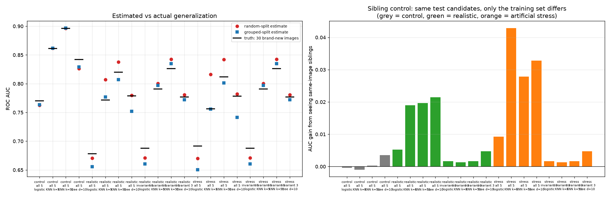
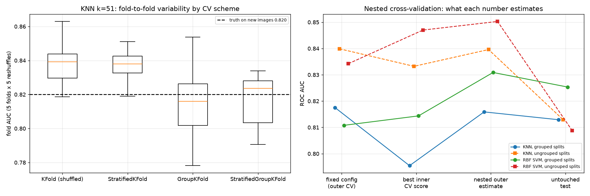
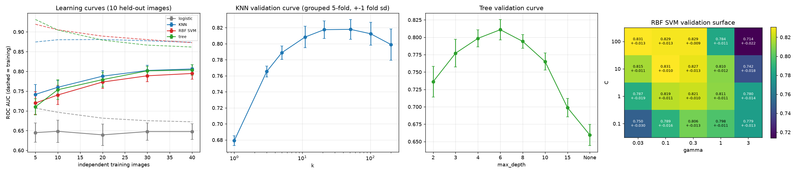
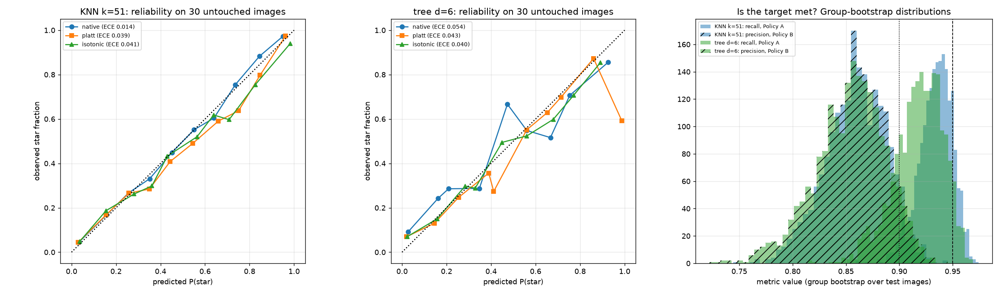
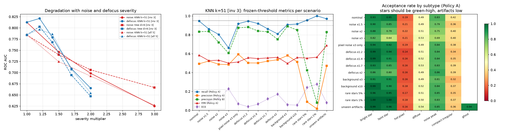

# Module 5: Grouped Evaluation, Cross-Validation, and Reliable Operating Points

All numbers come from `python run_all.py` (about 17 minutes; the SVM grids in Experiments B and C take most of it). The full console output is saved in `outputs/run_all_output.txt`.
The grouped generator reuses the Module 4 feature model (`../module-4/star_data.py`). The classifiers and metrics reuse Module 4's `classifiers.py`, including the from-scratch logistic regression trained with Module 2's gradient descent.

| File | Purpose |
|---|---|
| `grouped_data.py` | `generate_grouped_candidates()`: per-image conditions, nuisance signature, optional artificial stress mechanism, scenario knobs; fixed development set (50 images) and **untouched test set (30 images)** |
| `ml_tools.py` | `Pipeline` (engineered features → training-only standardization → model), grouped/random split helpers, metrics |
| `exp_a_leakage.py` | A: random vs grouped splits, new-image truth, sibling control |
| `exp_b_cross_validation.py` | B: own `kfold_indices` with tests, KFold / Stratified / Group / StratifiedGroup comparison, nested CV, selection-optimism check |
| `exp_c_learning_curves.py` | C: learning curves in images, validation curves, selection stability over 10 development sets |
| `exp_d_thresholds_calibration.py` | D: thresholds from calibration images, native/Platt/isotonic calibration by condition, strict nested calibration, group bootstrap |
| `exp_e_shift_failure.py` | E: 14 scenarios with severity ladders, frozen thresholds, subtype acceptance, failure report |

**Note on the problem set:** the screenshots I worked from stop part-way through Experiment D Part 3 (the group bootstrap) and Experiment E's error analysis. I implemented both from the visible text: bootstrap intervals for recall, precision and FPR, and a failure report by source subtype. If there were further requirements below the cut, they are not covered here.

---

## Experiment A: data leakage and grouped evaluation

### Part 1: the grouped generator

Each image *j* draws shared conditions **g_j**, and every candidate is generated from **x_ij = f(source_ij, g_j, ε_ij)**:

| image variable | distribution | realistic or artificial? |
|---|---|---|
| focus offset | stellar PSF width × exp(N(0, 0.20)) | **realistic**: focus and temperature differ between exposures |
| background | sky × exp(N(0, 0.35)) per image; candidates in one image scatter only exp(N(0, 0.05)) around it | **realistic**: one sky level per frame |
| noise scale | × exp(N(0, 0.15)) | **realistic**: gain and readout conditions |
| PSF shape | ellipticity U(0, 0.20) subtracted from every star's roundness | **realistic**: optical aberration shared across the frame |
| measurement bias | measured widths × exp(N(0, 0.08)); roundness + N(0, 0.05) | **realistic**: plate-scale and moment-estimator calibration error per frame |
| star fraction | U(0.10, 0.70) per image | **realistic**: field density varies with pointing |
| artifact mix | Dirichlet(8 × base mix) per image | **realistic**: hot pixels with temperature, diffuse glow with moonlight |
| **batch code** (`stress=True`) | the reported background × exp(N(0, 0.6)), random per image | **artificial**: a planted image identifier, meaningful only for images the model has seen |

The image's **nuisance signature** (shared sky, width calibration and PSF shape) lets a model partly recognise which image a candidate came from. Because star fractions differ by image, recognising the image is worth something, but only for images already seen. The `group_effects=False` **control** removes all image structure.

My first parameter choice was too weak: random and grouped splits differed by under 0.01 AUC. Before strengthening the effects, I also had the stress mechanism wrong. It made the background a *fixed function* of the star fraction, which is a genuine pattern that holds on new images too, so it isn't leakage. A leakage shortcut has to be a *random* per-image code. Both are fixed above.

The realistic development set has 50 images, 7,616 candidates, and per-image star fractions from 0.11 to 0.70.

### Part 2: random vs grouped split (realistic data, all 5 features, 20 seeds)

Each grouped split holds out whole images until about 30% of candidates are in the test set. The random split uses the same test size. "New images" means the model was trained on all 50 development images and tested on the **30 untouched images**: the quantity both strategies are trying to estimate.

| quantity | KNN k=5: random | KNN k=5: grouped | KNN k=5: new images | KNN k=51: random | KNN k=51: grouped | KNN k=51: new images |
|---|---|---|---|---|---|---|
| training accuracy | 0.827 | 0.834 | – | 0.771 | 0.778 | – |
| test accuracy | 0.747 (0.006) | 0.720 (0.012) | 0.724 | 0.761 (0.006) | 0.732 (0.018) | 0.751 |
| ROC AUC | **0.807** (0.007) | **0.777** (0.009) | **0.772** | 0.838 (0.007) | 0.807 (0.013) | 0.820 |
| precision | 0.671 | 0.650 | 0.625 | 0.712 | 0.685 | 0.675 |
| recall | 0.630 | 0.595 | 0.576 | 0.604 | 0.564 | 0.588 |
| Brier score | 0.174 | 0.193 | 0.191 | 0.159 | 0.173 | 0.163 |
| test star fraction | 0.373 ± 0.007 | 0.384 ± 0.030 | – | same | same | – |
| independent test images | **0** (all 50 also in training) | **15.6** | 30 | 0 | 15.6 | 30 |

| quantity | logistic: random | logistic: grouped | logistic: new | tree d=10: random | tree d=10: grouped | tree d=10: new |
|---|---|---|---|---|---|---|
| test accuracy | 0.645 | 0.629 | 0.660 | 0.734 | 0.707 | 0.740 |
| ROC AUC | 0.670 | 0.656 | 0.678 | 0.780 | 0.752 | 0.779 |
| precision / recall | 0.543 / 0.308 | 0.536 / 0.295 | 0.541 / 0.337 | 0.651 / 0.621 | 0.626 / 0.600 | 0.661 / 0.561 |
| Brier score | 0.214 | 0.221 | 0.209 | 0.197 | 0.218 | 0.190 |

For KNN with k = 5, the grouped AUC was lower than the random AUC in **100% of the 20 seeds**.

**AUC summary and the sibling control.** The sibling control holds the same test images out, splits their candidates 50/50, and puts half of them ("siblings") into training for one model but not the other, at equal training size. Both models are scored on **the same test candidates**, so composition and difficulty cannot differ:

| data | features | model | random | grouped | new images | sibling gain (pure leakage) |
|---|---|---|---|---|---|---|
| control | all 5 | KNN k=5 | 0.862 | 0.862 | 0.861 | −0.001 |
| control | all 5 | tree d=10 | 0.826 | 0.829 | 0.842 | +0.004 |
| realistic | all 5 | KNN k=5 | 0.807 | 0.777 | 0.772 | **+0.019** |
| realistic | all 5 | KNN k=51 | 0.838 | 0.807 | 0.820 | **+0.020** |
| realistic | all 5 | tree d=10 | 0.780 | 0.752 | 0.779 | **+0.021** |
| realistic | invariant 3 | KNN k=5 | 0.800 | 0.797 | 0.791 | +0.001 |
| realistic | invariant 3 | KNN k=51 | 0.843 | 0.835 | 0.826 | +0.002 |
| stress | all 5 | KNN k=5 | 0.816 | 0.756 | 0.756 | **+0.043** |
| stress | all 5 | tree d=10 | 0.782 | 0.742 | 0.779 | **+0.033** |
| stress | invariant 3 | (any) | — same as realistic invariant 3 — | | | ~0 |

### Findings

1. **Leakage needs a channel.**
   - With no image structure (control), every estimate agrees and the sibling gain is zero.
   - With realistic image structure and all 5 features, seeing siblings from the same image is worth about **+0.02 AUC**. The artificial batch code doubles that.
   - With Module 4's invariant features (no background, no peak), the gain almost vanishes (+0.001 to +0.005). The absolute sky level was the main image fingerprint. Removing it closes most of the leak, and the artificial code becomes irrelevant because it lives in the background feature.
2. **Random splitting is optimistic exactly where leakage exists:** +0.036 AUC for KNN k=5 against new-image truth, and +0.060 under stress. Grouped splitting matches the truth for KNN k=5 (0.777 vs 0.772).
3. **Grouped splits are noisier and slightly pessimistic.** Test star fraction varies 4× more across seeds (sd 0.030 vs 0.007), and fold scores vary more, because there are only about 15 independent test images. Grouped training uses only about 35 images, while the new-image model uses 50; Experiment C shows how strongly AUC depends on image count. So the grouped estimate can fall *below* the truth (tree: 0.752 vs 0.779).

**Engineering question: does a higher random-split accuracy prove the classifier learned the wrong thing?** No. A gap between random and grouped splits mixes three effects:
- **leakage**: test candidates share images with training candidates;
- **training size**: grouped training sets contain fewer independent images;
- **composition**: grouped test sets have different, more variable star fractions and conditions.

The gap alone can't separate these. The sibling control can: it holds the test candidates fixed and changes only whether same-image siblings were in training. That is how we know the realistic all-5 gap is about +0.02 of genuine leakage, and that with invariant features the remaining gap is mostly training size and composition. Even when leakage exists, the classifier is not "wrong". It is using image identity, which is real information *for images it has seen*. It is useless for new images, and those are the only ones that matter operationally.

## Experiment B: K-fold and nested cross-validation

**Part 1: own `kfold_indices(n, k, seed, shuffle)`.** All checks pass for (n, k) = (10, 3), (101, 5), (7616, 5), (50, 50) and (13, 4), with and without shuffling:
- every observation appears in a validation fold exactly once;
- training and validation indices are disjoint and together cover all n;
- fold sizes differ by at most 1;
- the folds are **identical to scikit-learn's `KFold`**, because shuffling uses the same `RandomState(seed)` permutation;
- k > n is rejected with a `ValueError`.

**Part 2: KNN k=51 (all 5 features), 5 folds × 5 reshuffles.** The truth on 30 new images is AUC **0.820**.

| splitter | mean AUC | fold sd | min–max over 25 folds | validation star-fraction sd | validation images also in training |
|---|---|---|---|---|---|
| KFold (shuffled) | 0.837 | 0.011 | 0.819–0.863 | 0.006 | **50 of 50** |
| StratifiedKFold | 0.837 | 0.007 | 0.819–0.851 | 0.000 | 50 of 50 |
| GroupKFold | **0.816** | **0.018** | 0.778–0.854 | **0.082** | 0 |
| StratifiedGroupKFold | **0.817** | 0.012 | 0.791–0.834 | 0.016 | 0 |

- **The non-grouped schemes overestimate by about 0.017** and look deceptively precise: low fold-to-fold spread, because every fold contains every image.
- **The grouped schemes land on the truth** but vary more from fold to fold.
- **StratifiedGroupKFold is the best compromise:** it balances star fraction across folds (sd 0.016 instead of 0.082) and so cuts the fold spread by about a third.

**Part 3: nested CV.** 5 outer × 3 inner folds. Preprocessing is fitted inside every fit, on the training rows only. Metric: ROC AUC.

| family, splits | fixed config (outer CV) | best inner-CV score | nested outer estimate | selected on all dev data | **untouched test** |
|---|---|---|---|---|---|
| KNN, grouped | 0.818 (k = 21) | 0.795 | **0.816 ± 0.011** | k = 21 | **0.813** |
| KNN, ungrouped | 0.840 | 0.833 | 0.840 ± 0.008 | k = 21 | 0.813 |
| RBF SVM, grouped | 0.811 (C = 1, γ = 1) | 0.814 | **0.831 ± 0.011** | C = 10, γ = 0.1 | **0.825** |
| RBF SVM, ungrouped | 0.834 | 0.847 | 0.850 ± 0.012 | C = 100, γ = 0.3 | 0.809 |

- **Grouped nested CV predicts the untouched test closely:** 0.816 vs 0.813 for KNN, 0.831 vs 0.825 for SVM.
- **Ungrouped nested CV is optimistic** (by 0.027 and 0.041), and it also **chooses worse hyperparameters.** For the SVM it picks C = 100 with larger γ, which exploits within-image structure: 0.809 on new images, against 0.825 for the grouped choice. Leakage contaminates the *selection* as well as the score.
- **Tuning pays off for the SVM:** the grouped-selected SVM (0.825) beats the fixed default configuration (0.814) on the untouched test.

**Engineering question: why can the best inner-CV score exceed the outer estimate?**
- **The theory:** the maximum of several noisy scores is biased upward (the "winner's curse"). Picking the best of many configurations on the same folds selects partly for luck, and the outer fold, never used for selection, removes that bias. That is the central purpose of nested CV.
- **What happened here:** the best inner score came out *below* the outer estimate (0.795 vs 0.816 for grouped KNN). A second effect is larger: inner models train on only about 53% of the development images, outer models on about 80%. With grouped data, AUC rises steeply with the number of images, so the training-size effect (about −0.02) outweighs the selection optimism.
- **Measuring the selection optimism directly:** I separated the two effects by scoring the *same* fold models on independent development images:

  | development subset | best CV score | same k on independent images | gap, chosen k | gap, averaged over all k | **selection optimism** |
  |---|---|---|---|---|---|
  | 10 images | 0.764 | 0.741 | +0.023 | +0.015 | **+0.008 ± 0.001** |
  | 25 images | 0.792 | 0.783 | +0.009 | +0.006 | **+0.003 ± 0.001** |

  The selection optimism is real, but it shrinks as the data grows. With a smooth KNN curve and 50 images it is too small to see under the training-size effect. With smaller data, a bigger grid or a noisier metric, it dominates, which is why the outer fold must never be used for selection.

## Experiment C: learning curves, validation curves and selection stability

**Learning curves** in independent images (10 held-out images, 10 repeats; training AUC / held-out AUC):

| training images (≈ candidates) | logistic | KNN k=21 | RBF SVM | tree d=6 |
|---|---|---|---|---|
| 5 (777) | 0.707 / 0.645 | 0.874 / 0.742 | 0.919 / 0.720 | 0.931 / 0.710 |
| 10 (1,514) | 0.696 / 0.648 | 0.880 / 0.760 | 0.905 / 0.740 | 0.905 / 0.754 |
| 20 (3,039) | 0.681 / 0.639 | 0.881 / 0.788 | 0.889 / 0.773 | 0.879 / 0.779 |
| 30 (4,544) | 0.675 / 0.648 | 0.877 / 0.802 | 0.880 / 0.789 | 0.867 / 0.801 |
| 40 (6,079) | 0.672 / **0.648** | 0.874 / **0.806** | 0.873 / **0.795** | 0.862 / **0.804** |

- **Logistic regression is limited by capacity.** Training and held-out curves are flat and close together (0.67 / 0.65), so more data can't help a model that can't represent the middle band of stellar widths.
- **The nonlinear models are still data-limited.** Held-out AUC keeps rising (KNN 0.742 → 0.806), with a large train–test gap at 5 images that closes steadily. More images would still help, with diminishing returns after about 30.
- **Independent images matter more than raw candidate count.** With the same 1,514 candidates, spreading them over 40 images instead of 10 whole images improves held-out AUC by **+0.029 (KNN), +0.030 (SVM) and +0.020 (tree)**, winning in 80–90% of repeats. Logistic regression, being capacity-limited, gains nothing. Each image adds a new set of environmental conditions, whereas extra candidates from an image already in the set mostly repeat it.

**Validation curves** (StratifiedGroupKFold(5), mean ± fold sd):
- **KNN:** AUC rises from k = 1 (0.679) and k = 3 (0.765) to a plateau at **k = 21–51 (0.818 ± 0.012)**, then falls to 0.799 at k = 201.
- **Tree:** depth 4 gives 0.798 and **depth 6 gives 0.811 ± 0.015**; deeper trees overfit sharply (depth 15: 0.699; unlimited: 0.660).
- **RBF SVM:** a broad ridge from C = 10–100 with γ = 0.03–0.3 peaks at **0.831 ± 0.010**. Large γ with large C overfits (0.714).

**Selection stability**: the full selection procedure repeated on 10 independently generated 50-image development sets:

| family | configurations selected (out of 10) | best CV score | untouched-test AUC | sd over datasets | per-image AUC | **per-image sd** | **worst-10% image** |
|---|---|---|---|---|---|---|---|
| KNN | **k = 51 × 10** | 0.822 | 0.816 | 0.0062 | 0.824 | **0.073** | **0.729** |
| RBF SVM | (C = 10, γ = 0.1) × 8, (1, 0.1) × 1, (100, 0.1) × 1 | 0.831 | 0.817 | 0.0060 | 0.824 | 0.082 | 0.713 |
| tree | depth 6 × 8, depth 4 × 2 | 0.808 | 0.800 | 0.0072 | 0.803 | 0.081 | 0.685 |

**Should stability influence the engineering decision? Yes.** KNN and the RBF SVM have practically identical mean AUC on new images (0.816 vs 0.817), but KNN is more stable on every other axis:
- the same hyperparameter on all 10 development sets;
- a smaller spread across images, i.e. imaging environments (sd 0.073 vs 0.082);
- a better worst-case image (0.729 vs 0.713);
- and, from Module 4, more robust under shift, with no γ that needs re-tuning when conditions change.

The SVM's higher CV score (0.831) partly reflects selecting from a larger grid; on new images it is no better. When mean performance is tied, the model whose behaviour you can predict is the better engineering choice: its validation numbers transfer more reliably, and its worst images are less bad.

## Experiment D: operational thresholds, calibration and uncertainty

**Setup** (all splits by image):
- **Models:** Module 4's KNN (k = 51, invariant features), and a depth-6 tree as the alternative.
- **Fit images:** 30 development images (4,627 candidates) train the classifier.
- **Calibration images:** the other 20 (2,989 candidates) fit the calibrators and choose the thresholds.
- **Test images:** the **30 untouched images** (4,631 candidates) are scored once.

### Part 1: do the targets hold on independent images?

| model | policy | threshold | calibration images | **untouched test** | target met on test? | test images meeting target |
|---|---|---|---|---|---|---|
| KNN | A (recall ≥ 0.95) | 0.19 | recall 0.955 | recall **0.934** | **no** | 70% |
| KNN | B (precision ≥ 0.90) | 0.76 | precision 0.914 | precision **0.860** | **no** | 43% |
| tree | A | 0.23 | recall 0.951 | recall **0.917** | no | 53% |
| tree | B | 0.72 | precision 0.891 (target unreachable) | precision 0.854 | no | 50% |

Thresholds chosen on 20 calibration images meet the targets on those images *by construction*, then miss them on new images by 1.5–4 points. Even where a target holds overall, it holds in only 43–70% of individual images. Re-tuning the thresholds on the test set itself would "meet" the targets (A at 0.15, B at 0.80), and would prove nothing about new images.

### Part 2: calibration

| model | probabilities | Brier | log loss | ECE | ECE by defocus tercile (low / mid / high) | ECE by sky tercile |
|---|---|---|---|---|---|---|
| KNN | native (vote fraction) | 0.162 | 0.501 | **0.014** | 0.063 / 0.044 / 0.027 | 0.039 / 0.052 / 0.068 |
| KNN | Platt | 0.164 | **0.487** | 0.039 | 0.092 / 0.029 / 0.033 | 0.067 / 0.078 / 0.037 |
| KNN | isotonic | 0.165 | 0.492 | 0.041 | 0.096 / 0.040 / 0.035 | 0.069 / 0.078 / 0.037 |
| tree | native (leaf frequency) | 0.171 | **0.811** | 0.054 | **0.153** / 0.040 / 0.045 | 0.095 / 0.081 / 0.071 |
| tree | Platt | 0.172 | 0.525 | 0.043 | 0.140 / 0.071 / 0.035 | 0.081 / 0.087 / 0.062 |
| tree | isotonic | 0.169 | 0.517 | 0.040 | 0.135 / 0.032 / 0.056 | 0.076 / 0.084 / 0.052 |

- **Calibration helps when the native probabilities are badly overconfident.** The tree's pure leaves claim certainty: its log loss is 0.81 natively and about 0.52 after calibration.
- **It can hurt when they are already reasonable.** KNN-51's vote fraction is nearly calibrated (ECE 0.014). Platt and isotonic, fitted on only 20 images, *raise* ECE to about 0.04: they learn the quirks of those particular images, the same image-level variance seen everywhere else in this module.
- **Calibration is not uniform across conditions.** Error is largest in the low-defocus tercile for both models (KNN Platt 0.092, tree native 0.153). Sharp images make stars narrower and harder to tell from compact artifacts, so a single global calibration curve can't be right for every imaging condition.

**Strict nested evaluation.** Calibration and threshold selection happen *inside* each outer-training portion of a grouped 5-fold CV: 70% of the outer-training images fit the model and 30% calibrate it. The outer fold is never touched until scoring.

| outer fold | 0 | 1 | 2 | 3 | 4 | mean |
|---|---|---|---|---|---|---|
| ECE native / Platt | 0.039 / 0.047 | 0.036 / 0.037 | 0.025 / 0.024 | 0.035 / 0.069 | 0.028 / 0.047 | 0.032 / 0.045 |
| recall at Policy A | 0.972 | 0.961 | 0.950 | 0.952 | 0.976 | **0.962** (≥ 0.95 in 80% of folds) |
| precision at Policy B | 0.973 | 0.877 | 0.901 | 0.774 | 0.869 | **0.879** (≥ 0.90 in 40% of folds) |

This is the honest estimate of the whole procedure (fit, calibrate, choose threshold): Policy A usually works, and Policy B usually doesn't.

### Part 3: group-level bootstrap

2,000 resamples of the 30 test images, with thresholds frozen:

| model | policy | metric | point | **group bootstrap 95% CI** | width | naive candidate bootstrap CI | width | P(target met) |
|---|---|---|---|---|---|---|---|---|
| KNN | A | recall | 0.934 | [0.900, 0.961] | 0.061 | [0.921, 0.945] | 0.024 | 15% |
| KNN | A | precision | 0.490 | [0.431, 0.549] | 0.119 | [0.472, 0.508] | 0.036 | – |
| KNN | A | FPR | 0.541 | [0.501, 0.576] | 0.076 | [0.523, 0.559] | 0.036 | – |
| KNN | B | recall | 0.259 | [0.226, 0.287] | 0.062 | [0.239, 0.281] | 0.042 | – |
| KNN | B | precision | 0.860 | [0.799, 0.910] | 0.111 | [0.828, 0.890] | 0.062 | 6% |
| KNN | B | FPR | 0.024 | [0.016, 0.031] | 0.014 | [0.018, 0.029] | 0.011 | – |
| tree | A | recall | 0.917 | [0.867, 0.955] | 0.088 | [0.904, 0.930] | 0.027 | 6% |
| tree | B | precision | 0.854 | [0.779, 0.910] | 0.131 | [0.821, 0.886] | 0.065 | 7% |

- **Image-level resampling gives intervals 1.3–3.3× wider than resampling candidates.** Candidates in the same image are not independent: they share focus, sky, calibration and star density. The real sample size is closer to 30 images than to 4,631 candidates.
- **The naive bootstrap is dangerously overconfident.** Its interval for KNN's Policy-A recall, [0.921, 0.945], would wrongly suggest the target is safely nearly met.
- **Reading the group-bootstrap result:** recall ≥ 0.95 holds in only 15% of resamples, and the 95% interval runs from 0.900 to 0.961. "Recall ≥ 0.95" cannot currently be claimed. To *demonstrate* a target you need many more independent images, or a threshold with margin, chosen so that the *lower* confidence bound clears the target.

## Experiment E: noise, shift and failure analysis

**Setup:**
- **Frozen system:** the models and thresholds from Experiment D (KNN k=51 on the invariant features: Policy A at 0.19, Policy B at 0.76). The tree and an all-5-feature KNN are included as contrasts.
- **Scenario data:** each scenario is **30 new images** with the development data's own per-image variation plus the perturbation.

### Modelling note: two kinds of noise

Raising pixel noise *alone* barely hurts (AUC 0.803 vs 0.813 nominal). Faint stars fall below the SNR-3 detection threshold, so the surviving candidates are *brighter* and easier. That is a real detection selection effect.

Lost class separation requires noisier *feature measurements*: width and roundness estimated less precisely at the same SNR, for example from pointing jitter or poorer centroiding. The "noise ×k" scenarios therefore scale both the pixel noise and the feature scatter, and "pixel noise ×3 only" isolates the selection effect.

### Results for the frozen KNN k=51 on invariant features

| scenario | P(star) | AUC | recall A | precision A | FPR A | recall B | precision B | ECE | outside training range (inv / all 5) |
|---|---|---|---|---|---|---|---|---|---|
| nominal | 0.375 | **0.813** | 0.946 | 0.493 | 0.584 | 0.256 | 0.834 | 0.039 | 2.0% / 4.1% |
| noise ×1.5 | 0.401 | 0.746 | 0.861 | 0.523 | 0.526 | 0.190 | 0.836 | 0.098 | 4.5% / 10.7% |
| noise ×2 | 0.386 | 0.698 | 0.804 | 0.488 | 0.532 | 0.170 | 0.720 | 0.128 | 6.3% / 7.7% |
| **noise ×3** | 0.415 | **0.625** | **0.663** | 0.484 | 0.501 | 0.117 | 0.606 | **0.228** | 16.0% / 19.5% |
| pixel noise ×3 only | 0.449 | 0.803 | 0.918 | 0.594 | 0.513 | 0.196 | 0.875 | 0.068 | 3.0% / 10.7% |
| defocus ×1.2 | 0.373 | 0.821 | 0.946 | 0.503 | 0.557 | 0.245 | 0.881 | 0.039 | 2.3% / 9.0% |
| defocus ×1.4 | 0.375 | 0.779 | 0.920 | 0.502 | 0.549 | 0.211 | 0.841 | 0.066 | 2.5% / 3.6% |
| defocus ×1.7 | 0.413 | 0.709 | 0.863 | 0.522 | 0.555 | 0.147 | 0.832 | 0.121 | 3.5% / 9.6% |
| **defocus ×2** | 0.445 | **0.665** | **0.810** | 0.536 | 0.562 | 0.110 | 0.753 | 0.171 | 4.3% / 4.9% |
| background ×3 | 0.432 | 0.809 | 0.908 | 0.581 | 0.498 | 0.209 | 0.890 | 0.060 | 2.4% / **56%** |
| background ×10 | 0.393 | 0.779 | 0.915 | 0.514 | 0.559 | 0.208 | 0.850 | 0.055 | 2.7% / **100%** |
| rare stars 5% | 0.054 | 0.841 | 0.955 | **0.090** | 0.553 | 0.305 | **0.424** | **0.241** | 1.8% / 2.5% |
| rare stars 1% | 0.010 | 0.850 | 1.000 | **0.017** | 0.564 | 0.244 | **0.081** | **0.277** | 1.4% / 11.2% |
| **unseen artifacts** | 0.388 | 0.800 | 0.970 | 0.472 | **0.687** | 0.303 | 0.828 | 0.081 | **1.5%** / 13.5% |

The all-5-feature KNN contrast shows why Module 4 chose the invariant features: on the brighter background its AUC drops to 0.677 (×3) and 0.644 (×10), and its Policy-A recall collapses to **0.774 and 0.437**, against 0.908 and 0.915 for the invariant model.

### Failure report (KNN invariant, Policy A)

The change in errors per 1,000 candidates relative to nominal, by source subtype:

| scenario | FP / 1000 | FN / 1000 | largest contributors to the change | dominant failure |
|---|---|---|---|---|
| nominal | 365 | 20 | – | – |
| noise ×1.5 / ×2 / ×3 | 315 / 326 / 293 | 56 / 76 / **140** | **+FN faint stars +34 / +54 / +116**; faint-star acceptance 0.95 → 0.64 | noise erodes the width/roundness evidence for faint stars first |
| pixel noise ×3 only | 283 | 37 | +FN faint stars +19 | mild: the detection threshold removes the faintest stars |
| defocus ×1.7 / ×2 | 326 / 312 | 57 / **85** | **+FN faint stars +37 / +62** | broadened stars look like diffuse artifacts or ghosts |
| rare stars 5% / 1% | **523 / 558** | 2 / 0 | +FP noise peaks +99 / +123, compact irregular +32, diffuse +37 | not a model failure: the same FPR applied to far more artifacts |
| unseen artifacts | **420** | 12 | **+FP ghosts +202**: 94% of ghosts accepted | a new population inside the familiar feature ranges |
| background ×3 / ×10 | 283 / 340 | 40 / 34 | +FN faint stars +18 | robust by design of the feature set |

FP per 1,000 candidates *falls* in some scenarios only because the subtype mix shifts (fewer noise peaks pass the detection cut); the per-subtype acceptance rates are in `outputs/run_all_output.txt`.

**Populations most responsible for degradation:**
1. **Faint stars** under feature noise and defocus. They are the star population closest to the decision boundary and are lost first: acceptance at noise ×3 is 0.64 vs 0.95 nominal.
2. **Ghosts**, the unseen artifact type: accepted 94% of the time. Worst of all, **the monitor can't see them**: only 1.5% of candidates fall outside the training range, *less* than at nominal.
3. **Noise peaks**, under low star prevalence: their FP rate is unchanged, but they now outnumber stars 20–100 to 1, so precision collapses (Policy B: 0.83 → 0.08).

### What to monitor in operation

- **The out-of-range monitor** catches gross feature shifts: brighter background on the full feature set, and severe noise (16% outside range). It is blind to defocus (4%) and to new artifact types inside the familiar ranges.
- **ECE drifting upward** is the most consistent warning sign across noise, defocus and prior shift.
- **Only labelled spot-checks** — catalogue cross-matching of accepted sources — can reveal an unseen artifact population.
