# Module 6: Image Patches, PCA, and Linear vs Nonlinear Representations

All numbers come from `python run_all.py` (about 6 minutes). The full console output is saved in `outputs/run_all_output.txt`.

| File | Purpose |
|---|---|
| `patches.py` | Image formation model (the course's `gaussian_source` and `noisy_patch` plus an elliptical PSF), grouped patch generator, adaptive-moment measurements (`measure`, `engineered_features`), fixed development / untouched test sets |
| `pca_lda.py` | `PCAFromScratch` (the course interface, also usable as a sklearn transformer) and `LDAFromScratch` (binary, optional shrinkage) |
| `exp_a_patches.py` … `exp_e_lda_tsne.py` | Experiments A–E |

**Note on the problem set:** several screenshots stop mid-section:
- Experiment A's engineering question, after "how much of the image variation arises from meaningful source characteristics, and how much…";
- Experiment C Part 3, after "compare centroid estimates before and after reconstruction";
- Experiment D Part 3, after the brightness-vs-morphology remark;
- Experiment E Part 3, after "colour the resulting points by source class and subtype".

I completed each from its visible intent. If there were further requirements below those cuts, they are not covered here.

---

## Experiment A: astronomical image patches

### Image formation model

- **Expected counts:** I(u, v) = B + A·exp(−q/2), in photo-electrons per pixel, evaluated at pixel centres. q is an elliptical quadratic form (σ_major, σ_minor, position angle); a circular PSF has σ_major = σ_minor.
- **Noise:** the course's starter model, measured = Poisson(expected) + N(0, RN²).
- **Not modelled yet:** saturation, flat field, pixel integration of undersampled PSFs, real cosmic-ray morphology, crosstalk.

**Per-image (capture-session) conditions**, shared by every patch from that image, following Module 5's discipline:

| variable | distribution |
|---|---|
| background | B_j = 50·exp(N(0, 0.5)) e⁻/px |
| read noise | RN_j ~ U(3, 8) e⁻ |
| focus | stellar σ_j = 1.1·exp(N(0, 0.15)) px |
| PSF shape | ellipticity U(0, 0.25), random position angle |
| star fraction | p_j ~ U(0.35, 0.65): balanced on average, as recommended for the PCA experiments |

**Sources:**
- **Position:** the centroid is offset U(−1.5, 1.5) px from the patch centre in each axis.
- **Stars:** the image's PSF, flux N(>F) ∝ F^−0.8 above 120 e⁻, with a **detection cut** at true matched-filter SNR ≥ 4.
- **Artifacts** (in equal shares):
  - **hot pixels:** a single pixel with 5% bleed into its neighbours;
  - **diffuse:** σ ≈ 3.5 px, up to 50% ellipticity;
  - **elongated:** cosmic-ray or trail fragment, σ_minor 0.4–0.8, σ_major 2–5;
  - **noise peaks:** weak compact bumps at SNR 4–7.

**Overlap is deliberate:** faint stars vs noise peaks (same SNR, similar width), undersampled stars vs hot pixels, and broad stars vs diffuse sources.

### Data

| set | images | patches | star fraction | per-image star fraction |
|---|---|---|---|---|
| development | 60 | 2,982 | 0.537 | 0.28–0.76 |
| untouched test | 30 | 1,499 | 0.542 | 0.39–0.77 |

| subtype | share | true SNR median (10–90%) | σ_major | axis ratio |
|---|---|---|---|---|
| bright star | 13.5% | 59.5 (27.9–356) | 1.06 | 0.89 |
| faint star | 40.1% | 8.0 (4.7–18.4) | 1.08 | 0.88 |
| hot pixel | 11.4% | 19.7 (6.1–54) | 0.45 | 1.00 |
| diffuse | 11.4% | 12.5 (6.0–18.7) | 3.44 | 0.76 |
| elongated | 11.2% | 33.2 (10.9–54) | 3.61 | 0.17 |
| noise peak | 12.3% | 5.4 (4.3–6.7) | 1.16 | 0.80 |

**Every split in this module is by image:** the two sets share no image ids, and PCA, scalers and classifiers are only ever fitted on development images (inside CV folds where applicable). As a check on difficulty, the hand-engineered features give 68% (logistic) and 80% (RBF SVM) accuracy on held-out images, so the categories genuinely overlap.

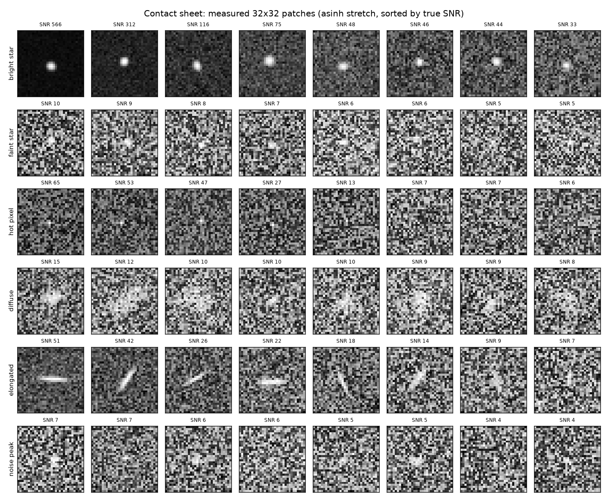
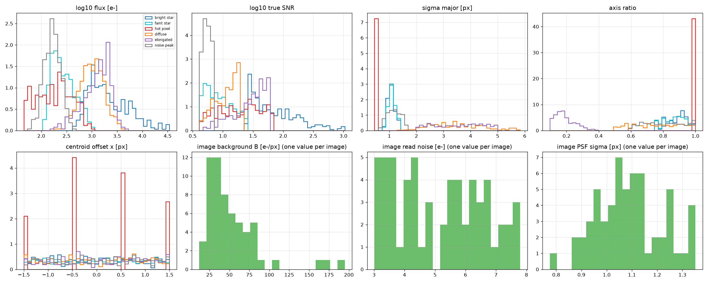

### Engineering question: how much pixel variation is meaningful?

Shares of the total sum of squares around the mean image (development set):

| component | share |
|---|---|
| background level (one number per image) | **20.3%** |
| source signal | **78.2%** |
| noise | 1.4% |
| cross terms | 0.1% |

Inside the source signal, two counterfactuals:
- **Position:** the source minus the same source re-rendered at the patch centre is **71.9%** of the source sum of squares.
- **Shape:** every source centred and scaled to the median flux keeps only **0.2%**.

**Conclusion:** the pixel variance is dominated by brightness (fluxes span 52–13,800 e⁻), by where bright sources sit within the patch, and by the sky level. Morphology, which is what actually separates stars from artifacts, is a tiny fraction of the variance. Noise is small in aggregate only because a few bright sources dominate the squared sums; for faint sources noise is everything. This predicts Experiment D: a method that ranks directions by variance will spend its first components on brightness and position.

## Experiment B: PCA from scratch

`PCAFromScratch` learns the mean image on training data only. It computes `U, s, Vt = np.linalg.svd(X_centered, full_matrices=False)` and stores the first k rows of Vt, explained variance s²/(N−1), the explained variance ratio and the cumulative ratio. `transform` returns (X − mean)·V_kᵀ; `inverse_transform` returns Z·V_k + mean.

**Validation against scikit-learn** (`PCA(svd_solver="full")`, 2,982 × 1,024 development patches, 1,499 held-out patches):

| check | result |
|---|---|
| explained variance ratios | max \|difference\| **2.2e-16** |
| orthonormality | max \|V Vᵀ − I\| **4.7e-15** |
| individual directions | \|cos\| = 1.000000 for all 1,024 (one near-equal pair, components 19/20, where vectors could legitimately rotate) |
| projection matrices ‖P_mine − P_sk‖_F, P_k = V_kᵀV_k | ≤ 1.2e-12 for every k |
| reconstructed held-out patches | max difference **≤ 4e-11** (pixel values up to 38,015) |
| error decreases as k increases | yes, on both training and held-out patches |
| full representation | rank 1,024: max \|X − X̂\| = 5.8e-11. With 500 patches: 500 components, numerical rank **499 = N − 1** (centring removes one dimension), reconstruction error 1.8e-11 |

Comparisons use projection matrices and reconstructions rather than raw component vectors, because component signs are arbitrary and near-equal singular values can rotate within their subspace.

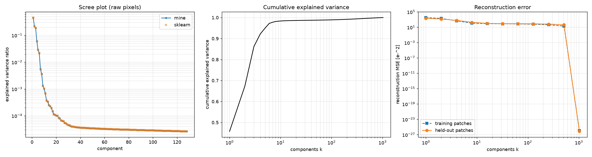
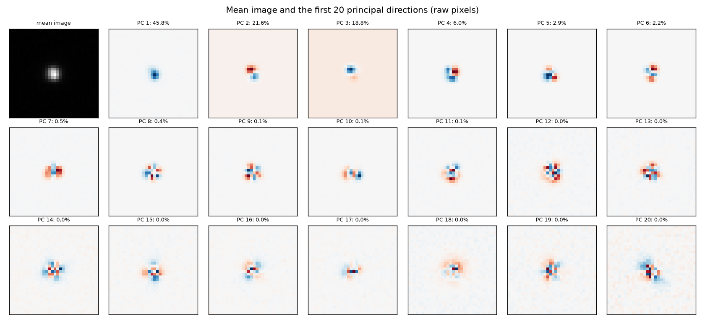

The first components are the mean-star blob and "dipoles" that move it by a pixel. **PC1 alone explains 45.8%** of the variance (brightness), and 4 components explain 92%.

**Engineering question: why SVD rather than an explicit covariance matrix?**
1. **Accuracy.** Forming XᵀX squares the condition number. On a test matrix with singular values from 1 down to 1e-12, SVD recovers all of them to 1%, but the covariance route fails below **2e-8**, which is about √ε. Small-variance directions, such as subtle morphology, are exactly the ones lost.
2. **Memory and scale.** The covariance matrix is D × D: 1,024² here is easy, but 64 × 64 patches give 4,096² and 256² stamps give 65,536² (32 GB). Thin or randomised SVD of X never builds it, and needs only the leading components.
3. **When the covariance route is fine.** For tall, well-conditioned data (N ≫ D, D = 1,024), the covariance route was actually **faster here** (0.38 s vs 1.9 s in the final run; timings vary with machine load, an earlier run took 1.9 s vs 17 s) and agreed to 6e-13. SVD is the safe default, not universally the fastest.

## Experiment C: reconstruction and information loss

PCA is fitted on development images only. Held-out patches come from the untouched images, with k ∈ {1, 2, 4, 8, 16, 32, 64, 128}.

**Preprocessing** (Part 4):
- **A:** raw pixels with feature-wise centring.
- **B:** a per-patch background (median of the 3-px border) subtracted, then centred.
- **C:** background subtracted, then divided by a per-patch aperture flux (floored at 3× the noise so empty patches don't explode), then centred.

Only the PCA mean and components are learned, and only from development images. Reconstructions are mapped back to pixel units for every approach.

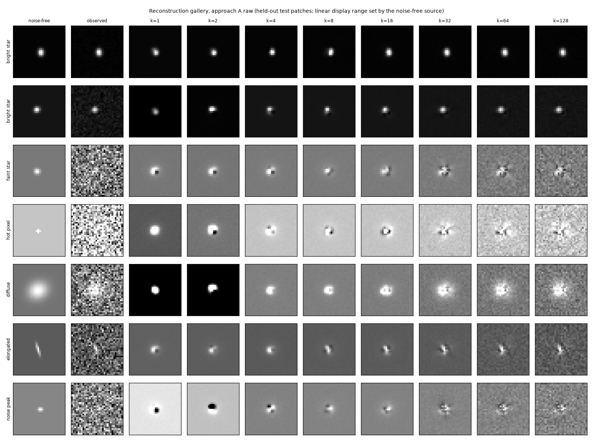
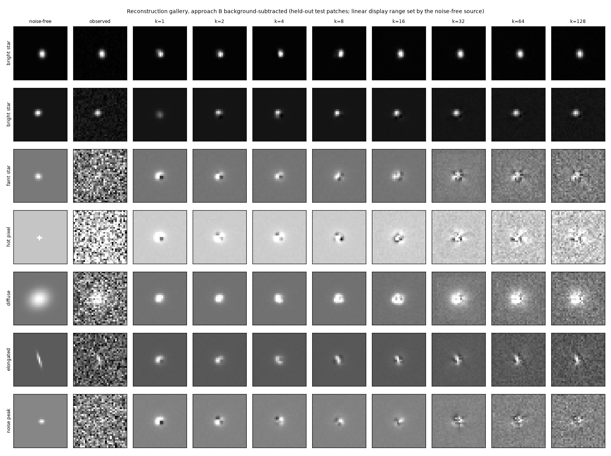
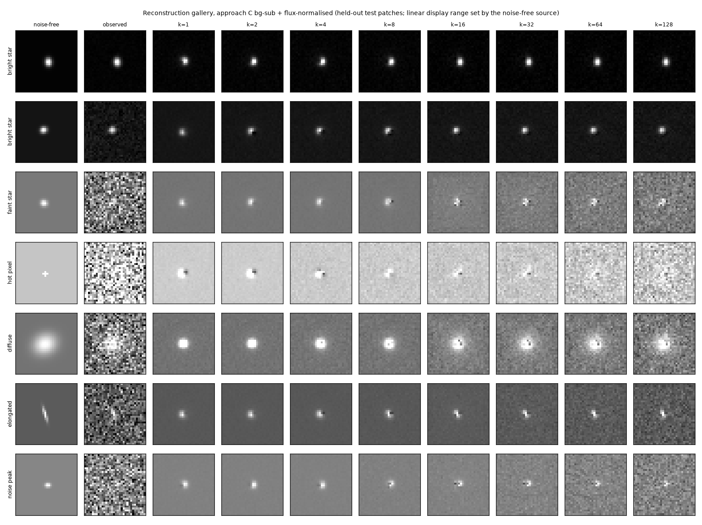
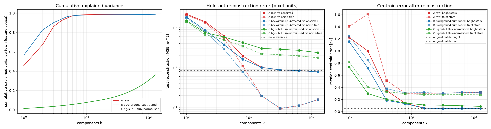

**Reconstruction error in pixel units [e⁻²]** (test patches; noise variance 83.8):

| k | A: vs observed | A: vs noise-free | A: cum. EV | B: vs observed | B: vs noise-free | B: cum. EV | C: vs observed | C: vs noise-free | C: cum. EV |
|---|---|---|---|---|---|---|---|---|---|
| 1 | 2180 | 2095 | 0.458 | 1843 | 1759 | 0.565 | 1491 | 1408 | 0.013 |
| 4 | 619 | 535 | 0.922 | 374 | 290 | 0.937 | 584 | 500 | 0.043 |
| 8 | 194 | 110 | 0.981 | 162 | 78 | 0.978 | 423 | 341 | 0.067 |
| 16 | 101 | 19.7 | 0.986 | 101 | 19.7 | 0.982 | 303 | 223 | 0.098 |
| 32 | 87.7 | **9.4** | 0.987 | 87.7 | **9.6** | 0.984 | 288 | 210 | 0.143 |
| 64 | 84.0 | 11.1 | 0.988 | 84.0 | 11.2 | 0.985 | 270 | 197 | 0.224 |
| 128 | 78.1 | 15.7 | 0.990 | 78.1 | 15.8 | 0.987 | 238 | 176 | 0.362 |

- **Error against the observed patch keeps falling** as components are added, and levels out at about the noise variance.
- **Error against the *noise-free* source has a minimum at k ≈ 32** (9.4 e⁻²), then rises: extra components start reproducing noise. PCA is acting as a denoiser, with an optimal compression level.
- **Approach C** spends its variance on amplified noise in faint patches: only 36% explained at k = 128. It reconstructs pixel values much worse.

**Physical-detail preservation.** Each feature is measured on the reconstruction and compared with the same measurement on the noise-free source, so the table isolates what PCA lost:

| approach | k | centroid error, bright | centroid error, faint | offset slope (1 = unbiased) | width error | roundness error | peak ratio | hot-pixel peak | elongated roundness | faint SNR ≥ 5 |
|---|---|---|---|---|---|---|---|---|---|---|
| original noisy patch | – | **0.056 px** | **0.326 px** | 0.992 | 2.8% | 0.033 | 1.01 | 0.98 | 0.17 | 69.6% |
| A raw | 1 | 1.225 | 1.404 | 0.425 | 42.8% | 0.054 | 0.58 | 0.30 | **0.88** | 72.5% |
| A raw | 4 | 0.346 | 0.511 | 0.640 | 18.6% | 0.128 | 0.81 | 0.30 | 0.68 | **93.8%** |
| A raw | 8 | 0.136 | 0.303 | 0.982 | 7.2% | 0.047 | 0.93 | 0.37 | 0.41 | 74.2% |
| A raw | 16 | 0.061 | 0.303 | 0.984 | 3.0% | 0.040 | 1.00 | 0.66 | 0.28 | 70.9% |
| A raw | 32 | 0.052 | 0.305 | 0.989 | 2.4% | 0.032 | 1.00 | 0.93 | 0.21 | 68.9% |
| A raw | 128 | 0.054 | 0.317 | 0.991 | 2.4% | 0.034 | 1.00 | 0.95 | 0.20 | 69.4% |
| B bg-subtracted | 2 | 0.719 | 0.850 | **0.238** | 29.1% | 0.088 | 0.69 | 0.28 | 0.83 | 93.1% |
| B bg-subtracted | 8 | 0.130 | 0.308 | 0.982 | 6.0% | 0.043 | 0.94 | 0.40 | 0.40 | 72.4% |
| B bg-subtracted | 32 | **0.051** | 0.300 | 0.989 | 2.3% | 0.035 | 1.00 | 0.93 | 0.20 | 69.1% |
| C flux-normalised | 8 | 0.141 | 0.296 | 0.888 | 4.9% | 0.078 | 0.98 | 0.73 | 0.62 | 64.0% |
| C flux-normalised | 32 | 0.105 | 0.278 | 0.927 | 4.4% | 0.050 | 0.98 | 0.86 | 0.49 | 64.6% |
| C flux-normalised | 128 | 0.086 | 0.276 | 0.943 | 3.9% | 0.045 | 0.98 | 0.89 | 0.40 | 66.0% |

The full table, all k for every approach, is in `outputs/run_all_output.txt`.

**What disappears at low k:**
- **Position.** With 1–4 components, a bright star's measured offset is pulled toward the centre of the training set. The offset slope ranges from 0.03 to 0.64 depending on k and approach, and the median centroid error is 0.2–1.2 px, against 0.056 px from the noisy patch itself. Raw and background-subtracted PCA (A and B) need **k ≥ 16** to match the original's centroid accuracy; flux-normalised PCA (C) never quite gets there (0.086 px at k = 128, slope 0.94).
- **Artifact identity.** Low-k reconstructions paint the dominant pattern, a mean star, onto everything. Elongated trails come back round (roundness 0.17 → **0.88** at k = 1), and hot-pixel peaks drop to 26–43% of their true height and are smeared into star-shaped blobs.
- **Honesty about faint sources.** "Faint stars detected at SNR ≥ 5" *rises* to 94% at k = 4. The reconstruction did not reveal faint stars; it **hallucinated** a star-like blob into every patch. The same thing happens to noise peaks, which is exactly the wrong behaviour for a star/artifact filter.
- **Brightness** (peak ratio 0.58 at k = 1) and **width** (40% error) return by k ≈ 16. Faint-star centroids stay at the noise limit of about 0.30 px at every k: PCA can't recover information the noise has already destroyed.

**Preprocessing:**
- **A and B** behave almost identically from k = 8 upward, because the background level is one easy component (A's PC1 absorbs it). B is cleaner at very low k.
- **C** emphasises morphology. Elongated roundness, the hot-pixel peak and width at small k are all preserved better. But it amplifies noise in faint patches and slightly biases centroids even at high k.

These answer different questions: A and B ask what the pixels look like, C asks what shape the source is.

**Engineering question: is a visually attractive reconstruction an accurate source of astrometric measurements?** No.
- **The trap.** At k = 8–16 the reconstructions look *better* than the data: smooth, noise-free and star-like. Centroids from them are still worse: 0.130–0.136 px at k = 8 vs 0.056 px from the raw patch, which is 2.3–2.4× worse. At k ≤ 4 they are systematically biased toward the patch centre.
- **Why.** PCA reconstruction is a projection onto what the *training set* typically looks like, so it shrinks every patch toward the training mean, in position, shape and brightness alike. Low noise and good looks are not accuracy, and a bias toward the patch centre is the most damaging possible error for astrometry.
- **Practice.** Measure centroids on the original pixels, or with a PSF-fitting estimator. Use PCA only where its bias has been measured against noise-free truth, as in this table.

## Experiment D: PCA as a classification representation

**Representations**, with everything learned fitted inside each training fold:
- **hand:** the 3 features measured from the pixels (log width, roundness, log SNR);
- **raw:** 1,024 background-subtracted pixels, standardised;
- **PCA-B(k):** k PCA scores of background-subtracted pixels;
- **PCA-C(k):** k PCA scores of flux-normalised pixels.

**Classifiers:** logistic regression, KNN and RBF SVM, with hyperparameters **and k** chosen by StratifiedGroupKFold(5) over the 60 development images.

**Grouped-CV ROC AUC** (best hyperparameters for each cell; mean ± fold sd):

| representation | logistic | KNN | RBF SVM |
|---|---|---|---|
| hand (3 features) | 0.787 | **0.907** | 0.903 |
| raw pixels (1,024) | 0.660 | 0.602 | 0.671 |
| PCA-B(2 / 4 / 8) | 0.597 / 0.596 / 0.672 | 0.646 / 0.768 / 0.802 | 0.594 / 0.614 / 0.797 |
| PCA-B(16 / 32) | 0.753 / 0.778 | 0.786 / 0.771 | **0.859** / 0.833 |
| PCA-B(64 / 128) | 0.782 / 0.778 | 0.734 / 0.665 | 0.811 / 0.782 |
| PCA-C(2 / 4 / 8) | 0.493 / 0.663 / 0.663 | 0.738 / 0.852 / 0.894 | 0.752 / 0.859 / 0.893 |
| PCA-C(16 / 32) | 0.688 / 0.690 | **0.905** / 0.894 | **0.901** / 0.898 |
| PCA-C(64 / 128) | 0.689 / 0.687 | 0.881 / 0.855 | 0.892 / 0.875 |

**Final:** selected by grouped CV, refit on all development images, scored once on the 30 untouched images. The last two columns repeat the evaluation on a realistic-prevalence test set with 15% stars.

| classifier | representation | hyperparameters | CV AUC | **test AUC** | precision | recall | fit s | ms / 1000 | AUC @ 15% | precision @ 15% |
|---|---|---|---|---|---|---|---|---|---|---|
| logistic | hand | C = 10 | 0.787 | 0.793 | 0.760 | 0.680 | 0.01 | 0.00 | 0.770 | 0.301 |
| logistic | raw | C = 1 | 0.660 | 0.697 | 0.667 | 0.642 | 0.17 | 0.00 | 0.730 | 0.246 |
| logistic | PCA-B(64) | C = 10 | 0.782 | 0.786 | 0.710 | 0.768 | 0.03 | 0.00 | 0.786 | 0.261 |
| KNN | **hand** | k = 45 | 0.907 | **0.893** | 0.776 | 0.831 | 0.01 | 0.02 | **0.912** | 0.378 |
| KNN | raw | k = 45 | 0.602 | 0.613 | 0.583 | 0.883 | 0.00 | 0.11 | 0.625 | 0.183 |
| KNN | PCA-B(8) | k = 5 | 0.802 | 0.801 | 0.746 | 0.739 | 0.02 | 0.05 | 0.804 | 0.310 |
| KNN | **PCA-C(16)** | k = 15 | 0.905 | **0.897** | 0.787 | 0.879 | 0.00 | 0.02 | 0.898 | 0.370 |
| RBF SVM | hand | C = 10, γ = 3/n | 0.903 | 0.890 | 0.775 | 0.858 | 0.11 | 0.25 | 0.901 | 0.361 |
| RBF SVM | raw | C = 1, γ = 0.3/n | 0.671 | 0.692 | 0.632 | 0.919 | **3.22** | **1.65** | 0.703 | 0.210 |
| RBF SVM | PCA-B(16) | C = 10, γ = 3/n | 0.859 | 0.850 | 0.738 | 0.919 | 0.21 | 0.31 | 0.851 | 0.299 |
| RBF SVM | **PCA-C(16)** | C = 1, γ = 3/n | 0.901 | **0.894** | **0.813** | 0.849 | 0.18 | 0.31 | 0.899 | **0.413** |

Raw-pixel classifiers trail every other representation for each classifier (test AUC 0.61–0.70, against 0.79–0.90 for the best representation), and the raw-pixel SVM is the most expensive model: about 15–18× slower to train and 5× slower to predict than the PCA-16 SVMs (timings vary slightly between runs).

### Part 3: variance preserved vs classification performance

| k | cumulative EV (B) | best AUC, PCA-B | cumulative EV (C) | best AUC, PCA-C |
|---|---|---|---|---|
| 2 | 0.826 | 0.646 | 0.026 | 0.752 |
| 4 | 0.937 | 0.768 | 0.043 | 0.859 |
| 8 | 0.978 | 0.802 | 0.067 | 0.894 |
| 16 | 0.982 | **0.859** | 0.098 | **0.905** |
| 32 | 0.984 | 0.833 | 0.143 | 0.898 |
| 64 | 0.985 | 0.811 | 0.224 | 0.892 |
| 128 | 0.987 | 0.782 | 0.362 | 0.875 |

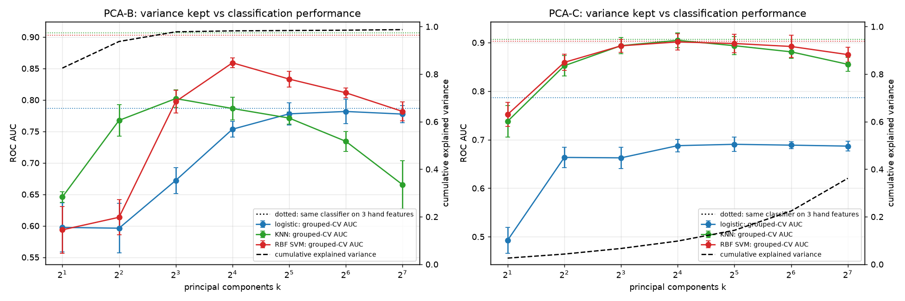

**The two curves behave very differently.**
- **Background-subtracted PCA** keeps 94% of the variance with 4 components, yet classifies badly (0.768). Those components encode *brightness and position*, which Experiment A showed dominate the variance and say little about class. Its AUC peaks at k = 16, then falls as noise components dilute the distance-based classifiers.
- **Flux-normalised PCA** keeps under 10% of the variance at k = 16, yet matches the hand features (0.905). Removing brightness forces the leading components to describe **morphology**.

Variance explained is the wrong criterion for choosing a classification representation: its job is to keep the *discriminative* directions, whatever their share of variance.

**Does dimensionality reduction help?**
- **Yes, relative to raw pixels:** for every classifier PCA beats the 1,024 raw pixels (KNN 0.60 → 0.80–0.90), and it cuts the SVM's cost by more than 10×.
- **No, relative to physics:** PCA does *not* beat three well-designed features. Morphology-focused PCA (C) only *ties* them.

The real lesson is that what matters is *which* information the representation keeps, not how many dimensions it has.

## Experiment E: PCA vs LDA vs nonlinear embeddings

### Part 1: LDA from scratch

On the hand-engineered features of the 60 development images:
- **Class means:** artifacts (−0.028, 0.401, 2.097) and stars (−0.160, 0.614, 2.515), in (log width, roundness, log SNR).
- **Scatter matrices:** S_W is 3 × 3; S_B = (m₁ − m₀)(m₁ − m₀)ᵀ has rank 1.
- **Discriminant direction:** w ∝ S_W⁻¹(m₁ − m₀) = (−0.265, **0.963**, 0.057). Roundness carries almost all of the linear discrimination.

**Against scikit-learn:** \|cos\| = **1.0000000000** with `LinearDiscriminantAnalysis(solver="eigen")`, and correlation 1.0000000000 with the `svd` solver's `transform`. Test predictions are 99.93% identical; the decision values differ by up to 2.5e-3 only because the pooled covariance here is divided by N − 2.

**Fisher ratio J(w) = wᵀS_Bw / wᵀS_Ww**, relative to LDA: LDA 1.000, the best of 2,000 random directions 0.992, and **the first PCA direction 0.175**. PCA's highest-variance direction is a poor separating direction.

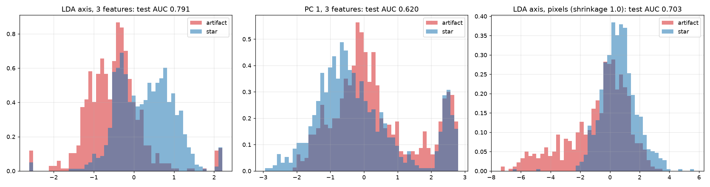

### Part 2: PCA vs LDA, same training and test groups

Test ROC AUC and accuracy:

| inputs | method | test AUC | accuracy |
|---|---|---|---|
| 3 features | logistic regression on the 3 features | **0.793** | 0.710 |
| 3 features | **LDA: 1 discriminant axis**, LDA threshold | **0.791** | 0.710 |
| 3 features | PCA, 1 axis → logistic | 0.620 | 0.563 |
| 3 features | PCA, 2 axes → logistic | 0.630 | 0.575 |
| 1,024 pixels | logistic on pixels (C = 1e-6, chosen by grouped CV) | 0.703 | 0.542 |
| 1,024 pixels | LDA, own shrinkage chosen by grouped CV (= 1.0) | 0.703 | 0.651 |
| 1,024 pixels | LDA, no shrinkage | 0.631 | 0.589 |
| 1,024 pixels | sklearn LDA, Ledoit–Wolf shrinkage | 0.692 | 0.652 |
| 1,024 pixels | PCA 16 → LDA / → logistic | 0.692 / 0.759 | 0.692 / 0.692 |
| 1,024 pixels | PCA 32 → LDA / → logistic | 0.728 / **0.782** | 0.687 / 0.718 |
| 1,024 pixels | PCA 128 → LDA / → logistic | 0.721 / 0.776 | 0.676 / 0.694 |

**Representation vs classifier.** On the engineered features, a single LDA axis matches a logistic regression trained on all 3 features (0.791 vs 0.793). The two find essentially the same linear boundary, so for a binary problem the representation adds nothing beyond the linear classifier itself. PCA's 1–2 axes lose most of the discrimination (0.62–0.63), because they are chosen for variance, not separation.

**On pixels:**
- **Plain LDA overfits** (0.631). S_W is 1,024 × 1,024 and invertible (N = 2,982 > D), but its condition number is 3.7e4, so inverting it amplifies noise directions.
- **Shrinkage fixes that**, and grouped CV pushes it all the way to **1.0**: the covariance becomes a scaled identity and w ∝ m₁ − m₀, a *mean-difference template*, i.e. a matched filter.
- **Logistic regression ends up in the same place:** grouped CV picks C = 1e-6, and as C → 0 its weights also tend to the class-mean difference. Both reach AUC 0.703. Logistic's low accuracy (0.542) comes from its badly placed intercept at that extreme regularisation, not from its ranking.

At this sample size, nothing estimated from the 1,024-pixel covariance generalises better than the simple template. Reducing to 32 PCA components first and then using logistic regression does better (0.782): a compact basis, then a discriminative classifier.

### Part 3: t-SNE

A stratified subset of 200 development patches per subtype, reduced to 50 dimensions by PCA, then embedded with t-SNE.

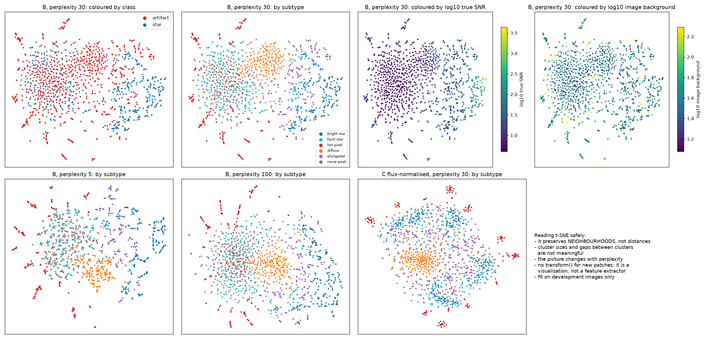

**What the embedding is organised by:**
- **Background-subtracted pixels (B)** are organised mainly by **brightness/SNR** (panel 3 shows a smooth SNR gradient). Bright stars form their own region; faint stars and noise peaks share one diffuse cloud, the same confusion seen in every module; diffuse sources and elongated trails form recognisable groups.
- **The image background shows no structure** (panel 4), as expected after background subtraction.
- **Hot pixels form many small, tight islands.** In the flux-normalised embedding there are about 9 compact clusters: one for each integer pixel position a hot pixel can occupy within ±1.5 px of the centre. t-SNE is faithfully clustering a **nuisance variable** (sub-patch position), not a physical one.

**Neighbourhood check** (agreement of the 10 nearest neighbours' labels, subtype / class):

| space | subtype | class |
|---|---|---|
| PCA-50 | 0.612 | 0.788 |
| t-SNE, perplexity 5 | 0.648 | 0.790 |
| t-SNE, perplexity 30 | 0.654 | 0.796 |
| t-SNE, perplexity 100 | 0.643 | 0.787 |
| t-SNE, flux-normalised, perplexity 30 | 0.556 | 0.802 |

t-SNE barely improves local class purity over the PCA input (0.79–0.80 vs 0.79): it makes structure *visible*, but doesn't *create* separability. The overall layout changes with perplexity, while the local neighbourhoods are stable.

**Reading t-SNE safely:**
- It preserves neighbourhoods, not distances; cluster sizes and the gaps between clusters mean nothing.
- It has no `transform()` for new patches, so it is a diagnostic visualisation, never a classifier feature or an evaluation tool.
- It was fitted on development images only.
