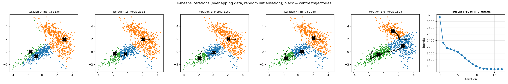
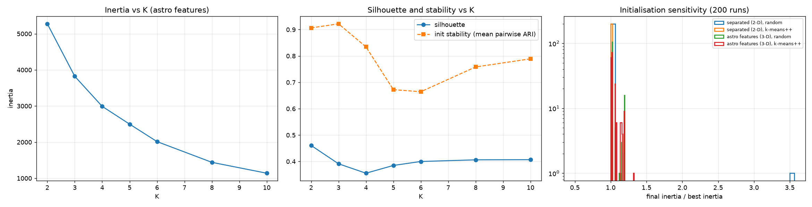
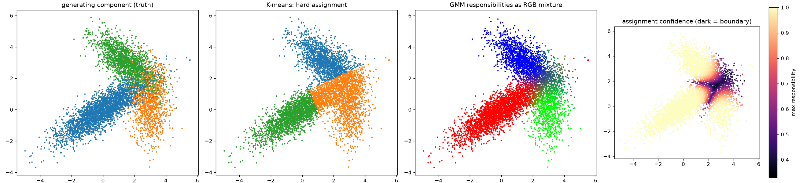
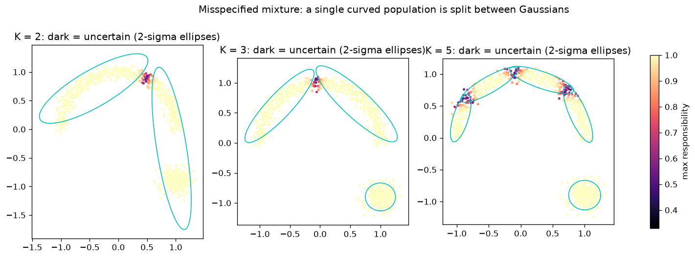
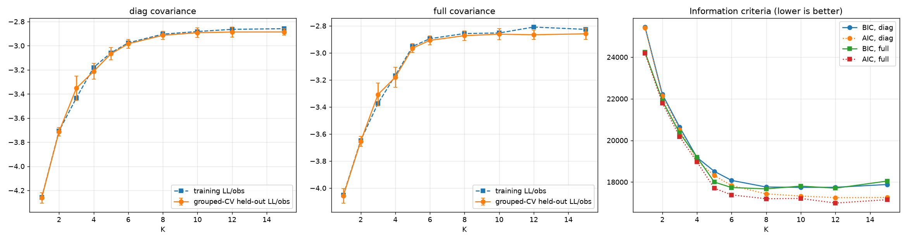
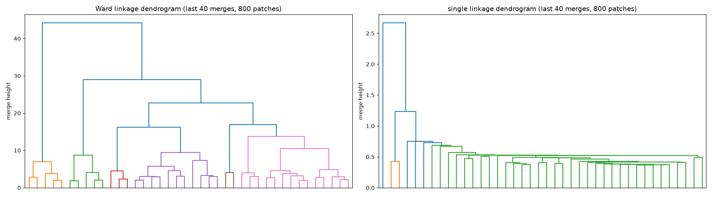
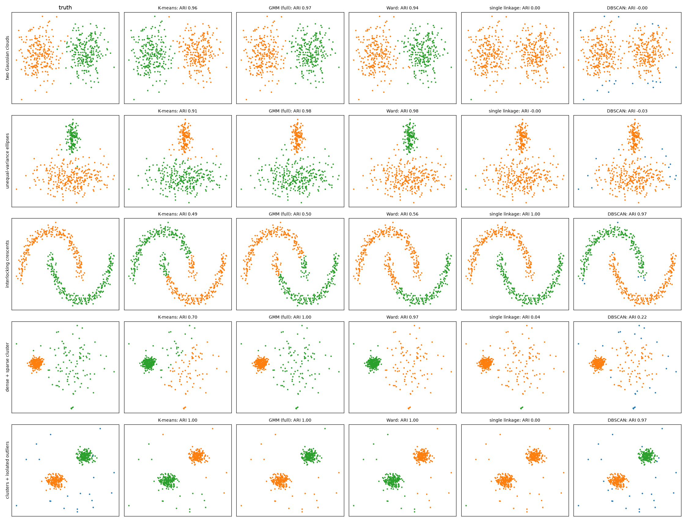
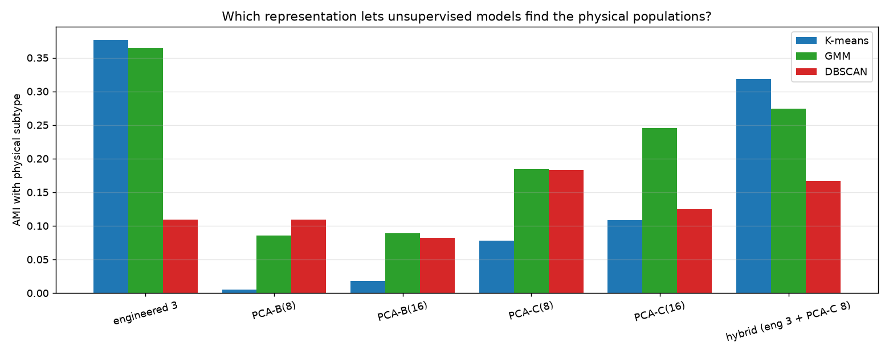
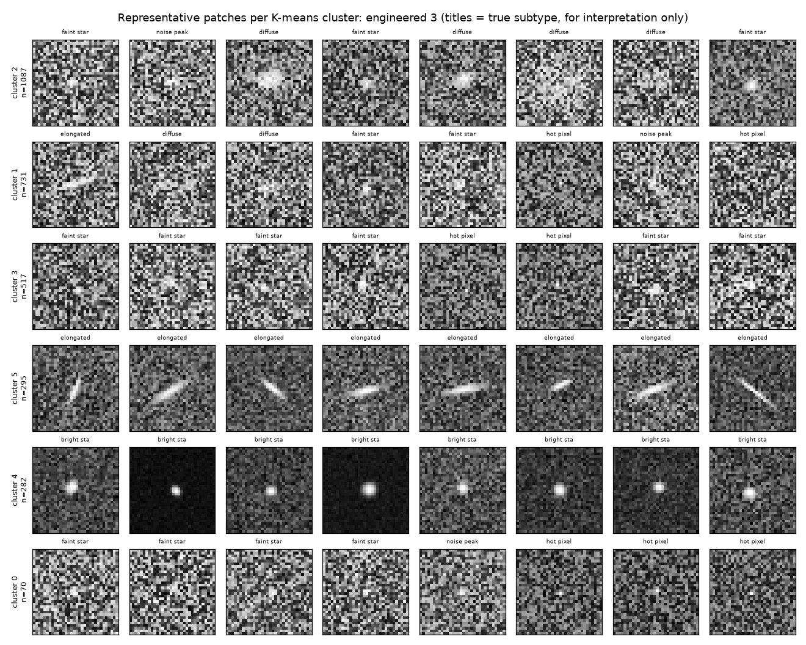
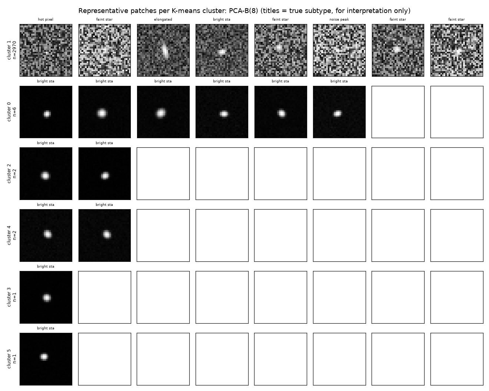

# Module 7: Unsupervised Learning — K-means, Gaussian Mixtures, Hierarchical Clustering, DBSCAN

All numbers come from `python run_all.py` (about 10 minutes, most of it Experiment C's grouped cross-validation). The full console output is saved in `outputs/run_all_output.txt`.
The astronomical data are Module 6's grouped patch datasets: 60 development images (2,982 patches) and 30 untouched images (1,499 patches). `data7.py` caches them so every experiment sees identical numbers. PCA and standardisation are fitted on development images only.

| File | Purpose |
|---|---|
| `clustering.py` | `KMeansScratch` (random / K-means++ initialisation, explicit empty-cluster repair, history), `log_gaussian` (Cholesky, triangular solves, invalid-covariance detection), `GaussianMixtureScratch` (diag / full EM, regularisation, log-likelihood history, AIC / BIC) |
| `data7.py` | Module 6 data and representations (engineered features, PCA-B, PCA-C), cached |
| `exp_a_kmeans.py` … `exp_e_feature_discovery.py` | Experiments A–E |

**Note on the problem set:** the last screenshot stops in Experiment E Part 4, after "Source SNR" in the list of variables to compare cluster membership against. I added image background, focus, centroid offset and image id. Anything required below that cut is not covered.

---

## Experiment A: K-means from scratch

`KMeansScratch` follows the course skeleton:
1. **Initialise** with `random` (K distinct observations) or `k-means++`, or pass explicit centres.
2. **Assign** each sample to its nearest centre.
3. **Update** each centre to the mean of its members.
4. **Track** the inertia.
5. **Check convergence:** squared centre shift ≤ tol × mean feature variance (scikit-learn's definition), or unchanged labels.

**Empty clusters are handled explicitly:** the empty cluster's centre jumps to the observation currently farthest from its own centre. In a test that started one centre at (100, 100), far from all the data, this needed **1 repair** and still recovered the three clusters (sizes 300 / 300 / 300, ARI 0.993).

### Part 2: against scikit-learn, with identical initial centres (lloyd, tol 1e-6)

| dataset | init | iterations (mine / sklearn) | inertia (both) | max \|centre diff\| | label agreement | ARI vs truth |
|---|---|---|---|---|---|---|
| separated | random | 7 / 7 | 1818.0861 | 2.7e-15 | 1.0000 | 0.993 |
| separated | K-means++ | 3 / 3 | 1818.0861 | 2.7e-15 | 1.0000 | 0.993 |
| overlapping | random | 15 / 15 | 1503.3480 | 4.4e-15 | 1.0000 | 0.541 |
| overlapping | K-means++ | 9 / 9 | 1503.2294 | 4.0e-15 | 1.0000 | 0.542 |

Centres were matched with the Hungarian algorithm (`linear_sum_assignment`) before comparison, since cluster numbering is arbitrary. On the overlapping data, both random and K-means++ give ARI of only 0.54. K-means' straight perpendicular-bisector boundaries can't follow the populations' different covariance shapes (Experiment B).

### Part 3: initialisation sensitivity (200 initialisations per strategy)

| dataset | K | init | found the best (within 0.01%) | distinct solutions (> 0.1% apart) | worst / best inertia |
|---|---|---|---|---|---|
| separated 2-D | 3 | random | 99.5% | 2 | **3.56** |
| separated 2-D | 3 | K-means++ | 100% | 1 | 1.00 |
| overlapping 2-D | 3 | random / K-means++ | 100% | 1 | 1.00 |
| astro features 3-D | 6 | random | 27.5% | 15 | 1.20 |
| astro features 3-D | 6 | K-means++ | 29.5% | 17 | 1.33 |

- **Easy problems:** K-means++ removes the rare catastrophic start, where random initialisation put two centres in one cluster (3.6× worse inertia).
- **The real feature space has a rugged objective.** Only about 30% of runs find the best 6-cluster solution, and there are 15–17 distinct local optima. Multiple restarts are mandatory, and K-means++ alone doesn't fix it.

### Part 4: astronomical features

Standardised log width, roundness and log SNR from the development images; labels used only afterwards.

| K | inertia | silhouette | init stability (pairwise ARI) | ARI vs subtype | ARI vs star / artifact |
|---|---|---|---|---|---|
| 2 | 5275 | **0.461** | 0.906 | 0.032 | 0.024 |
| 3 | 3822 | 0.391 | 0.922 | 0.165 | 0.047 |
| 4 | 2990 | 0.355 | 0.834 | 0.172 | 0.059 |
| 5 | 2498 | 0.385 | 0.672 | 0.191 | 0.049 |
| 6 | 2015 | 0.400 | 0.664 | 0.223 | 0.054 |
| 8 | 1441 | 0.406 | 0.758 | **0.289** | 0.102 |
| 10 | 1140 | 0.407 | 0.789 | 0.267 | 0.097 |

**K = 6, composition by subtype**, ordered by log SNR:

| cluster | n | bright star | faint star | hot pixel | diffuse | elongated | noise peak | centre (log w, round, log SNR) |
|---|---|---|---|---|---|---|---|---|
| 0 | 70 | 0% | 29% | **53%** | 0% | 0% | 19% | (−1.9, 1.55, −0.9) |
| 3 | 517 | 0% | 41% | 34% | 0% | 5% | 20% | (−1.7, −1.5, −0.7) |
| 1 | 731 | 0% | 53% | 12% | 7% | 4% | 23% | (0.3, −0.2, −0.7) |
| 2 | 1087 | 11% | 53% | 3% | 26% | 0% | 7% | (0.6, 0.8, 0.1) |
| 5 | 295 | 1% | 2% | 2% | 2% | **93%** | 0% | (0.5, −1.0, 0.7) |
| 4 | 282 | **100%** | 0% | 0% | 0% | 0% | 0% | (0.1, 1.1, 2.1) |

The best silhouette is at **K = 2**, splitting "resolved" from "unresolved / narrow" sources. With K = 3 the clusters are: narrow faint sources, extended / medium sources, and bright stars (75% pure).

**Engineering question: the best silhouette is at a small K, but the simulation has six subtypes. What does that mean?**
- **Silhouette measures geometry, not physics.** It rewards compact, well-separated blobs *in the chosen feature space*. With these 3 features, the only well-separated structure is coarse (narrow vs resolved; bright stars). Faint stars, noise peaks and faint hot pixels overlap almost completely in measured width, roundness and SNR, so splitting them lowers the silhouette.
- **The best K says nothing about how many physical populations exist.** It says how many the *representation* separates cleanly. Several subtypes may share one blob, and one subtype (stars, spanning four decades of SNR) can be spread across several.
- **Other criteria disagree with silhouette.** Agreement with the true subtypes peaks at K = 8 (ARI 0.289) while silhouette prefers K = 2, and the stability of the solution also depends on K.

To resolve more populations you need better features, not a different K.

## Experiment B: Gaussian mixture EM from scratch

### Part 1: log density

`log_gaussian` uses Σ = LLᵀ, z = L⁻¹(x − μ) via `solve_triangular`, and log|Σ| = 2 Σ log Lᵢᵢ. Σ⁻¹ is never formed.

| test | result |
|---|---|
| matches `scipy.stats.multivariate_normal.logpdf`, D = 1, 2, 3, 5, 8 | max error 2.9e-13 ✓ |
| rejects non-symmetric / indefinite / NaN / singular covariances | all four raise `InvalidCovarianceError` with a clear message ✓ |

**Ill-conditioned covariances** (D = 6), compared with an extended-precision reference:

| condition number | Cholesky (mine) | explicit inverse |
|---|---|---|
| 1e2 | 7e-14 | 8e-14 |
| 1e6 | 3e-10 | 5e-10 |
| 1e10 | 2e-6 | 2e-6 |
| 1e13 | 6e-4 | 6e-5 |

At these small sizes the accuracy is comparable: both lose about log₁₀(κ) digits, and at κ = 1e13 the explicit inverse even happened to do better. Cholesky's real advantages are elsewhere:
- **Speed:** one factorisation, reused for both the determinant and the solves.
- **Free validity check:** the factorisation fails exactly when Σ is not positive definite.
- **No inverse to store or symmetrise.**

Near-singular covariances need regularisation (`reg_covar`) whichever formula is used.

### Parts 2–3: EM and property tests

The data are 6,000 draws from a known 3-component 2-D mixture with correlated covariances.

| test | diag | full |
|---|---|---|
| converged | yes, 49 iterations | yes, 86 iterations |
| weights sum to one | \|Σw − 1\| = 2.9e-15 ✓ | 2.0e-15 ✓ |
| every responsibility vector sums to one | 1.8e-15 ✓ | 8.9e-16 ✓ |
| covariances valid | min variance 0.43 ✓ | min eigenvalue 0.21, symmetric, 0 repairs ✓ |
| log-likelihood never decreases | largest decrease 0 ✓ | 0 ✓ |
| recovers the known mixture (full) | – | weights 0.503 / 0.196 / 0.301 (true 0.5 / 0.2 / 0.3); means within 0.05; covariance error 1.3–3% ✓ |
| fitted log-likelihood ≥ log-likelihood at the true parameters | – | −3.3194 ≥ −3.3208 ✓ (it is the maximum-likelihood estimate) |
| **agrees with sklearn `GaussianMixture`** (same initial weights / means / precisions, tol 1e-10) | max \|Δ responsibility\| 1.1e-5, same 65 iterations ✓ | 2.2e-5, same 116 iterations ✓ |

The diagonal model's lower likelihood (−3.546 vs −3.319) is a correct diagnosis: the true components are correlated, so "diag" is misspecified.

### Part 4: hard vs soft clustering

On the same overlapping data, accuracy against the generating component is **K-means 0.796** and **GMM (argmax) 0.904**.

The responsibilities are **calibrated**: when the GMM gives an observation a top responsibility of 0.50–0.60, that top component is the true one 52% of the time.

| max responsibility | n | argmax is the true component |
|---|---|---|
| 0.33–0.50 | 369 | 0.453 |
| 0.50–0.60 | 288 | **0.521** |
| 0.60–0.70 | 242 | 0.665 |
| 0.70–0.80 | 268 | 0.761 |
| 0.80–0.90 | 322 | 0.829 |
| 0.90–0.99 | 780 | 0.956 |
| 0.99–1.00 | 3,731 | 0.999 |

**What soft assignment adds.** A hard label says "component 1" both for a point deep inside the cluster and for one on the boundary. P(Z = 1 | x) = 0.52 says *this is a coin flip*, and those coin flips really are about 50/50. In the uncertain zone (max responsibility < 0.6, 11% of the points), K-means' labels are wrong **57%** of the time, with no warning. Soft assignments let downstream steps:
- weight observations;
- defer or flag ambiguous ones;
- carry the uncertainty forward instead of discarding it.

**Engineering question: does an uncertain assignment mean the source itself is ambiguous?** Not necessarily. The demo fits GMMs to **one crescent-shaped population plus one compact blob**:

| K | BIC | crescent points with max responsibility < 0.8 | blob points |
|---|---|---|---|
| 2 | 2035 | 3.3% | 0% |
| 3 | 932 | 2.7% | 0% |
| 4 | 548 | 8.0% | 0% |
| 5 | **392** | **14.0%** | 0% |

BIC keeps asking for more components, because a curved population isn't Gaussian. The extra components tile the crescent, and points in the *middle* of that single, unambiguous population get split responsibilities. That uncertainty belongs to the **model**, not to the source.

Uncertain responsibilities therefore have two possible causes, which must be told apart:
- **Genuine physical overlap**, as in the calibrated overlapping-Gaussians case above.
- **An inadequate mixture**: non-Gaussian shapes, too many or too few components, or mis-scaled features.

How to tell them apart:
- **Overlap:** uncertain points lie between *distinct* populations, and the calibration curve holds.
- **Misspecification:** uncertain points lie *inside* a population, and the number of components keeps growing with K (or BIC).

## Experiment C: selecting mixture models

The data are the engineered features (D = 3) of the 60 development images, with K ∈ {1, 2, 3, 4, 5, 6, 8, 10, 12, 15}, diagonal vs full covariance, and the best of 5 initialisations per configuration.

**Parameter counting** (Part 2):
- **full covariance:** p = (K−1) + KD + K·D(D+1)/2
- **diagonal covariance:** each component has D variances and no covariances, so **p = (K−1) + KD + KD = K(2D + 1) − 1**

For D = 3 that gives 9, 19, 29, … (full) and 6, 13, 20, … (diag), which match both my formula and scikit-learn's `_n_parameters()` for every configuration.

**A problem discovered first:**
- **Point masses in the measured features.** 342 patches (11.5%) sit *exactly* on the width floor (unresolved: 159 hot pixels, 122 faint stars, 60 noise peaks). 69 sit at roundness exactly 1, and 11 are failed-measurement fallbacks.
- **The likelihood runs away.** With a tiny covariance floor (reg 1e-6), a Gaussian component can collapse onto such a spike and gain unbounded likelihood: training **and** held-out log-likelihood keep rising to K = 15 (−1.62 per observation). EM is chasing measurement artefacts.
- **The fix:** a covariance floor of 0.05 (in standardised variance units), comparable to measurement resolution, keeps the likelihood bounded.

**Part 3: grouped 5-fold CV over images** (GroupKFold, standardisation refitted in each fold, no labels). Held-out log-likelihood per observation, with the 0.05 floor:

| K | diag | full |
|---|---|---|
| 1 | −4.262 | −4.056 |
| 2 | −3.713 | −3.655 |
| 3 | −3.353 | −3.308 |
| 4 | −3.213 | −3.180 |
| 5 | −3.067 | −2.965 |
| 6 | −2.984 | −2.907 |
| **8** | −2.914 | **−2.872** |
| 10 | −2.892 | −2.862 |
| 12 | −2.886 | −2.866 |
| 15 | −2.886 | −2.859 |

The highest score is at K = 15 with full covariance, but the curve is nearly flat beyond K ≈ 8. **The one-standard-error rule picks K = 8, full**: the fewest parameters within 1 SE (0.019) of the best. **BIC agrees** (K = 8, full); AIC prefers K = 12. Convergence was 5/5 for almost every configuration; at K ≥ 8 with full covariance, a few initialisations hit the iteration limit (2–4 of 5 converged), and the best-likelihood fit was kept.

**On the untouched test images**, the selected model scores **−2.884** per observation against −2.857 on development, so the density generalises to unseen images.

**Part 4: what the 8 components represent** (labels used only here):

| component | weight | dominant content | median true SNR | size [px] | axis ratio |
|---|---|---|---|---|---|
| 5 | 0.415 | faint stars 59%, noise peaks 18%, hot pixels 10%, diffuse 8% (**mixed faint compact**) | 7 | 1.03 | 0.87 |
| 6 | 0.230 | bright stars 61%, faint stars 35% (**bright compact**) | 31 | 1.01 | 0.90 |
| 1 | 0.158 | faint stars 41%, hot pixels 34%, noise peaks 21% (**narrow / unresolved**) | 7 | 0.87 | 0.90 |
| 7 | 0.086 | **elongated 100%** | 38 | 1.47 | 0.17 |
| 3 | 0.079 | **diffuse 100%** | 14 | 3.24 | 0.79 |
| 2 | 0.023 | hot pixels 52% — the **roundness = 1 measurement spike** | 9 | 0.45 | 1.00 |
| 4 | 0.006 | elongated 54%, hot pixels 38% (13 patches) | 45 | 1.05 | 0.20 |
| 0 | 0.004 | the **11 failed measurements** | 6 | 0.45 | 1.00 |

**How much each variable is explained by component membership:**

| variable | association |
|---|---|
| elongation (axis ratio) | η² = **0.638** |
| compact vs diffuse (source size) | η² = **0.535** |
| bright vs faint (true SNR) | η² = **0.459** |
| image background | η² = 0.008 |
| focus (image PSF σ) | η² = 0.006 |
| image id | AMI 0.003 |
| physical subtype | AMI 0.445 |

So the components correspond to **morphology (elongated, diffuse), brightness (bright vs faint compact), and measurement flags**. They do *not* follow background or focus conditions, because the features are background-invariant by design, and focus varies only modestly. Faint compact sources stay **mixed populations**. Two small components exist only because of degenerate measurements: the mixture has "discovered" measurement flags as populations, which is useful for data quality, but they are not physics.

## Experiment D: hierarchical clustering and DBSCAN

### Part 1: hierarchical clustering

Agglomerative clustering on 800 random development patches, cut at 6 clusters:

| linkage | cluster sizes | ARI vs subtype |
|---|---|---|
| single | 774, 20, 2, 2, 1, 1 | 0.006 |
| complete | 415, 203, 151, 20, 9, 2 | 0.139 |
| average | 571, 145, 55, 20, 7, 2 | 0.089 |
| **Ward** | 333, 173, 137, 75, 62, 20 | **0.201** |

**Single linkage chains**: one long path of nearest neighbours swallows almost everything. **Ward** gives balanced clusters, including a 100%-elongated and a 100%-bright-star cluster.

Cutting the Ward tree lower gives more, purer groups: 2 clusters → ARI 0.022; 3 → 0.084; 6 → 0.201; 10 → 0.273.

### Part 2: DBSCAN

DBSCAN on all 2,982 standardised development patches; full grid in the output file:

| eps | min_samples | clusters | noise | ARI vs subtype | stability (ARI between eps and 1.1·eps) |
|---|---|---|---|---|---|
| 0.15 | 5 | 35 | 30.8% | 0.176 | 0.77 |
| 0.2 | 10 | 11 | 27.6% | 0.208 | 0.84 |
| 0.3 | 10 | 6 | 6.7% | 0.162 | 0.70 |
| 0.3 | 20 | 5 | 15.4% | 0.256 | 0.75 |
| 0.4 | 10 | 4 | 2.0% | 0.038 | **0.28** |
| 0.5 | 10 | 3 | 0.7% | 0.010 | 0.93 |

**DBSCAN is fragile on this data:**
- Small eps fragments the data and labels much of it noise.
- Large eps merges everything into one density-connected mass.
- In between, a 10% change in eps can reorganise the clusters (stability 0.28–0.70).

The k-distance heuristic suggests eps ≈ 0.42, which gives only 3 clusters. Varying density (faint sources are dense, bright stars and artifacts sparse) means no single eps fits everything.

### Part 3: geometry stress tests

ARI against the generating labels:

| dataset | K-means | GMM (full) | Ward | single linkage | DBSCAN |
|---|---|---|---|---|---|
| two Gaussian clouds | 0.960 | **0.968** | 0.937 | 0.000 | 0.000 |
| unequal-variance ellipses | 0.912 | **0.982** | **0.982** | 0.000 | −0.025 |
| interlocking crescents | 0.489 | 0.500 | 0.559 | **1.000** | 0.972 |
| dense + sparse cluster | 0.699 | **1.000** | 0.968 | 0.040 | 0.217 |
| clusters + isolated outliers | 1.000 | 1.000 | 1.000 | 0.000 | 0.970 (95% of outliers flagged) |

**Each definition of a cluster has its own blind spot:**
- **K-means** assumes equal-size spherical blobs, so it splits the sparse cluster.
- **GMMs** handle ellipses and unequal densities but not curved shapes.
- **Ward** behaves like K-means.
- **Single linkage and DBSCAN** follow connected shapes perfectly (crescents). But they merge touching clouds, and an eps chosen for one density fails on the other.
- **Only DBSCAN reports outliers.** Every other method forces them into a cluster.

### Part 4: what DBSCAN calls noise

With eps 0.3 and min_samples 10, 200 of 2,982 patches are labelled noise:

| subtype | share of all | share of noise | enrichment | rate labelled noise |
|---|---|---|---|---|
| bright star | 13.5% | 17.0% | 1.25× | 8.4% |
| faint star | 40.1% | 15.5% | 0.39× | 2.6% |
| **hot pixel** | 11.4% | 25.5% | **2.23×** | 15.0% |
| diffuse | 11.4% | 14.0% | 1.23× | 8.3% |
| **elongated** | 11.2% | 19.0% | **1.70×** | 11.4% |
| noise peak | 12.3% | 9.0% | 0.73× | 4.9% |

**The noise points are a mixture:**
1. **Rare artifacts:** hot pixels and elongated trails are over-represented.
2. **Unusually bright stars:** 34 bright stars are flagged, with median true SNR **≈ 1,000**. 12% of the noise points are above the 99th SNR percentile. They are perfectly measured; there are just few of them, because of the power-law flux distribution.
3. **Faint stars whose measured properties are atypical:** median measured log width −0.66 and roundness 0.27, against 0.02 and 0.62 for other faint stars. These are noisy measurements of ordinary stars.

Notably, the noise is *under*-represented on the unresolved width floor (4% vs 11%), because those spikes are dense.

**Engineering question: why is a low-density observation not the same as an invalid measurement?**
- **Density describes the sample, not the measurement.** It reflects how common a measurement is in *this* dataset, not whether it is correct. The brightest stars are the best-measured objects in the set, yet they are "outliers" because bright stars are rare.
- **Density can be high for invalid data too.** The unresolved-width spike is the densest part of the space, and it is a measurement artefact.
- **The density depends on choices.** It changes with the representation, with eps, and with which images are in the sample.

Validity has to be judged with measurement physics: residuals, SNR, flags, consistency with a PSF model. A low-density flag is a prompt to *look*, not a reason to *discard*. Discarding by density would systematically remove the brightest, most astrometrically valuable stars.

## Experiment E: unsupervised astronomical feature discovery

**Representations** (fitted on development data, every column standardised):
- engineered 3 features;
- PCA-B(8 / 16), background-subtracted;
- PCA-C(8 / 16), flux-normalised;
- hybrid: engineered 3 + PCA-C(8).

Following Module 6, k ∈ {8, 16}; both are reported rather than tuned on labels. PCA-B keeps 97.8% / 98.2% of the variance with 8 / 16 components; PCA-C keeps 6.7% / 9.8%.

**Models**, all without labels:
- K-means, K = 6, best of 10 starts;
- full GMM, K = 6, covariance floor 0.05;
- DBSCAN, eps from the k-distance heuristic.

K = 6 is a fixed, label-free choice so the representations can be compared directly.

### Part 3: external agreement

| representation | model | clusters | ARI | AMI | purity | stability across seeds | test-image ARI |
|---|---|---|---|---|---|---|---|
| **engineered 3** | **K-means** | 6 | **0.223** | **0.377** | **0.592** | 0.657 | 0.200 |
| engineered 3 | GMM | 6 | 0.202 | 0.365 | 0.534 | **1.000** | 0.209 |
| engineered 3 | DBSCAN | 4 (+3.7% noise) | 0.045 | 0.109 | 0.404 | – | – |
| PCA-B(8) | K-means | 6 | 0.002 | 0.005 | 0.405 | 0.531 | 0.001 |
| PCA-B(16) | GMM | 6 | 0.049 | 0.089 | 0.443 | 0.255 | 0.045 |
| PCA-C(8) | GMM | 6 | 0.053 | 0.185 | 0.456 | 0.780 | 0.057 |
| PCA-C(16) | GMM | 6 | 0.067 | 0.246 | 0.461 | 0.734 | 0.061 |
| hybrid | K-means | 6 | 0.154 | 0.319 | 0.514 | 0.589 | 0.138 |
| hybrid | GMM | 6 | 0.132 | 0.274 | 0.450 | 0.487 | 0.111 |

All 18 combinations are in the output file.

**Purity needs a reference point.** Sixty *random* clusters already score **0.401**, and one cluster per patch would score 1.000. So purity is only meaningful next to the cluster count and the chance-corrected ARI / AMI. PCA-B's purity of 0.405 is chance level.

### Part 2: what was learned

**K-means on PCA-B(8) learned brightness, nothing else.** One cluster holds 2,970 patches; the other five hold the **12 brightest stars** (true SNR 1,200–5,600). Brightness dominates every background-subtracted component (Experiment A of Module 6), and standardising the scores turns the bright tail into extreme outliers, which K-means then spends its clusters on.

**K-means on the engineered features learned physically interpretable groups:**

| cluster | n | content | standardised (log w, roundness, log SNR) |
|---|---|---|---|
| 4 | 282 | **bright stars 100%** | (0.13, 1.12, 2.12) |
| 5 | 295 | **elongated 93%** | (0.54, −1.00, 0.73) |
| 0 | 70 | hot pixels 53% (narrow and *round*) | (−1.90, 1.55, −0.92) |
| 3 | 517 | narrow, low SNR: faint stars 41%, hot pixels 34%, noise peaks 20% | (−1.72, −1.49, −0.67) |
| 2 | 1,087 | round, resolved: faint stars 53%, diffuse 26%, bright stars 11% | (0.56, 0.75, 0.07) |
| 1 | 731 | faint, less round: faint stars 53%, noise peaks 23% | (0.30, −0.24, −0.65) |

### Part 4: morphology or nuisance?

AMI between K-means cluster membership and each variable:

| representation | subtype | star / artifact | true SNR | background | focus | centroid offset | image id |
|---|---|---|---|---|---|---|---|
| engineered 3 | **0.377** | 0.121 | **0.257** | 0.001 | 0.002 | 0.008 | 0.003 |
| PCA-B(8) | 0.005 | 0.004 | 0.004 | 0.001 | 0.001 | 0.001 | 0.000 |
| PCA-B(16) | 0.018 | 0.013 | 0.014 | 0.001 | 0.002 | 0.000 | 0.000 |
| PCA-C(8) | 0.078 | 0.032 | 0.012 | 0.001 | 0.001 | **0.032** | 0.001 |
| PCA-C(16) | 0.108 | 0.055 | 0.008 | 0.001 | 0.003 | **0.047** | 0.003 |
| hybrid | 0.319 | 0.146 | 0.155 | −0.001 | 0.001 | 0.037 | 0.003 |

- **Engineered features → morphology and brightness.** Clusters track subtype and SNR and ignore every nuisance variable. Brightness is partly physical (bright stars) and partly a nuisance; the SNR association means some clusters are "faint things" rather than one population.
- **PCA-B → nothing physical.** Its clusters isolate a handful of extreme-flux outliers.
- **PCA-C → partly a nuisance.** Its clusters follow **sub-patch centroid position** (AMI 0.032–0.047) about as strongly as star vs artifact (0.032–0.055). Flux-normalised pixels still encode *where* the source sits, as Module 6's t-SNE also showed with its hot-pixel islands.
- **Hybrid → in between.** Adding PCA-C components to the engineered features *dilutes* them: AMI with subtype falls from 0.377 to 0.319.

**Conclusion.** Unsupervised models discover only the structure that dominates the representation. With physically designed, nuisance-invariant features they recover bright stars, trails and diffuse sources almost cleanly, and leave the genuinely overlapping faint populations mixed. With raw-pixel PCA they mostly rediscover brightness and position. The representation decides what is found, far more than the choice of clustering algorithm.
