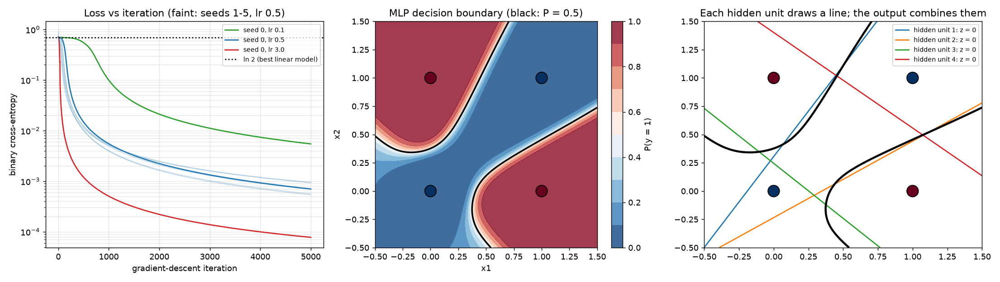
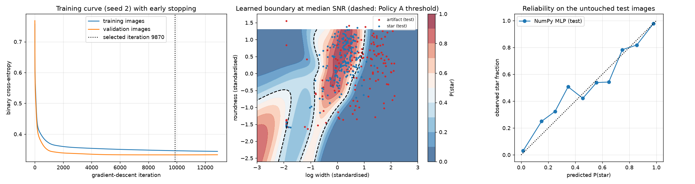

# Module 8: A Neural Network From Scratch

All numbers come from `python run_all.py` (about 5 minutes). The full console output is saved in `outputs/run_all_output.txt`.
Module 2's numerical-gradient checker is imported from `../module-2`. The star data are Module 6's grouped patches, loaded through `../module-9/data9.py`. That folder holds the ensemble set, which was named module-9 by accident; its gradient-boosting finalist is the comparison model here.

| File | Purpose |
|---|---|
| `mlp.py` | `MLP` (course skeleton: `forward`, `loss`, `backward`, `step`, `predict_proba`) plus flat get/set of parameters, and `train()` (full-batch gradient descent with optional early stopping) |
| `exp_a_xor.py` | Experiment A: 2 → 4 → 1 on XOR |
| `exp_b_gradcheck.py` | Experiment B: backpropagation against central differences, and four planted bugs |
| `exp_c_star.py` | Experiment C: 3 → 16 → 1 on the star / artifact features, compared with gradient boosting |

**The network** (one hidden layer):

```
z1 = X W1 + b1,  a1 = tanh(z1),  z2 = a1 W2 + b2  (logit),  p = sigmoid(z2)
J  = mean(log(1 + e^z2) - y z2)                          # BCE from logits via np.logaddexp
dz2 = (p - y)/N;  dW2 = a1^T dz2;  db2 = sum(dz2)
dz1 = (dz2 W2^T) * (1 - a1^2);  dW1 = X^T dz1;  db1 = sum(dz1)
```

**Initialisation:** W ~ N(0, 1/fan-in), biases 0 (Xavier/LeCun scale for tanh), so the hidden units start in tanh's responsive range rather than saturated.

---

## Experiment A: XOR

**A single linear classifier cannot solve XOR.** Logistic regression trained by gradient descent ends at w = (0, 0), b = 0, predicting p = 0.5 for every point with loss = ln 2 = 0.693. Scanning lines confirms that no straight boundary puts more than 3 of the 4 points on the correct side.

**The 2 → 4 → 1 network** (tanh hidden layer, sigmoid output, binary cross-entropy, full-batch gradient descent, 5,000 iterations):

| learning rate | runs with all 4 points correct (20 random seeds) | median final loss |
|---|---|---|
| 0.1 | 20/20 | 5.1e-3 |
| 0.5 | 20/20 | 8.5e-4 |
| 1.0 | 20/20 | 4.1e-4 |
| 3.0 | 20/20 | 1.3e-4 |

Selected run (seed 0, learning rate 0.5): P(y = 1) is 0.0001, 0.9992, 0.9992 and 0.0011 for the inputs (0,0), (0,1), (1,0), (1,1). **All four are correct**, and the final loss is 7.0e-4.

**Non-convexity.** With four hidden units every initialisation succeeded. With the *minimal* 2 → 2 → 1 network (learning rate 0.5, 50 seeds), **only 32 of 50 runs succeed**. Every failed run stalls at the same loss, **0.347 = ½·ln 2**: a local minimum where the network classifies two points confidently and leaves the other two at p = 0.5. Over-parameterising a small network makes the non-convex objective much easier to optimise, which is why the problem set suggests trying multiple initialisations.



**How it works.** Each hidden unit computes tanh of one linear function, so it draws one line across the plane (right panel). The output unit takes a weighted combination of those four soft half-planes, which can carve out the two diagonal regions XOR needs: the curved black P = 0.5 boundary. The loss curve has a characteristic **plateau at ln 2** for the first few hundred iterations at small learning rates. That is the symmetric starting point, where the network behaves almost linearly; the plateau ends once the hidden units specialise.

## Experiment B: verifying backpropagation

Module 2's `numerical_gradient` with h = 10⁻⁵, compared with the backpropagation gradient for every trainable parameter. The relative error is Module 2's E = ‖g_bp − g_num‖ / max(1, ‖g_bp‖, ‖g_num‖), computed for each parameter block.

**Case 2 – a well-conditioned double-precision problem** (3 → 16 → 1, 64 random observations, 81 parameters):

| parameter | analytical gradient (first entries) | numerical gradient (first entries) | relative error |
|---|---|---|---|
| W₁ (48) | −0.020480, 0.021775, 0.013548 | −0.020480, 0.021775, 0.013548 | **2.7e-11** |
| b₁ (16) | 0.020440, −0.013109, −0.013406 | 0.020440, −0.013109, −0.013406 | **1.5e-11** |
| W₂ (16) | −0.032075, 0.002525, −0.025249 | −0.032075, 0.002525, −0.025249 | **1.4e-11** |
| b₂ | −0.052011 | −0.052011 | **1.4e-12** |
| all parameters | | | **3.4e-11 → PASS** (target < 1e-6) |

**Case 1 – the XOR network at initialisation** (17 parameters): relative errors 1.1e-11 (W₁), 1.1e-11 (b₁), 1.1e-11 (W₂), 1.7e-12 (b₂); 1.9e-11 overall → **PASS**.

**Step size h**, Case 2:

| h | relative error |
|---|---|
| 1e-1 | 6.3e-4 |
| 1e-3 | 6.4e-8 |
| **1e-5** | **3.4e-11** |
| 1e-7 | 4.0e-9 |
| 1e-9 | 3.7e-7 |

The error is V-shaped: truncation dominates at large h, round-off at small h, and h = 10⁻⁵ sits at the bottom.

**Deliberately incorrect derivatives**, Case 2:

| bug | W₁ | b₁ | W₂ | b₂ | overall | verdict |
|---|---|---|---|---|---|---|
| tanh′ written as (1 − a) instead of (1 − a²) | 7.4e-2 | 3.6e-2 | 1.4e-11 | 1.4e-12 | 8.2e-2 | **detected** |
| ReLU derivative used for a tanh layer | 6.3e-2 | 6.9e-2 | 1.4e-11 | 1.4e-12 | 9.3e-2 | **detected** |
| output error (y − p) instead of (p − y) | 1.7e-1 | 1.1e-1 | 3.1e-1 | 1.0e-1 | 3.8e-1 | **detected** |
| sum instead of mean (forgot 1/N) | 9.8e-1 | 9.8e-1 | 9.8e-1 | 9.8e-1 | 9.8e-1 | **detected** |

**Every bug is caught**, at errors of 10⁻²–10⁰, against 10⁻¹¹ for the correct code: nine orders of magnitude of separation. The per-block table also **localises** the mistake: a hidden-layer derivative bug leaves W₂ and b₂ exact (1e-11) while W₁ and b₁ fail.

One caution about the metric: max(1, ·) in the denominator turns E into an *absolute* error when gradients are smaller than 1, as here. A tiny but wrong gradient component could hide under the threshold, so checks should use well-scaled test problems.

**What PyTorch's autograd computes.** Exactly these products of local derivatives, applied in reverse order through the computation graph (reverse-mode differentiation). The gradient check is how to confirm that a hand-written or custom autograd function matches the mathematics.

## Experiment C: the network on star classification

**Features:** log width, roundness, log SNR from Module 6. **Images are kept separate throughout:**
- **training:** 45 development images (2,262 candidates); standardisation is fitted on these only;
- **validation:** 15 development images (720 candidates);
- **test:** 30 untouched images (1,499 candidates), used **once**.

**Training:** a 3 → 16 → 1 network with tanh hidden units, trained by full-batch gradient descent at learning rate 0.5 for up to 40,000 iterations. **Early stopping** halts training once validation loss hasn't improved for 3,000 iterations and **restores the best iteration**. Five initialisation seeds were tried, and seed 2 (best iteration 9,870) was chosen on validation loss, a development-data choice:

| seed | best iteration | stopped at | train loss | validation loss | validation AUC |
|---|---|---|---|---|---|
| 0 | 7,770 | 10,770 | 0.349 | 0.333 | 0.924 |
| 1 | 5,010 | 8,010 | 0.354 | 0.336 | 0.922 |
| **2** | **9,870** | 12,870 | 0.346 | **0.333** | 0.923 |
| 3 | 6,870 | 9,870 | 0.350 | 0.340 | 0.922 |
| 4 | 3,590 | 6,590 | 0.357 | 0.336 | 0.923 |

**Thresholds**, chosen on the validation images: Policy A (recall ≥ 0.95) = **0.40**; Policy B (precision ≥ 0.90) = 0.68.

### Comparison on the untouched test images

| metric | gradient boosting (Module 9 finalist, 11 hybrid features) | **NumPy neural network (3 features)** | gradient boosting refit on the same 3 features and 45 images |
|---|---|---|---|
| test ROC AUC | 0.922 [0.907, 0.936] | **0.888** [0.873, 0.902] | 0.889 |
| Brier score | 0.113 | **0.134** | 0.136 |
| log loss | 0.346 | 0.392 | – |
| high-recall policy (A) recall | 0.952 | **0.917** | – |
| precision / FPR at Policy A | 0.771 / 0.333 | 0.726 / 0.409 | – |
| high-precision policy (B) precision | 0.874 | **0.904** | – |
| serialized model size | 744 KB | **1.0 KB** (81 parameters) | 645 KB |
| prediction latency | 3.0 µs / candidate | **0.6–1.7 µs / candidate** (varies with machine load between runs) | – |
| training time | 3 s | 23–51 s (pure NumPy, one seed; machine-load dependent) | – |

For information only, not used for any choice: the test AUC of all five seeds was 0.888–0.891, so the result doesn't depend on a lucky seed.



**Interpretation:**

- **The network learns a genuinely nonlinear boundary that generalises to unseen image groups.** Its high-probability region is a band of moderate width and high roundness, the stellar locus that no linear model could represent (Modules 4–6). It reaches AUC 0.888 on 30 images it never saw, and its validation loss (0.333) is close to its training loss (0.346): no overfitting.
- **The gap to gradient boosting comes from the inputs, not the learner.** The same gradient-boosting configuration on the *same three features* scores 0.889, a tie. The Module 9 finalist's advantage (0.922) comes from its 8 extra PCA morphology components. A network given those inputs would be the fair next comparison.
- **The network's probabilities are reasonably calibrated** (Brier 0.134; reliability panel) without any post-hoc calibration, because it is trained directly on the log loss.
- **It is extremely compact:** 81 numbers, about 1 KB, roughly 700× smaller than the boosted ensemble. Prediction is one small matrix product.
- **The Policy A threshold under-delivers:** test recall is 0.917 against the 0.95 target (95% group-bootstrap interval [0.902, 0.933]; the target was met in 0% of resamples). The threshold came from just **15 validation images**, whereas the Module 9 finalist's came from out-of-fold predictions on all 60. That is the same lesson as Modules 5 and 9: operating points need many independent images, or a safety margin.
- **Extrapolation needs care.** In the empty corner of feature space (very narrow, very elongated sources; lower left of the boundary panel), the network extrapolates a spurious "star" region. Trees can't extrapolate beyond the range of their splits; a smooth network can. This is a reason to monitor out-of-range inputs, as Module 5 did.
- **Training is slow here only because it is plain full-batch gradient descent in NumPy** (about 10,000 iterations). Mini-batches, momentum or Adam, and PyTorch, which arrive next, will fix that. The point of this module was to make every gradient explicit and verified.
