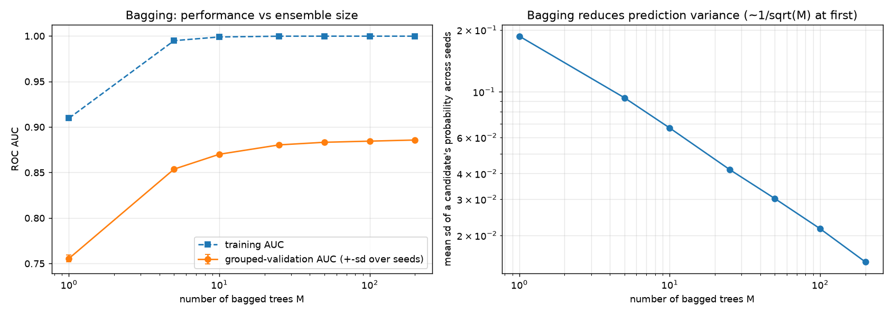
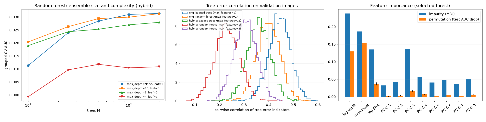
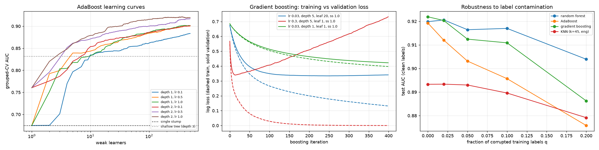
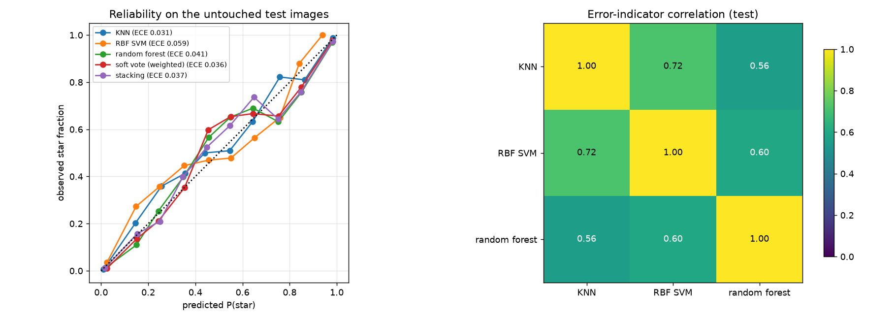
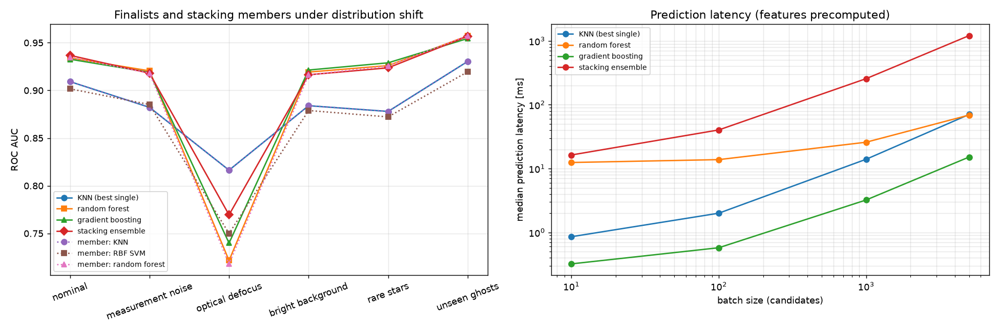

# Module 9: Ensemble Methods — Bagging, Random Forests, Boosting, Voting and Stacking

All numbers come from `python run_all.py` (about 10 minutes). The full console output is saved in `outputs/run_all_output.txt`. Timings depend on machine load; the hardware is listed in Experiment E.

**Data:** Module 6's grouped patch datasets, loaded through Module 7's cache: 60 development images (2,982 candidates) and 30 **untouched** test images (1,499).

**Representations:**
- **eng:** log width, roundness, log SNR.
- **hybrid:** eng plus 8 flux-normalised PCA components (PCA-C), with PCA fitted on development images only.

**Evaluation discipline:**
- every hyperparameter, calibration and threshold choice uses development images only, through grouped CV (`StratifiedGroupKFold`) over images;
- the test images are used for final numbers only;
- distribution-shift sets are newly generated 30-image scenarios.

| File | Purpose |
|---|---|
| `data9.py` | data access, hybrid features, `features_from_patches` (deployment feature pipeline), shifted-scenario generator (noise, defocus, background, rare stars, unseen ring-shaped ghosts) |
| `ensembles.py` | `bootstrap_indices`, `group_bootstrap_indices`, `BaggingScratch` (candidate or image bootstrap, exact-sample mode, group-aware out-of-bag), `majority_vote`, `soft_vote` (the course version), diversity metrics |
| `exp_a_bagging.py` … `exp_e_final_system.py` | Experiments A–E |

**Notes on the problem set:**
- **Folder name:** you called this set "module-9", and there is no module-8 folder, so this is `machine_learning/module-9`.
- **Cut-off screenshot:** the last screenshot ends in Experiment E Part 5 ("Record hardware details, library versions, and whether calculations run on CPU or GPU"). Anything required after that is not covered.

---

## Experiment A: bagging from first principles

### Part 1: the bootstrap sampler

One bootstrap sample of n = 2,982:
- 26.3% of observations appear more than once (one appears 6 times);
- 37.4% are left out entirely.

Over 2,000 samples the **unique fraction is 0.6320 ± 0.0058**, against the theoretical 1 − (1 − 1/n)ⁿ = 0.6322 (limit 1 − 1/e = 0.6321).

The image-level bootstrap draws 60 images with replacement:
- unique images 0.6351 (theory 0.6352);
- sample size n × (1.000 ± 0.014), since images differ in size.

### Parts 2–3: `BaggingScratch` against scikit-learn

`BaggingScratch` fits one sklearn `DecisionTreeClassifier` per bootstrap sample and averages the members' class probabilities. For an exact test, every member was rebuilt from **scikit-learn's own** `estimators_samples_` and tree seeds. **All 25 members came out identical**, and the ensemble probabilities differ by at most **2.2e-16**. With independent random draws, the two implementations reach similar test AUC (0.871 vs 0.874).

### Part 4: ensemble size

Unrestricted trees, 5 grouped folds, 5 seeds:

| M | train AUC | grouped-validation AUC | sd over seeds | prediction sd of one candidate across seeds |
|---|---|---|---|---|
| 1 | 0.910 | 0.756 | 0.0038 | 0.186 |
| 5 | 0.995 | 0.854 | 0.0010 | 0.094 |
| 10 | 0.999 | 0.870 | 0.0013 | 0.067 |
| 25 | 1.000 | 0.880 | 0.0012 | 0.042 |
| 50 | 1.000 | 0.883 | 0.0005 | 0.030 |
| 100 | 1.000 | 0.884 | 0.0007 | 0.022 |
| 200 | 1.000 | **0.886** | 0.0002 | 0.015 |

- **Bagging turns an unstable 0.756 tree into a 0.886 classifier.**
- **The variance falls as expected.** The spread of an individual prediction across seeds shrinks roughly as 1/√M: 0.186 → 0.042 → 0.015.
- **Gains flatten after about 50 trees.** The training AUC is saturated at 1.0, so the benefit is purely variance reduction, not better fitting.

### Part 5: candidate vs image bootstrap

100 trees, 5 seeds, scored on the 30 unseen test images:

| model | grouped-CV AUC | test AUC | worst-image AUC | 10th-percentile image | member AUC | member spread |
|---|---|---|---|---|---|---|
| single tree | 0.760 ± 0.024 | 0.750 | 0.607 | 0.679 | – | – |
| candidate-level bagging | 0.884 ± 0.011 | **0.880** | 0.797 | 0.820 | 0.749 | 0.255 |
| image-level bagging | 0.882 ± 0.013 | 0.879 | 0.786 | 0.822 | 0.748 | 0.255 |

Image minus candidate bagging: **−0.0012 ± 0.0021** test AUC.

**Engineering question: does group-level sampling generalise better across imaging conditions, or just add tree variation?**
- **Neither, here.** Image-level bagging is statistically indistinguishable from candidate-level bagging: same AUC, same worst image, and identical member strength and spread.
- **Why not more diversity?** Every bootstrap still sees about 63% of the images, and within this simulation the image-level conditions vary smoothly. The extra "conditions diversity" adds little that the candidate-level resampling didn't already provide.
- **What generalisation across environments needs** is features that are invariant to those conditions, not a different resampling unit.
- **Where image-level resampling *is* essential** is in *evaluation*: honest out-of-bag scores (Experiment B Part 5) and bootstrap confidence intervals (Experiment E).

## Experiment B: random forests and feature randomisation

### Part 1: baseline

Grouped 5-fold CV; train AUC is measured on the training folds.

| representation | model | train AUC | validation AUC |
|---|---|---|---|
| eng | decision tree, unrestricted | 1.000 | 0.760 |
| eng | decision tree, depth 6 | 0.924 | 0.879 |
| eng | random forest, 200 trees | 1.000 | 0.889 |
| hybrid | decision tree, unrestricted | 1.000 | 0.792 |
| hybrid | decision tree, depth 6 | 0.935 | 0.874 |
| hybrid | random forest, 200 trees | 1.000 | **0.931** |

The forest gains more from the hybrid features (+0.042) than a single tree does. With 11 features, many diverse trees can each use different PCA-C morphology components.

### Part 2: feature randomisation

200 trees, grouped-CV AUC; max_features = all is equivalent to plain bagged trees.

| max_features | eng (3 features) | hybrid (11 features) |
|---|---|---|
| 1 | **0.889** | 0.931 |
| 2 | 0.887 | **0.932** |
| 3 | 0.885 (= bagging) | 0.931 |
| 5 | – | 0.930 |
| 8 | – | 0.929 |
| 11 | – | 0.925 (= bagging) |

Feature randomisation helps a little and consistently, +0.004 to +0.007, more with more features. With only 3 features there is little to randomise.

### Part 3: ensemble size and tree complexity

Hybrid features, grouped CV, 60 configurations; full grid in the output file.
- **Depth-4 trees are too weak:** about 0.910 at every ensemble size.
- **Deep trees with leaves of 1–5 samples are best:** 0.930–0.931 from 100 trees on.
- **Leaves of 20 samples cost about 0.006.**
- **Selected:** M = 200, unrestricted depth, min_samples_leaf = 5, grouped-CV AUC **0.931 ± 0.014**.

### Part 4: tree-error correlation

Validation images of fold 0, 100 trees each:

| representation | ensemble | mean single-tree accuracy | mean pairwise error correlation | ensemble accuracy | ensemble AUC |
|---|---|---|---|---|---|
| eng | bagged trees (all 3 features) | 0.760 | 0.444 | 0.787 | 0.890 |
| eng | random forest (max_features = 1) | 0.754 | **0.398** | 0.799 | 0.891 |
| hybrid | bagged trees (all 11 features) | **0.785** | 0.359 | 0.831 | 0.930 |
| hybrid | random forest (max_features = 1) | 0.745 | **0.232** | 0.829 | 0.935 |
| hybrid | random forest (max_features = 3) | 0.777 | 0.305 | **0.841** | **0.937** |

- **Feature randomness does measurably reduce error correlation:** on the hybrid features it falls from 0.359 to 0.232.
- **It also weakens each tree** (accuracy 0.785 → 0.745). Breiman's bound depends on both correlation and strength, and the best ensemble balances them: **max_features = 3** has correlation 0.305 and strength 0.777, giving the best accuracy and AUC.
- **The reduction helps only up to a point:** the most decorrelated forest is not the most accurate one.

### Part 5: out-of-bag vs grouped vs test

| estimate | AUC |
|---|---|
| sklearn out-of-bag score, selected forest | **0.933** |
| grouped 5-fold CV | 0.931 |
| **untouched test images** | **0.920** |
| own bagging, candidate-level OOB (scored by trees that missed that *candidate*) | 0.927 (test 0.911) |
| own bagging, **image-level OOB** (scored only by trees that never saw that candidate's *image*) | **0.924** (test 0.911) |

**Why ordinary OOB is optimistic.** A candidate that is out of bag was usually not alone. Its siblings from the same image, sharing sky, focus, PSF shape and calibration, were almost certainly *in* the bag, so the tree has effectively seen its environment. That is Module 5's leakage in another form. Computing OOB at the image level removes it: the gap to the test result roughly halves (+0.016 → +0.013), and the remaining gap reflects the test images' different composition and difficulty.

### Feature importance

Selected forest, hybrid features:

| feature | impurity importance (training data) | permutation importance (test-AUC drop) |
|---|---|---|
| roundness | 0.187 | **0.154** |
| log width | **0.238** | 0.129 |
| log SNR | 0.135 | 0.037 |
| PC-C 3 | 0.136 | 0.017 |
| PC-C 1, 2, 4–8 | 0.03–0.06 each | ≤ 0.007 each |

**Impurity importance overstates the PCA components:** they hold 44% of the impurity importance, but removing them costs little on new images. Impurity importance is computed on training data and favours continuous, high-cardinality features. **Permutation importance on held-out images** shows the decisions rest mainly on roundness and width, with PC-C 3 the only PCA component that matters.

## Experiment C: AdaBoost and gradient boosting

Hybrid features, grouped 5-fold CV.

### Part 1: AdaBoost (SAMME)

| weak learner | learning rate | n = 1 | 10 | 50 | 100 | 200 | 500 | best |
|---|---|---|---|---|---|---|---|---|
| stump (depth 1) | 0.1 | 0.675 | 0.835 | 0.854 | 0.862 | 0.871 | 0.883 | 0.883 (494) |
| stump | 1.0 | 0.675 | 0.833 | 0.878 | 0.887 | 0.894 | 0.902 | 0.902 (395) |
| depth 2 | 0.5 | 0.760 | 0.871 | 0.894 | 0.900 | 0.905 | 0.917 | 0.917 (496) |
| **depth 2** | **1.0** | 0.760 | 0.879 | 0.910 | 0.915 | 0.920 | 0.920 | **0.921 (364)** |

For reference, a single stump alone scores 0.675 and a single depth-3 tree 0.832. Boosted stumps reach 0.90, and boosted depth-2 trees 0.92. A small learning rate needs far more learners: at learning rate 0.1, 500 stumps are not yet converged.

### Part 2: gradient boosting

48 configurations; the best iteration is chosen by mean validation log loss.

| learning rate | depth | min leaf | subsample | best iteration | validation log loss | validation AUC | validation LL at 400 | train LL at 400 |
|---|---|---|---|---|---|---|---|---|
| **0.03** | **5** | **20** | **1.0** | **252** | **0.334** | **0.929** | 0.341 | 0.132 |
| 0.1 | 5 | 20 | 1.0 | 72 | 0.337 | 0.928 | 0.435 | 0.022 |
| 0.03 | 5 | 20 | 0.5 | 251 | 0.338 | 0.929 | 0.343 | 0.142 |
| 0.1 | 3 | 20 | 1.0 | 133 | 0.342 | 0.926 | 0.367 | 0.114 |
| 0.3 | 5 | 1 | 1.0 | 14 | 0.340 | 0.927 | **0.732** | 0.0001 |

The learning-curve figure shows the classic picture. At **learning rate 0.3 with depth 5**, validation loss bottoms out after about 14 trees and then **doubles** (0.34 → 0.73) while the training loss reaches 0. A small learning rate is much more forgiving: 0.03 stays near its optimum from about 200 to 400 trees. Subsampling 0.5 made no real difference here.

### Part 3: difficult observations

Out-of-fold error rate / log loss by subtype:

| subtype | tree (depth 6) | random forest | AdaBoost | gradient boosting |
|---|---|---|---|---|
| bright star | 0.015 / 0.200 | 0.005 / 0.037 | 0.007 / 0.479 | 0.005 / 0.039 |
| faint star | 0.170 / 0.829 | 0.192 / 0.393 | 0.212 / 0.637 | 0.180 / 0.390 |
| hot pixel | 0.261 / 0.865 | 0.062 / 0.270 | 0.073 / 0.554 | 0.065 / 0.180 |
| elongated | 0.147 / 0.358 | 0.036 / 0.173 | 0.060 / 0.567 | 0.045 / 0.129 |
| **noise peak** | **0.681** / 1.061 | **0.627** / 0.855 | **0.602** / 0.702 | **0.632** / 1.001 |
| unresolved (width floor) | 0.330 / 0.994 | 0.211 / 0.431 | 0.237 / 0.605 | 0.222 / 0.420 |
| all | 0.208 / 0.654 | 0.170 / 0.332 | 0.181 / 0.594 | 0.168 / 0.335 |

- **Faint stars barely improve under boosting** (error 0.17–0.21 for every model), and neither do noise peaks (0.60–0.68). These two populations overlap in these features and no ensemble can separate them. The ensembles' gains come almost entirely from **hot pixels and elongated trails**, where a single tree errs 15–26% of the time and the ensembles 4–7%.
- **AdaBoost's log loss is poor** (0.59) despite good AUC: its scores are not probabilities and would need calibration.
- **AdaBoost does disproportionately chase noise peaks.** In its final training weights, noise peaks are 12% of the data but hold **60% of the top-1% weights**, with a mean weight 2.75× average. Faint stars hold 20%. Unresolved (corrupted-measurement) patches get only slightly elevated weight (1.15×). So exponential-loss boosting concentrates on the irreducibly ambiguous noise peaks.

### Part 4: label contamination

Training labels corrupted; test AUC on clean labels, mean of 3 seeds:

| q | random forest | AdaBoost | gradient boosting | KNN (k = 45) |
|---|---|---|---|---|
| 0 | 0.920 | 0.919 | 0.922 | 0.893 |
| 0.02 | 0.921 | 0.912 | 0.920 | 0.893 |
| 0.05 | 0.916 | 0.903 | 0.912 | 0.893 |
| 0.10 | 0.917 | 0.896 | 0.911 | 0.890 |
| 0.20 | 0.904 | **0.876** | 0.886 | 0.879 |
| **drop** | **−0.016** | **−0.043** | −0.036 | −0.014 |

**Averaging methods are robust; boosting is not.** Random forests and KNN average over many independent votes, so random label flips largely cancel. AdaBoost *up-weights* every observation it gets wrong, and a flipped label is permanently "wrong", so the corrupted points gain more and more influence: the largest drop, and visible already at q = 0.02. Gradient boosting's log loss bounds each point's pull, so it degrades less than AdaBoost but more than the forest.

### Part 5: boosting as gradient descent

For six observations, the numerically differentiated −∂L/∂F of binary log loss equals **y − p** to **9.1e-11**.

On the real data I reproduced scikit-learn's first gradient-boosting step exactly (**max \|ΔF₁\| = 4.4e-16**):
1. The initial score is F₀ = log-odds of the star fraction (0.148).
2. The pseudo-residuals y − p₀ are fitted by a depth-1 regression tree (`friedman_mse`).
3. Each leaf gets a **Newton step**, Σr / Σp(1 − p).

The log loss falls from 0.690 to 0.601.

**How the next learner helps.** Each tree is a step of gradient descent *in function space*. The pseudo-residuals are the direction in which the loss falls fastest at every training point. A tree can't move every point independently, so it finds the best *piecewise-constant* approximation of that direction: it groups candidates whose residuals agree (for example, "narrow, round, low SNR: still under-predicted") and moves each group together. The learning rate is the step size, which is why small rates generalise better, as Part 2 showed.

## Experiment D: voting, stacking and error diversity

**Base models**, built on three different principles:
- **KNN** (similarity), engineered features;
- **RBF SVM** (margin), engineered features;
- **random forest** (bagged trees), hybrid features.

**The ensemble procedure**, fitted using only the groups it is given:
1. hyperparameters by grouped 3-fold CV;
2. grouped 5-fold out-of-fold scores;
3. Platt calibration on those out-of-fold scores;
4. soft-vote weights minimising out-of-fold log loss on a simplex grid;
5. a logistic-regression meta-classifier on out-of-fold logits;
6. the base models refitted on all groups.

### Part 4: nested grouped evaluation

The whole procedure is refitted inside each of 5 outer folds:

| method | outer-fold AUC | accuracy | log loss | ECE |
|---|---|---|---|---|
| KNN | 0.906 ± 0.019 | 0.813 | 0.371 | 0.042 |
| RBF SVM | 0.899 ± 0.019 | 0.801 | 0.402 | 0.066 |
| random forest | 0.934 ± 0.008 | 0.838 | 0.317 | 0.038 |
| best individual (chosen inside each fold) | 0.934 ± 0.008 | 0.838 | 0.317 | 0.038 |
| hard vote | 0.814 ± 0.022 | 0.816 | – | – |
| soft vote, equal weights | 0.926 ± 0.014 | 0.826 | 0.342 | 0.048 |
| soft vote, weighted | **0.935** ± 0.008 | 0.841 | 0.316 | 0.038 |
| **stacking** | **0.935** ± 0.009 | **0.841** | **0.313** | **0.035** |

The weights were selected inside each fold, and they were stable: KNN 0.10–0.15, SVM 0, random forest 0.85–0.90.

### Parts 1, 2, 5: untouched test images

The procedure is fitted on all development images and scored on the test images. The best individual model, chosen by development out-of-fold AUC, is the random forest.

| method | AUC [95% group-bootstrap CI] | accuracy | log loss | Brier | ECE | AUC minus best individual [CI] |
|---|---|---|---|---|---|---|
| KNN | 0.893 [0.878, 0.907] | 0.783 | 0.381 | 0.130 | 0.031 | −0.027 [−0.038, −0.015] |
| RBF SVM | 0.890 [0.873, 0.906] | 0.791 | 0.422 | 0.139 | 0.059 | −0.030 [−0.043, −0.019] |
| **random forest (best individual)** | 0.920 [0.905, 0.935] | 0.827 | 0.348 | 0.114 | 0.041 | – |
| hard vote | 0.798 [0.776, 0.820] | 0.801 | – | 0.199 | – | −0.122 |
| soft vote, equal weights | 0.913 [0.897, 0.926] | 0.813 | 0.362 | 0.120 | **0.025** | −0.008 [−0.014, −0.000] |
| soft vote, weighted | 0.921 [0.906, 0.935] | 0.828 | 0.344 | 0.113 | 0.036 | +0.001 [+0.000, +0.002] |
| **stacking** | **0.922** [0.907, 0.935] | **0.833** | **0.342** | **0.113** | 0.037 | **+0.002 [−0.001, +0.006]** |

**What the voting variants show:**
- **Hard voting** throws away confidence: its AUC is that of a single operating point, though its accuracy is fine.
- **Equal-weight soft voting** is *worse* than the forest alone: averaging in two weaker models dilutes the best one. It does give the best-calibrated probabilities (ECE 0.025), because averaging three calibrated models smooths the extremes.
- **Validation-weighted voting and stacking** learn to rely mostly on the forest. The stacking meta-coefficients on the logits are RF **0.79**, KNN 0.26 and SVM 0.05. Both edge out the forest, but the gain is within the 95% interval.

### Part 3: diversity on the test images

| pair | disagreement | error correlation | both wrong | A right, B wrong | A wrong, B right |
|---|---|---|---|---|---|
| KNN / RBF SVM | 0.095 | **0.716** | 0.165 | 0.043 | 0.052 |
| KNN / random forest | 0.140 | 0.561 | 0.125 | 0.048 | 0.092 |
| RBF SVM / random forest | 0.126 | 0.597 | 0.128 | 0.045 | 0.081 |

Error rates by subtype:

| subtype | KNN | SVM | RF | all three wrong | exactly two wrong | stacking |
|---|---|---|---|---|---|---|
| faint star | 0.281 | 0.191 | 0.202 | 0.125 | 0.090 | 0.186 |
| **hot pixel** | 0.300 | 0.347 | **0.076** | 0.053 | **0.206** | 0.082 |
| noise peak | 0.483 | 0.653 | 0.574 | **0.386** | 0.193 | 0.591 |

**KNN and the SVM are nearly redundant:** both use the same 3 features, and their error correlation is 0.72. The random forest is the genuinely different member. It sees the PCA morphology components, and on **hot pixels** it is usually right where both other models fail ("exactly two wrong" is 21%). But the forest is also the strongest model, so the others rarely correct *it*. On noise peaks all three fail together 39% of the time. That error is shared, so no combination can fix it.

**Engineering question: when does stacking learn useful complementarity, and when does it just add a layer that can overfit?**
- **When it helps:** base models have comparable strength *and* make different errors on *different* subsets, *and* there is enough out-of-fold data to estimate how to combine them.
- **When it doesn't:** here one model dominates and the others' errors are mostly a superset of its errors. The meta-learner correctly learns "mostly trust the forest", so stacking ≈ weighted voting ≈ the forest, a +0.002 AUC gain that isn't statistically significant.
- **What it costs:** another layer to fit and calibrate, nested CV to evaluate honestly, and 6× the prediction cost (Experiment E).
- **When it overfits:** if the meta-learner had been trained on *in-sample* base predictions, it would have trusted the overconfident forest even more, since a random forest has 100% training accuracy. Grouped out-of-fold predictions are what keep it honest.

## Experiment E: final system comparison and deployment trade-offs

### Part 1: finalists, frozen from development-only evidence

| finalist | configuration | basis |
|---|---|---|
| best single classifier | KNN, k = 45, engineered features | highest development out-of-fold AUC among non-ensembles (Exp D) |
| best random forest | 200 trees, min_samples_leaf = 5, hybrid | grouped-CV grid (Exp B) |
| best boosting model | gradient boosting: learning rate 0.03, depth 5, min leaf 20, 252 trees, hybrid | lowest grouped-CV log loss; beat AdaBoost (Exp C) |
| best heterogeneous ensemble | stacking of KNN, SVM and RF | nested evaluation (Exp D) |

### Part 3: thresholds, from development data only

Platt calibration and policy thresholds come from grouped out-of-fold development predictions:
- **Policy A:** recall ≥ 0.95 → thresholds 0.29–0.33.
- **Policy B:** precision ≥ 0.90 → thresholds 0.63–0.69.

### Part 2: untouched test images

| model | AUC [95% CI] | log loss | Brier | Policy A recall / precision / FPR | Policy B recall / precision / FPR | worst-image AUC | 10th-pct image | fit s | size |
|---|---|---|---|---|---|---|---|---|---|
| KNN (best single) | 0.893 [0.878, 0.907] | 0.381 | 0.130 | 0.952 / 0.717 / 0.444 | 0.624 / **0.923** / 0.061 | 0.803 | 0.842 | **0.0** | **128 KB** |
| random forest | 0.920 [0.904, 0.935] | 0.351 | 0.115 | 0.948 / 0.771 / 0.333 | 0.738 / 0.878 / 0.121 | 0.815 | 0.865 | 1.0 | 4.9 MB |
| **gradient boosting** | **0.922** [0.907, 0.936] | 0.346 | **0.113** | **0.952** / 0.771 / 0.333 | 0.719 / 0.874 / 0.122 | **0.840** | 0.867 | 3.0 | 744 KB |
| stacking ensemble | **0.922** [0.907, 0.935] | **0.342** | **0.113** | **0.953 / 0.776 / 0.326** | **0.745** / 0.877 / 0.124 | 0.833 | **0.884** | 14.1 | 9.3 MB |

**Paired group-bootstrap AUC differences** (same resampled images):

| comparison | difference | 95% CI |
|---|---|---|
| stacking − KNN | **+0.029** | [+0.020, +0.037] |
| stacking − random forest | +0.002 | [−0.002, +0.008] |
| stacking − gradient boosting | **+0.000** | [−0.004, +0.005] |

**Do the frozen policies hold up?** (group bootstrap over test images)
- **Policy A** recall is met in only **39–61%** of image resamples. Its 95% intervals, e.g. [0.935, 0.969] for stacking, straddle 0.95.
- **Policy B's precision target is reliably met only by KNN** (P(≥ 0.90) = 98%). The tree ensembles reach 0.874–0.878, meeting it in just 2–8% of resamples. A threshold chosen on development data has no safety margin on new images, as Module 5 also found.

### Part 4: distribution shift

Frozen models; 30 new images per scenario. Cells show AUC (Policy A recall / FPR).

| model | nominal | measurement noise (read noise × 3) | **optical defocus (PSF × 1.6)** | bright background (× 6) | rare stars (5%) | unseen ring ghosts |
|---|---|---|---|---|---|---|
| KNN (best single) | 0.909 (0.95 / 0.41) | 0.882 | **0.816** (0.79 / 0.39) | 0.884 | 0.878 | 0.930 |
| random forest | 0.934 (0.96 / 0.31) | 0.921 | **0.722** (0.56 / 0.28) | 0.919 | 0.926 | 0.957 |
| gradient boosting | 0.933 (0.96 / 0.32) | 0.919 | 0.740 (0.57 / 0.28) | 0.921 | 0.929 | 0.954 |
| stacking ensemble | **0.937** (0.96 / 0.30) | 0.918 | 0.769 (0.64 / 0.27) | 0.916 | 0.924 | 0.957 |
| member: RBF SVM | 0.902 | 0.885 | 0.750 | 0.879 | 0.872 | 0.920 |

**AUC drop from nominal:**

| model | noise | defocus | background | rare stars |
|---|---|---|---|---|
| KNN | −0.027 | **−0.093** | −0.025 | −0.031 |
| random forest | −0.014 | **−0.213** | −0.015 | −0.008 |
| gradient boosting | −0.014 | −0.193 | −0.011 | −0.004 |
| stacking | −0.019 | −0.167 | −0.020 | −0.013 |
| member SVM | −0.016 | −0.152 | −0.023 | −0.029 |

**Does the ensemble decline more slowly than its members?** **Partly.**
- **Under defocus**, the decisive shift, stacking (−0.167) declines more slowly than its random-forest (−0.217) and SVM (−0.152) members... but **much faster than its KNN member (−0.093)**. The meta-learner learned to trust the forest on nominal data, so it inherits the forest's fragility.
- **The tree ensembles fail worst under defocus** (random forest recall at Policy A falls to 0.56). Axis-aligned splits on width learned at nominal focus become wrong cut-offs once every star is 60% wider. KNN's smooth similarity degrades more gracefully.

**Other scenarios:**
- **Noise and bright background:** all models lose about 0.01–0.03 AUC; the background-invariant features hold up as designed.
- **Rare stars:** AUC barely moves, but **Policy B precision collapses** to 0.26–0.31 for every model. This is prior shift (Module 4): it needs re-thresholding or prior correction, not a better model.
- **Unseen ghosts:** these ring-shaped reflections turned out to be *easy* to reject (AUC rises, and ≤ 7% are accepted at Policy A), because their measured width and roundness fall in clearly artifact-like territory. That doesn't guarantee robustness to other unseen artifact types; Module 5's compact, star-like ghosts were accepted 94% of the time.

### Part 5: prediction latency

CPU only; **no GPU is used by any model**. Single process, random forest with n_jobs = 1, features precomputed. Values are median / p95 in ms after 3 warm-up calls, over 30 repeats (10 at N = 5,000).

| model | N = 10 | N = 100 | N = 1,000 | N = 5,000 | µs per candidate at 5,000 |
|---|---|---|---|---|---|
| KNN | 0.86 / 0.96 | 2.00 / 3.27 | 14.0 / 15.1 | 70.4 / 74.6 | 14.1 |
| random forest | 12.5 / 15.1 | 13.8 / 17.9 | 25.9 / 28.3 | 68.9 / 72.0 | 13.8 |
| **gradient boosting** | **0.32 / 0.48** | **0.58 / 0.67** | **3.2 / 4.5** | **15.2 / 16.0** | **3.0** |
| stacking ensemble | 16.3 / 21.8 | 40.3 / 50.5 | 256 / 263 | 1,211 / 1,228 | 242 |
| feature extraction (moments + PCA-C from 32 × 32 patches) | 3.5 / 4.2 | 29.2 / 30.6 | 755 / 761 | 3,686 / 3,696 | **737** |

**Hardware and software:**
- **CPU:** Qualcomm ARMv8 (64-bit), 12 logical CPUs.
- **OS:** Windows 11 (10.0.26200).
- **Software:** Python 3.14.5, NumPy 2.4.4, SciPy 1.17.1, scikit-learn 1.9.1, OpenBLAS (12 threads).

**What dominates latency:**
- **Feature extraction, not the classifier.** At 0.74 ms per candidate it costs more than every model except stacking. Optimising the moment measurements would pay off more than choosing a faster classifier.
- **Fixed per-call overhead for the random forest.** Iterating over 200 trees costs about 13 ms even for 10 candidates.
- **Stacking's cost.** It runs three base models plus calibration, so it is about 80× slower than gradient boosting per candidate.

### Most defensible choice

**Recommendation: gradient boosting** (learning rate 0.03, depth 5, 252 trees, hybrid features).
- **Accuracy:** it ties the stacking ensemble on every accuracy and calibration metric (AUC 0.922, Brier 0.113; paired difference 0.000, CI ±0.005).
- **Worst case:** it has the best worst-image AUC (0.840).
- **Cost:** it is about **80× faster** to evaluate than stacking (3.0 µs per candidate) and **12× smaller** than stacking's 9.3 MB, with one model to maintain instead of four plus calibrators.

**Its weakness is shared by every tree model:** defocus (AUC 0.74). Two mitigations follow from the evidence:
- **Monitor the PSF width** (Module 5's shift monitor) and recalibrate or retrain when focus drifts.
- **If focus drift can't be controlled, consider KNN as a fallback.** It is the most robust under defocus (0.816) and the only model that met Policy B's precision target on new images, at a cost of about 0.03 AUC under nominal conditions.

**Stacking isn't worth it here.** Its accuracy gain over the forest and gradient boosting is not distinguishable from zero, and it doesn't fix the defocus weakness.
